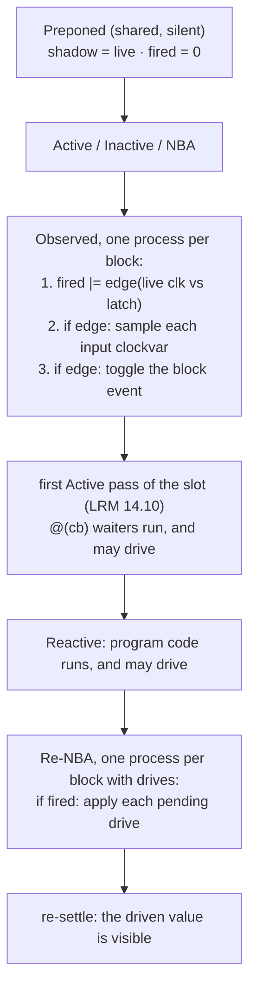

# Clocking blocks (IEEE 1800-2023 Clause 14)

Status: **implemented** for input sampling, synchronous drives, cycle delays and
the clocking-block clock sources of an assertion. Every remaining gap is a loud
refusal with a TODO; §5 lists them. The region choice is derived in §2; tests in
`tests/clocking_test.cpp` (24 cases) and `tests/sva_test.cpp`.

Size, for the record against `docs/TODO.md`'s original `~600 lines` estimate:
781 lines added to `src/`, 746 to `tests/`, over four commits.

---

## 1. Why it mattered

Three landed subsystems were blocked on this one:

| Consumer | What it needed |
|---|---|
| `default clocking` as an assertion clock (LRM 16.16(a)) | a clocking block that elaborates, and its event |
| `global clocking` / `$global_clock` (LRM 14.14) | the same |
| Multiclock SVA's `default`/`global clocking` half | the same |

And it is the load-bearing testbench construct: LRM 24.4 is explicit that
"programs that read design values **exclusively** through clocking blocks with
clocks that are design signals are insensitive to read-write races", and that
nonzero input skews alone do *not* buy that.

Still blocked, and NOT unblocked by this work: `program` **ports** (LRM 24.3,
refused in `lower_instance`). Port skew needs the clockvar machinery *plus* a
Reactive-safe port copy, and `require_reactive_safe` already rejects event
controls and intra-assignment delays in reactive code.

## 2. The shape of it

Four pieces, three of them processes.

1. **Elaboration.** `lower_members` accepts `SymbolKind::ClockingBlock` in
   Collect (`collect_clocking_block`) and Emit (`lower_clocking_block`,
   `lower_clocking_drives`). An interface body walks the same members, so an
   interface- or modport-scoped block (LRM 14.9, 25.5.5) needs no separate path.
2. **A clockvar is storage, not an alias.** Interfaces are lowered by symbol
   canonicalization (`canonical_value_symbol` collapses a modport port onto the
   underlying signal); a clockvar deliberately is *not*, because reading it yields
   the value sampled at the most recent clocking event, which differs from the
   live signal for most of every cycle. The sampled storage is registered under the
   `ClockVarSymbol` in `sigmap_`, so `cb.sig`, `bus.cb.sig` and
   `@(posedge cb.sig)` resolve through the ordinary `signal_of` path and
   expression lowering is untouched.
3. **Sampling in Observed.** One process per block: detect the edge from the live
   clock against a one-slot latch (the detection a monitor uses, and what makes
   the block step once per cycle however many deltas the clock's driver needed),
   then sample, then toggle the block's event. `input #1step` — the LRM 14.4
   default — reads the Preponed shadow of the previous step, shared with the
   assertion sampler through `sampled_shadow_of`; an explicit `input #0` reads the
   live signal here in Observed, which is where 14.4 puts it.
4. **Drives in Re-NBA.** `cb.sig <= expr` evaluates the RHS immediately into
   per-clockvar pending state and does not block (LRM 14.16); a new region
   process, `ir::Activation::ReNba` run by `emit_renba_run`, applies the pending
   drives of any block whose event fired this slot.

Why those two regions are the only workable choice, and the two latches that make
it exact: an Observed store is an ordinary design write and the drain re-settles
the active set afterwards, so a `@(cb)` waiter runs "in the first Active region
after the Observed region", which is LRM 14.10's own sentence; and a drive may be
*issued* by a process the Observed body woke, or by a program's Reactive code, so
nothing earlier than Re-NBA can decide maturation — which is where 14.16 puts the
value change anyway.

## 3. What this cost the rest of the simulator

- One new `ir::Activation` (`ReNba`), one new backend runner (`emit_renba_run`),
  and `has_renba()` folded into `design_uses_reactive_` so a design without a
  clocking block pays nothing. `reject_unsupported_observed` became
  `reject_resume_once`, shared by both resume-once regions.
- `finalize_sva_sampling` became `finalize_preponed`: the same single Preponed
  process now also clears each block's per-step "my event fired" latch.
- No new IR opcode, no new runtime entry point, no change to the wait engine.

## 4. Cycle delays and clock sources

- `##n` / `##0` (LRM 14.11) wait on the **default clocking**'s event, resolved
  through slang's `Compilation::getDefaultClocking`, which implements 14.12's
  scope rule. `##0` suspends only when the event has not yet occurred in this time
  step, which is exactly what the per-step latch answers. The count is tested at
  run time, not folded, so `##(n)` takes the same path.
- An unclocked concurrent assertion takes the scope's `default clocking` event as
  its leading clocking event — the last rule of LRM 16.16's precedence chain
  (explicit > contextually inferred > default), and the same answer 16.14.6 gives
  when no clock can be inferred from the procedure. `getEvent()` is bound in the
  block's own scope, so it is already this instance's `TimingControl`: no
  `InferredClockMap` round trip.
- An event control that merely *names* a block — `@(cb)`, or `@($global_clock)` —
  is peeled to that block's own clocking event for an assertion
  (`clocking_event_of`), which is LRM 16.14.6(c)(1)'s inferable event expression
  "consisting solely of a clocking block identifier".

## 5. Refused, loudly, each with a TODO

| Construct | Why |
|---|---|
| input skew other than `#1step` / `#0`; output skew other than `#0` | the value is the one held at a time the edge does not name (LRM 14.13), so it needs a per-clockvar history keyed by time |
| edge-based skew (`input posedge`, `output negedge`) | a second event per block (LRM 14.4) |
| net-typed clockvar output | LRM 14.16 wants a `'z`-initialized `(strong1, strong0)` driver joined to the net's resolution, not a direct write |
| `cb.sig <= ##n expr` | one pending slot per clockvar cannot hold two drives maturing in different cycles, which LRM 14.16.2 requires; needs a ring indexed by cycle offset |
| bit-select or slice as a drive target | the pending value is one whole-signal store (LRM 14.16 allows both forms) |
| clocking item bound to an expression | LRM 14.5 slices and concatenations |
| non-posedge/negedge or multi-signal clocking event | the Observed body detects its own edge from a one-slot history |
| clockvar of non-packed type | the sample is one whole-signal copy |
| assertion item declared inside a block | LRM 14.3, under 16.16(b)'s three restrictions |
| sampled value function in procedural code | LRM 16.9.3; needs history rings keyed to the default clocking, not to a monitor |

slang already rejects the illegal cases, so none of them need a clotho-side
diagnostic: writing an input clockvar, reading an output clockvar, `assign` /
`force` on a clockvar, a concatenated drive target, a non-`CycleDelay`
intra-assignment delay on a drive, a blocking assignment to a clockvar, `##n`
with no default clocking, a duplicate `default clocking`, `global clocking` in a
generate block, a nested block, and a block in an illegal scope.

## 6. Verification

`tests/clocking_test.cpp`, 24 cases: the `#1step` vs `#0` pair that differ in one
token and print different values, the block-default/per-item skew override, a
pulse between two events being invisible, an edge of the sampled stream, `@(cb)`
ordering against an Active-region cascade, two blocks over one signal, an
interface-scoped block read through an interface port, a renamed item, six drive
cases (including LRM 14.16.2's own last-writer-wins example and 14.16.1's inout
non-interference), a program driving through a block, five cycle-delay cases, and
every refusal above by needle. `tests/sva_test.cpp` pins that a default-clocked
assertion lowers to the same monitor as an explicitly clocked one.
