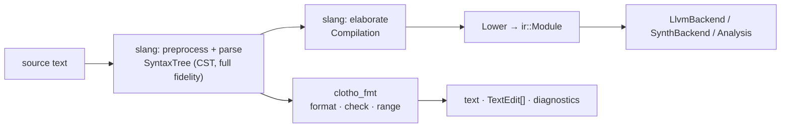

# `clotho fmt`: the source formatter

Status: **scoping**. Nothing started. No formatter code, no `fmt` command, no style
config exists in the repo today.

Goal: a clang-format-class SystemVerilog formatter — correct before configurable,
configurable before opinionated — usable as a CLI, as a CI gate, and as the
`textDocument/formatting` implementation for a future language server
(synthesis-and-lsp-scoping.md §6.7 lists formatting as a **tier 1**, synchronous,
slang-only capability; this document is that entry).

Two questions drive it: how formatters are actually built (§3–§5), and where this
lands in the frontend stack (§1–§2). The second has a short answer: **nowhere near
the IR.**

---

## 1. What it is, and what it is not

`clotho fmt` reprints the user's source. It is a function on *text*, and its
correctness statement is about *tokens*:

> The significant token sequence and the comment set of the output are identical to
> the input's. Only whitespace changes.

That is the whole contract, and everything in §6 exists to enforce it.

**It is not `sv-writer`.** These get confused, so state the boundary once:

| | `clotho fmt` | `sv-writer` (S7, sv-writer.md) |
|---|---|---|
| input | source text (unelaborated CST) | `ir::Module` (+ optional legalization `Result`) |
| output | the same design, respaced | a *normalized* design, semantically equivalent |
| preserves | every token, every comment | no comments, no parameters, no generates |
| needs | slang parse only | full elaboration + lowering + analyses |
| consumer | humans, editors, CI | downstream synthesis tools |

`sv-writer` is a *rewriter* — parameters folded, generates unrolled, gates folded
to expressions, port connections turned into copy processes (sv-writer.md §4's
"no" rows). A formatter that did any of those would be a bug. They share nothing
but, possibly, the output buffer and column tracker. Nothing in this document
should ever be implemented by round-tripping through `ir::Module`.

## 2. Where it sits

Upstream of everything Clotho currently does.



**New CMake target, minimal edges.** `clotho_fmt` links `slang::slang` and
`tomlplusplus::tomlplusplus` (already in the build tree — slang's
`external/CMakeLists.txt:157` fetches it). It does **not** link `clotho` (the
frontend), `clotho_ir_core`, `clotho_ir`, `clotho_runtime`, or LLVM. It sits
*beside* `clotho` in the dependency graph, not above it.

That is not tidiness, it is a capability: **fmt must work on files Clotho cannot
lower.** Unresolved include, unsupported construct, half-typed buffer — those are
exactly when you reach for a formatter. Any dependency on elaboration destroys
that, and it is much cheaper to refuse the dependency now than to unpick it later.

**IRs needed: one, and it is new and local.** The doc IR of §4.2. No `ir::Module`,
no `DesignFacts`.

**Semantic analyses needed: none.** This is the load-bearing simplification, and
it is worth saying why it holds for SV when it does not hold for C++. clang-format's
chronic pain is that it has no parser: `a * b;` is a declaration or a
multiplication and it must guess. Clotho has slang, a strict
SV parser, and the CST node kind already carries the answer. So the formatter
inherits slang's ambiguity resolution and adds none of its own. Corollary, stated
as policy: **if slang cannot parse it, fmt does not format it** (§5.4).

**Syntactic analyses needed: four**, all local walks over the token stream, all in
`clotho_fmt`, none of them compiler analyses:

1. comment re-attachment and blank-line runs (§5.1),
2. atomic-region marking for the preprocessor (§5.2),
3. error-region marking (§5.4),
4. alignment-run detection (§5.3).

**What it wants from existing work:** the `SourceManager` must outlive the parse
(synthesis-and-lsp-scoping.md §3.5 already wants this) because §5.2 queries macro
locations; and it wants structured `{severity, code, range}` diagnostics (§3.4) to
say "cannot format: unbalanced `` `ifdef `` at x:y". `Diagnostic.h` currently lives
in the `clotho` target, which `clotho_fmt` must not link — either it moves to a
small shared header-only target or `fmt` reports slang `Diagnostic`s plus a short
list of its own. **This is the one dependency decision to make up front.**

---

## 3. How formatters are built

Three families. The choice is not cosmetic; it determines the configurability
ceiling.

### 3.1 Trivia patching — reject

Keep the original text; mutate the whitespace trivia in place. slang makes this
tempting (`Token::withTrivia`, `SyntaxRewriter`, `deepClone`) and it is what the
one public attempt did (slang discussion #828).

It cannot work, for a structural reason: **a line break is a global decision.** You
cannot choose where to break an expression without knowing the indent of the
enclosing statement and the remaining column budget, and a per-token trivia patch
sees neither. #828's own posted results show it — `[1:0      ][K_DIM-1:0]` — local
decisions producing globally wrong alignment. The maintainer's advice in that
thread was to go look at clang-format.

Secondary problem: the CST is immutable, so patching means `deepClone` plus arena
lifetime management for every node you touch, which is more machinery than printing
from scratch, not less.

### 3.2 Document algebra (Oppen / Wadler; Prettier, Roslyn)

Lower the tree to a small combinator language, then lay *that* out:

```
Text(token) · Space · Break(penalty) · HardBreak
Group(mode, children)      mode ∈ {Flat, Break, Fill}
Indent(n, child) · Anchor(id, run) · Verbatim(byte-range)
```

`Break` is "a space, or a newline plus the current indent". A `Group` is measured:
if its flat rendering fits the column budget, every `Break` inside it becomes a
space; otherwise they become newlines (`Break` mode) or are packed greedily
(`Fill`). Layout is one pass with lookahead, linear in tokens.

Pros: the engine is ~300 lines and provably terminating; the *language* is a table
of one function per syntax kind, which is boring, reviewable, and independently
testable; and because it is compositional you can lay out a subtree at a given
starting indent without laying out the file — which is exactly what range
formatting and on-type formatting need (§8).

Cons as usually stated: all-or-nothing groups give you no way to say "prefer
breaking after a comma over breaking inside a subexpression", and
continuation-aligned-to-open-paren is awkward. §3.4 fixes the first; §5.3 shows the
second is a smaller loss than it sounds, because the alignment that matters in SV is
*inter-line*, not intra-line, and lives outside the engine entirely.

### 3.3 Penalty search (clang-format, Verible)

Annotate every token with `{must-break, can-break, split-penalty, spaces}`, cut the
stream into "unwrapped lines" (one logical statement each), then run a shortest-path
search over the space of append/wrap decisions, minimizing Σ break penalties +
over-column penalties. clang-format does Dijkstra over `(token index, indent
state)`; Verible does the same and its own developer guide admits the algorithm
"is not very scalable, but there are plans to replace it with something like
dynamic programming".

Pros: expresses per-construct preference directly, which is what "highly
configurable like clang-format" actually means in practice. Cons: large; the
annotator is a heuristic pile with no separable IR (clang-format's `TokenAnnotator`
is the least approachable part of it); superlinear cost on pathological
expressions; and slicing a subrange out of a global search is painful.

### 3.4 Decision: §3.2's structure, §3.3's costs

Build the document algebra, and put the penalty on the `Break` node. Resolve a
group by a **bounded DP over the subset of its direct breaks that fire**, rather
than pure all-or-nothing, falling back to all-or-nothing beyond a node-count
threshold.

This buys §3.3's expressiveness at §3.2's size, and keeps the two properties that
matter most here:

- **Separable policy.** "How SV constructs decompose" (a 533-arm table, the 90% of
  the work) is fully separated from "how a document is laid out" (one small solved
  algorithm). Verible entangles these by having policy functions *reshape* the
  partition tree; clang-format entangles them in the annotator. Do not.
- **Sliceability.** Required by LSP range formatting, and free here.

Honest risk, marked: a class-B `Align(current column)` node would make a group's fit
measurement position-dependent, so any memoization keys on start column. That is the
one place the DP can degrade — and it is why class B is off by default and class A is
a separate pass (§5.3). [INFERENCE] on magnitude; measure before adding memoization.

---

## 4. Pipeline

### 4.1 Stages

| # | stage | output |
|---|---|---|
| 1 | slang preprocess + parse | `SyntaxTree` (CST with trivia) |
| 2 | trivia analysis | comment attachments, blank-line runs (§5.1) |
| 3 | region marking | atomic spans: macro, `ifdef`, fmt-off, parse-error (§5.2, §5.4) |
| 4 | doc build | doc IR — one arm per `SyntaxKind`, `Style` consumed here |
| 5 | layout | line buffer: text + indent + originating byte offsets |
| 6 | alignment | column-aligned runs from `Anchor` nodes, on by default (§5.3) |
| 7 | emit | text, or minimal `TextEdit[]` against the original (§8) |

Stage 4 is the grind and the only stage that grows: 533 `SyntaxKind` enumerators,
352 `TokenKind`. Base-class handlers cut the count (slang dispatches
`DataTypeSyntax` for every type node without a specific handler), and an unhandled
kind falls to `Verbatim`, so coverage is incremental **and measurable** — see §7.

### 4.2 Doc IR representation

Flat arena, SoA, index-based children — the house layout, matching `Ir.h`'s
columnar rationale. No `std::string` per node, one output buffer, incremental
column tracking. sv-writer.md §3 records what the alternative costs: an
`optional<string>` per expression node and an `ostringstream` per constant put that
printer at 128 MB/s. Do not re-learn it.

`Anchor` is zero-width and layout-inert: it records `(line, column, id, run)` during
stage 5 and is consumed only by stage 6. It cannot affect a break decision, which is
what makes §5.3's pass unable to corrupt anything.

### 4.3 `Verbatim` is the single escape hatch

One mechanism, four users: macro expansions, `ifdef`-disabled text, `fmt off`
regions, unhandled/unparseable nodes. It emits raw source bytes, re-indents only
its first line, and marks the layout column *unknown* afterward, forcing a break.

Unifying these is worth more than it looks: every "we cannot format this" path in
the tool is one code path with one test story.

### 4.4 Verified: the round-trip baseline

F1 rests on one assumption — slang's CST reproduces its input byte for byte — and
everything else (incremental `Verbatim` coverage, oracle (a), `--check`) is
unimplementable if it is false. Measured before writing any of it, with pyslang
11.0.0 over the repo's 219 `.sv`/`.v`/`.svh` files:

| corpus slice | files | byte-identical |
|---|---|---|
| no `` `include ``, no macro use | 148 | **148 (100%)** |
| no `` `include ``, macro used but never defined | 29 | **29 (100%)** |
| no `` `include ``, macro expands to tokens | 3 | 0 |
| contains `` `include `` | 39 | 1 |

**Both failure classes are one mechanism, and it is a printer-construction bug, not
a fidelity limit.** A `SyntaxPrinter` built with the *default* constructor has no
`SourceManager`, so `shouldPrint(SourceLocation)` is vacuously true and it emits
**both** the macro-use directive trivia *and* the tokens the macro expanded to:

```
src:     `assert(!mem_do_wdata);          `PICOSOC_MEM #(
printed: `assert(!mem_do_wdata)empty_statement;   `PICOSOC_MEMpicosoc_mem #(
```

(picorv32 defines `` `assert `` as `empty_statement`; picosoc defines
`` `PICOSOC_MEM `` as `picosoc_mem`.) Includes fail the same way — the included
buffer's tokens print at the `` `include `` site. Macros that are *never defined*
round-trip perfectly precisely because there are no expansion tokens to double-print.

So the printer must be constructed **with the tree's `SourceManager`**, and the
exact flag set is now a spec, not a guess:

```cpp
SyntaxPrinter p(tree.sourceManager());   // NOT SyntaxPrinter() — this is the bug above
p.setIncludeAllLocations(false)          // load-bearing: filter tokens by origin buffer
 .setIncludeDirectives(true)             // default false; directives are trivia and vanish
 .setIncludeSkipped(true)                // default false; DisabledText + skipped tokens vanish
 .setSquashNewlines(false)               // default true; collapses blank-line runs
 .setIncludeMissing(false)               // parser-inserted tokens are not in the source
 .setExpandMacros(false).setExpandIncludes(false);
```

Three consequences worth carrying forward:

- **§5.2's design is confirmed empirically.** A macro use survives as `Directive`
  trivia holding its original source text, and its expansion is separately
  identifiable by source location. That is exactly the handle `Verbatim` needs.
- **The four non-default flags are each a silent data-loss bug** if missed, and none
  of them fails loudly. Oracle (a) catches all four on the first run; nothing else
  would.
- **Multi-file is not a formatter concern.** An `` `include ``d file is formatted as
  its own input, never at its use site.

Same run, same corpus, timing the two stages (180 include-free files, 2.01 MB):
**parse 19.7 MB/s, print 54.1 MB/s** — parse dominates 2.7:1, and the largest file
(12 238 lines, 307 KB) prints in ~6 ms. §9's budget is measured, not assumed, and a
naive printer already meets it before any optimisation.

---

## 5. The hard parts

Everything above is mechanical. These are where formatters actually break.

### 5.1 Comments and blank lines

In slang, **all trivia is leading trivia of the following token** (confirmed by the
maintainer in #828, and it is what `SyntaxPrinter::print(Token)` relies on). So
`x = 1; // why` stores the comment as leading trivia of whatever token comes next —
possibly in a different node, at a different indent depth, possibly `end`. A
formatter that prints trivia where it is stored produces garbage.

Required pass, over the token stream in order. For each token `T` with trivia list
`L`, and each comment `C ∈ L`:

- `C` is **trailing** on the *previous* token iff no `EndOfLine` precedes it in `L`.
- otherwise `C` is **own-line**, leading `T`, and the count of `EndOfLine` between
  the previous item and `C` gives the blank-line run to preserve (clamped by
  `max_blank_lines`).

Two classic bugs to design against, not discover:

- **Block-closer comments.** An own-line comment leading `end` / `endmodule` /
  `endcase` belongs at *body* indent, not at the closer's indent. Special-case it.
- **Comment/`Verbatim` interaction.** A comment inside a verbatim region must not
  also be emitted by the trivia pass. Region marking (stage 3) runs before doc
  build for this reason.

No comment *reflowing* in v1. clang-format's `ReflowComments` is a durable bug farm
and reflowing a comment is the one thing that changes bytes users wrote.

### 5.2 The preprocessor

The largest source of residual bugs in a formatter, and it splits three ways.
All three are grounded in APIs already available: `TriviaKind::{Directive,
DisabledText}` with a real syntax node behind `Directive`, and
`SourceManager::{isMacroLoc, getExpansionRange, getFullyOriginalRange}`.

**Macro uses.** A token whose `location()` satisfies `isMacroLoc` came from an
expansion; its text is not in the file at that point. The maximal run of such
tokens becomes one `Verbatim` over `getFullyOriginalRange`, which prints the
original `` `NAME(args) `` text. Format *around* macro uses, never inside.

**Macro definitions.** `` `define `` bodies are always verbatim. Line continuations
are semantic: inserting a newline changes the macro.

**Conditionals.** The hard one. `` `ifdef X module a; `else module b; `endif `` is
not a formattable tree — the branches straddle node boundaries and the disabled
branch survives only as raw `DisabledText`. v1 policy: if a top-level member's span
contains `DisabledText`, or a conditional directive whose open and close are not
both inside the same node, the **whole member is `Verbatim`**. Sound, coarse, and
on some codebases that means most of the file. Balanced-branch detection is the
obvious v2; say so rather than pretending v1 covers it.

`` `include `` and unrecognized directives: verbatim line, column 0.

### 5.3 Alignment

"Alignment" names three different mechanisms with different costs, different risks
and different defaults. Conflating them is how this gets mis-scoped, so split them
first.

| | what | mechanism | default |
|---|---|---|---|
| **A** | **inter-line column alignment** — port lists, `.name(sig)` maps, declaration blocks, assignment blocks, case items, trailing comments | padding post-pass over laid-out lines | **on** |
| **B** | continuation aligned to an open bracket / operator | `Align(current column)` node inside the layout engine | off |
| **C** | intra-token padding (`[1:0 ]`) | nothing — this is a bug | never |

clang-format's `AlignConsecutiveDeclarations`, `AlignConsecutiveAssignments` and
`AlignTrailingComments` are class A; `AlignAfterOpenBracket: Align` and
`AlignOperands` are class B. Class C is what §3.1's trivia-patching attempt
produced.

**Class A is the single highest-value readability feature in an SV formatter, and
it should be on by default.** SV declarations are wide and columnar — direction,
net/data type, packed dimensions, name, unpacked dimensions, comment — and reading
a 60-port module means scanning a column, not a line. It is also the *safest*
feature in the whole tool: it only inserts spaces into an already-correct line
buffer, so it is structurally incapable of losing a token or changing a break
decision. Class B is the one that complicates the engine (§3.4) and is genuinely
contested; keep it off.

#### The mechanism: builders declare anchors, one pass does arithmetic

Add a zero-width node to the doc IR:

```
Anchor(id, run_key)     // "this position belongs to column group `id` of run `run_key`"
```

The per-`SyntaxKind` builder emits anchors — it is the only thing that knows a port
declaration has six cells. The post-pass knows nothing about SV: group consecutive
lines by `run_key`, and for each `id`, pad every line to the maximum column. Same
seam as everywhere else in this design: policy in the 533-arm table, algorithm in
the engine.

Four rules, each of which was a bug in the prototype before it was a rule:

1. **Anchors are emitted unconditionally. An absent construct is an empty cell, not
   a missing column.** A port with no packed dimension still emits the
   after-dimension anchor, or it drops out of the run and its name does not line up.
2. **Runs are defined structurally**, by sibling identity in the CST — same node
   kind, same parent, consecutive, laid out onto one line each — not by matching
   token patterns. This is where Clotho beats clang-format outright:
   `AlignConsecutiveDeclarations` misfires because it is *guessing* what a
   declaration is, and Clotho has slang's parse. Runs additionally break on a blank
   line and (by default) on an own-line comment, which bounds the blast radius of an
   edit to one declaration block.
3. **Separators come before trailing comments.** `.d(data_in),  // comment`, never
   `.d(data_in)  // comment,`. The comma is part of the aligned cell; the comment is
   the cell after it. This falls straight out of §5.1 — a trailing comment is stored
   as leading trivia of the token *after* the comma.
4. **An anchor with no following content on its line contributes to the target but
   receives no padding**, or every short line gains trailing whitespace.

#### Interaction with `column_limit`

Padding can push a line past the limit, and something has to give. Policy, in
order: per anchor `id`, if aligning would push any member of the run over
`column_limit`, **drop that column for the whole run** and keep the earlier ones.
Degradation is per-column, not per-run, so a block with one pathological wide
declaration still gets its direction and type columns aligned. The alternative —
splitting the run at the offending line — produces two differently-aligned blocks,
which reads worse than one partially-aligned block.

#### The real cost, stated

Class A is **unstable under editing**: renaming one signal can reflow its whole
run, so a diff touches lines the author did not. That is a genuine cost, and it is
the argument for rule 2's tight run scoping — not an argument for turning the
feature off. clang-format users accept exactly this trade, and for SV the
readability return is larger than it is for C++.

Class A must also be recomputed from scratch, never read from the input, or oracle
(c) — `fmt(perturb(x)) == fmt(x)` — fails. It is derived only from the run's own
content, so this holds by construction.

### 5.4 Broken input

An editor buffer mid-keystroke is the normal case for LSP, and slang reports it
structurally: missing tokens, `SkippedTokens`, `SkippedSyntax`.

Uniform rule: **a node whose subtree contains a missing or skipped token is
`Verbatim`.** Same mechanism as everything else in §4.3. Consequences:

- LSP: always returns something; the broken region is left alone.
- CLI: `clotho fmt` reports the unformatted regions as diagnostics and exits 1.
  Per cli.md's "errors, not silent no-ops", declining to format must be visible.

### 5.5 Small things that are still correctness

CRLF preservation (detect dominant line ending, preserve it); trailing whitespace
stripped; exactly one final newline; tabs vs spaces as a style option but column
counting must be consistent with it; column width measured by display width, not
bytes, or the choice documented; and `// clotho-fmt off` / `on` plus
`// clotho-fmt-ignore` for the next statement, because a formatter is hard to adopt into
an existing codebase without an escape hatch.

---

## 6. The correctness contract

"Very correct" is a test story, not an aspiration. Four oracles, in increasing
strength, all cheap, all in CI over the full corpus (`examples/`, the test corpus,
picorv32, hazard3, rocket).

**(a) Token identity.** Parse the output; walk both token streams
(`SyntaxNode::token_iterator` exists) and require identical `(kind, rawText)`
sequences, plus an identical comment multiset. This single test catches every
"the formatter ate my code" class of bug and it is the reason to build the harness
first, before any style work.

**(b) Idempotence.** `fmt(fmt(x)) == fmt(x)`. Fuzzable, non-negotiable.

**(c) Whitespace normalization.** `fmt(perturb(x)) == fmt(x)` for whitespace-only
perturbations of the corpus. Strictly stronger than (b): it asserts the output
depends *only* on tokens + comments, which is the actual spec of a
non-preserving formatter. Perturbation must respect what is deliberately preserved
— blank-line runs, fmt-off regions — so it is limited to intra-line spacing and
line-continuation-free whitespace.

**(d) IR identity.** `clotho build --emit=ir` byte-identical on original and
formatted source. **This oracle is specific to Clotho.** Verible and clang-format
can only compare tokens; Clotho can compare the lowered design. It is the strongest
available statement that formatting changed nothing, and it costs one CI script
because `--emit=ir` with `-o` already works (cli.md). Restricted to corpus files
Clotho can lower — which is the point of keeping (a) as the universal check.

Note (a) and (d) are complementary, not redundant: (a) covers files Clotho cannot
lower, (d) covers preprocessor-state bugs that preserve tokens but change meaning.

---

## 7. Coverage must be measurable

`Verbatim` fallback for unhandled syntax kinds is the right incremental strategy —
the tool is correct from day one and gets prettier over time. But it interacts with
PRINCIPLES.md's never-silently-accept rule, so resolve that explicitly rather than by
omission:

Declining to *reflow* a construct is a formatter's legitimate output, unlike a
compiler silently mislowering one. What is forbidden is doing it *invisibly*. So:

- `clotho fmt --stat=coverage` reports the `SyntaxKind`s that hit the verbatim
  path, with counts. Per cli.md, a counter is a `--stat=` value, never a new flag.
- The doc-build switch has **no `default:` arm** — a new slang syntax kind fails to
  compile until it is classified, which is exactly `ZElision.cpp:154-644`'s
  discipline (synthesis-and-lsp-scoping.md §3.1) and the same reasoning: one place
  a new kind gets a decision, enforced by the compiler.

## 8. Surfaces

### 8.1 CLI

Per cli.md: a new command word in `argv[1]`, one `CommandLine` registration, one
`--help`, no second parser, errors instead of ignored options.

```
clotho fmt [options] <source>...

  -i, --in-place        rewrite files in place
      --check           exit 1 if any file would change; write nothing
      --range <a:b>     format only these lines (repeatable)
      --style <spec>    style file path, or a named base style
  -o, --output <file>   single-input only; '-' is stdout
```

`--check` is the CI gate and must print a diff-shaped report, not just a status.

### 8.2 Library API, LSP-shaped from the start

The LSP requirements are cheap now and expensive to retrofit, so build to them:

```cpp
namespace clotho::fmt {
struct Style { /* §9 */ };
struct Edit  { uint32_t offset, length; std::string_view text; };
struct Result {
    std::string       text;
    std::vector<Edit> edits;   // minimal, against the original buffer
    std::vector<Diag> diags;
};
Result format(const slang::syntax::SyntaxTree&, const Style&,
              std::span<const LineRange> ranges = {});
}
```

Four things this shape gets right:

- **Caller-owned tree.** The language server already parsed the buffer for
  diagnostics; formatting must not re-parse it.
- **Edits, not documents.** Returning whole-file text destroys the client's cursor,
  undo stack and folding state. clang-format returns `Replacements` for this reason.
  Producing minimal edits is only cheap if stage 5 keeps the originating byte offset
  per emitted token — hence "from the start".
- **Ranges** cover `rangeFormatting` and `onTypeFormatting`, and work because the
  engine is compositional (§3.4).
- **Reentrant, no global state**, so tier-1 formatting never blocks on anything
  (synthesis-and-lsp-scoping.md §6.7: tier 1 and tier 2 must never share a lock).

### 8.3 Style config

`.clotho-fmt`, TOML, discovered by walking up from each input file — clang-format's
model, which is the one thing about clang-format nobody disputes. toml++ is already
in the build tree via slang.

The two rules that keep a style surface from rotting, both learned from
clang-format's 100+ interacting options:

1. **Every option is consumed at exactly one place** in the doc builder. An option
   read in two places is two options.
2. **Every option has an isolated test** — one input, that option toggled, nothing
   else. Options whose effect can only be demonstrated in combination are design
   errors.

Ship **one** named base style (`clotho`) plus `column_limit`, `indent_width`,
`tabs`, `max_blank_lines`, and the class-A alignment toggles — which are the
options users will actually reach for, so they get real names per construct group:
`align_port_declarations`, `align_port_connections`, `align_declarations`,
`align_assignments`, `align_case_items`, `align_trailing_comments`, plus
`align_across_comments`. Class B stays a single `align_continuation = false`.
Resist more until someone asks; cli.md's convention section is the precedent for
how narrow to keep a surface.

## 9. Performance

Formatting is on the keystroke path, so the target is stated against the LSP
budget, not throughput: **whole-file format of a 10k-line file under 10 ms
excluding parse**, with parse dominating total time. Layout is a single pass over a
flat arena; nothing here is algorithmically expensive except §3.4's bounded DP,
which is why it is bounded.

sv-writer.md §3 is the cautionary measurement: a straightforward tree printer with
per-node `std::string` and per-constant `ostringstream` lands at 128 MB/s. One
buffer, no per-node allocation, hand-rolled number formatting.

## 10. Milestones

| | | acceptance |
|---|---|---|
| **F0** | Prove the CST round-trips before writing the tool (§4.4) | **done** — 177/180 include-free files byte-identical; both failure classes diagnosed to printer construction |
| **F1** | Harness: `clotho_fmt` target, `clotho fmt` command, `format()` as an identity transform, oracles (a)+(b) in CI | 219/219 corpus files byte-identical; `--check` clean on a formatted tree and dirty on a perturbed one |
| **F2** | Doc IR + layout engine + `Verbatim`; doc build for declarations, module/interface headers, and structured statements | oracle (a) green corpus-wide; oracle (d) green on lowerable corpus |
| **F3** | Trivia pass: comments, blank lines, block-closer rule | oracle (c) green; hand-written comment-placement corpus |
| **F4** | `Anchor` + class-A alignment pass: port declarations, port connections, declaration blocks, trailing comments | oracle (a)+(b)+(c) green with alignment on; no trailing whitespace; run scoping and per-column `column_limit` degradation each tested |
| **F5** | Preprocessor regions: macro uses, define bodies, conditionals | oracle (a) green on a macro-heavy corpus; `--stat=coverage` reports the verbatim rate |
| **F6** | Expression layout: break penalties, group modes, `column_limit` respected | no line over the limit except unbreakable tokens and verbatim regions; oracle (b) green |
| **F7** | `Style` + `.clotho-fmt` discovery + per-option isolated tests | every option has a one-input test; `--style` and upward discovery both covered |
| **F8** | LSP shape: ranges, minimal edits, reentrancy | range format of a subtree equals the corresponding slice of a whole-file format |

F1 is the whole project's insurance policy and must land alone: a formatter without
token-identity checking in CI is a tool that will eventually delete someone's code.
F2–F6 are the substance, and **F4 is deliberately early** — column alignment is
where most of the perceived quality of an SV formatter comes from, it is the safest
pass in the tool (padding only, layout-inert), and deferring it to the end would
mean every earlier style decision gets re-litigated once it lands. F7–F8 are
independently shippable.

## 11. Limitations, stated

- **Macro-heavy code will be barely formatted.** §5.2 is the ceiling, and it is
  clang-format's ceiling too. A design that wraps every port list in a macro gets
  little from this tool.
- **`ifdef`-heavy code, worse**, because v1's granularity is the whole top-level
  member. Balanced-branch detection is deferred, not solved.
- **No comment reflowing** (§5.1), so over-long comment lines stay over-long.
- **Column alignment reflows its whole run on an edit** (§5.3). It is on by default
  because the readability return is worth it; the mitigation is tight structural run
  scoping, not disabling it. Continuation alignment (class B) stays off.
- **We inherit slang's parse.** A construct slang mis-parses is unformattable, and
  the fix is upstream. This is a better position than clang-format's, but it is not
  no position.
- **Oracle (d) only covers what Clotho can lower**, which today is a subset of legal
  SV (`TODO.md`). Coverage of the strongest oracle grows with the simulator.

None of these block a v1 that is safe to run on a real codebase, which is the only
bar that matters for a formatter.
