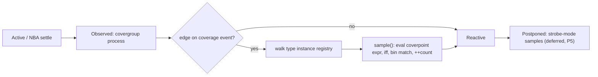

# Functional coverage — `covergroup` (LRM 19)

Target: LRM Clause 19 in full — `covergroup` as a type, instances via `new`,
coverage events, `coverpoint`, value bins, transition bins, `wildcard`,
`ignore_bins` / `illegal_bins`, `cross` with the `binsof` select algebra,
`option` / `type_option`, the six predefined methods, the coverage-computation
arithmetic of 19.11, and the coverage system tasks of 19.9.

Status: **P0 and P1 landed** (§11). A covergroup is a type you can instantiate,
sample procedurally or from a clocking event, and query; value bins (explicit
sets, ranges, `$`, `[]`, `[N]`, `default`), automatic bins, `ignore_bins` and
`illegal_bins` all work; the 19.11 arithmetic is implemented exactly, including
the zero-denominator table and type-level aggregation; a run writes a
deterministic text report under `--coverage <file>`. Everything else in Clause 19
is refused loudly and by name (§10) — cross coverage, transition bins,
`wildcard`, covergroup formals, `with function sample`, `iff` guards, real
coverpoints, `covergroup extends`, `@@` block events, and the coverage database.

Two changes to the plan below came out of building it and the text is corrected
in place: a covergroup type is a plain 64-bit handle rather than a synthetic
`Kind::Class` (§6.1), which removed the whole key-widening problem the plan
opened with; and the bin model is static, frontend-evaluated data with the
matcher in the runtime (§6.3) rather than per-instance tables built by generated
code, which is what makes a non-constant bin bound a refusal rather than a
feature.

This document owns the covergroup type representation, the bin model, the
sampling trigger and its region, the coverage arithmetic, and the report. It
consumes `docs/design/classes.md` (handle plane, GC), `docs/design/
mailbox-and-semaphore.md` (built-in methods intercepted at the call),
`docs/design/concurrent-assertions.md` §3 (regions, Observed processes) and
`docs/design/cli.md` (option conventions), and changes none of them.

---

## 1. What this is

Functional coverage is two things bolted together, and they fail independently:

1. **A language surface.** A user-defined type with formals, a handle, an
   embedded declaration form inside a class, six built-in methods, two option
   structs, and a bin-specification sublanguage (value sets, ranges with
   tolerances, `$`, wildcards, transitions with three repetition operators, and a
   set algebra over cross products).
2. **A measurement.** Per-bin hit counts, per-item and per-group percentages
   with a specified weighted-average formula, per-instance versus per-type
   aggregation, and a database written at end of run.

LRM compliance means both. A simulator that lowers the syntax and counts nothing
is not partially compliant, it is silently wrong — which is exactly the state
immediate `cover` is in today (§3.3).

**In scope:** everything in 19.3 through 19.11.

**Out of the language, therefore out of scope:** code coverage (line, toggle,
branch, expression, FSM). The LRM does not define it; 19.2 names it explicitly as
the *other* kind of coverage. Verilator's `--coverage` conflates the two; clotho
should not.

**Out of *this* design, by delegation:** `cover property` / `cover sequence`
reporting, which is an SVA-layer gap with its own prerequisite (§10.4); and
immediate `cover` counting (§3.3).

---

## 2. What a compliant implementation has to do — the four sub-projects

Sizing first, because the phase plan (§11) follows from it. Clause 19 is not one
feature; it is four algorithms with almost no shared code.

| # | sub-project | what it is | why it is separate |
|---|---|---|---|
| A | **Bin algebra** | Evaluate bin specifications per instance into value sets; distribute values across `[]` / `[N]`; synthesize auto bins; subtract `ignore_bins` / `illegal_bins`; apply `wildcard` don't-care matching; then match a sampled value to a bin | Pure set arithmetic over integer ranges. No time, no state. |
| B | **Transition automaton** | `(a => b => c)`, `[* r]`, `[-> r]`, `[= r]`, `default sequence`, overlapping matches, "at most once per sample" | A per-bin NFA over the sampled-value stream, with pending state that survives across samples. Shares *shape* with libsva, not code: no clock, alphabet is value ranges, and a match is a count not a verdict. |
| C | **Cross select algebra** | The cartesian product of target bins, plus `binsof(x)`, `binsof(x.b)`, `intersect {..}`, `!`, `&&`, `||`, `with (expr)`, `matches N`, `CrossQueueType` set expressions, `cross_retain_auto_bins` | Operates on *bin tuples*, a level above A. `with` filters iterate value tuples, which is combinatorial in the coverpoint widths — the LRM itself (19.6.1.4) tells users to use functions instead. |
| D | **Accounting and report** | 19.11's weighted averages, `at_least`, `weight`, `goal`, the four-case zero-denominator table, per-instance versus type coverage, `merge_instances` union-by-bin-name, `get_coverage` / `get_inst_coverage` numerics, the end-of-run database | Requires a *type-wide* state tier that clotho does not have at all (§7). |

Everything else — the type, the handle, the methods, the trigger, the options —
is plumbing over existing clotho mechanisms, and is cheap (§6, §8).

---

## 3. Before this work

### 3.1 The four front doors, as they were

```
$ cat cg_mod.sv
module top;
  bit clk; bit [3:0] a;
  covergroup cg @(posedge clk);
    cp: coverpoint a;
  endgroup
  cg c = new;
  initial begin #1 $finish; end
endmodule

$ clotho run cg_mod.sv
cg_mod.sv:3:14: error: unsupported module member kind=CovergroupType [unsupported-construct]
```

Four distinct refusals, all loud, all correct as far as they go:

| shape | site | message |
|---|---|---|
| `covergroup` as a **module member** | `src/Lower.cpp:2837` / `:2844` | `unsupported module member kind=CovergroupType` |
| a **covergroup-typed value** (instance variable, class property, generic type parameter) | `src/Lower.cpp:3599` | `covergroup type is not supported` |
| `$get_coverage`, `$coverage_get`, `$coverage_get_max` | `src/Lower.cpp:22592` | `unsupported system function '$get_coverage'` |
| `$set_coverage_db_name`, `$load_coverage_db`, `$coverage_control`, `$coverage_merge`, `$coverage_save` | `src/Lower.cpp:21159` | `unsupported system task '$set_coverage_db_name'` |

### 3.2 One hole, now closed by construction

A **package-scope** covergroup *declaration* with no instance was accepted
silently:

```
$ cat cg_pkg.sv
package p;
  covergroup cg(ref int x);
    coverpoint x;
  endgroup
endpackage
module top; initial $finish; endmodule

$ clotho run cg_pkg.sv
cg_pkg.sv:6: $finish called at 0 s
```

Harmless in effect — a covergroup that is never instantiated samples nothing —
but the asymmetry with the module-member walk was an accident rather than a
decision. It is now uniform for a different reason: a covergroup declaration is a
TYPE, lowered on demand at the first `new` of it, so a declaration nothing
instantiates is inert wherever it sits, which is exactly what LRM 19.4 says of an
embedded covergroup left unconstructed.

### 3.3 The precedent that is already silently wrong

Immediate `cover (expr);` (LRM 16.3) compiles, runs, and counts nothing.
`src/Lower.cpp:16064-16101` lowers it to one `Cond` whose false-region is opened
and closed empty; the true region runs the user's action block if written. So:

```
$ clotho run c3.sv           # cover (a) $display("imm cover hit");
imm cover hit
imm cover hit
...
```

The pass action fires, and nothing else exists — no count, no name, no report.
The justification sits in place (`src/Lower.cpp:11631`). Unlike every other unimplemented construct,
this one is invisible: a design full of immediate covers looks healthy. Landing a
coverage report makes this a decision that has to be taken explicitly, not an
oversight that persists (§10.4).

### 3.4 Prior work, refreshed

Two commits, both still live, both narrower than they look:

**"slang: let class methods/constraints/covergroups see later
members".** A real UVM shape (`apb_coverage_monitor.svh:37`,
`OPCODE: coverpoint analysis_txn.we` declared *before* `apb_seq_item
analysis_txn;`) failed with "identifier used before its declaration". LRM 8.6 /
8.11 / 19.4-19.5 make methods, constraint blocks and covergroup expressions an
explicit exception to declare-before-use. The defect was entirely in vendored
slang: `Lookup::unqualifiedImpl`'s scope-chain walk-up re-anchored to a
positional `LookupLocation` on every hop, including the hop that lands on the
class scope. A coverpoint reaches that walk-up two hops deeper (coverpoint →
`CovergroupBodySymbol` → `CovergroupType` → class scope). Fixed at that one
choke point, carried as `patches/slang-class-forward-ref.patch` and applied via
`cmake/ApplySlangPatch.cmake` so it survives a clean re-fetch. Documented in
`docs/design/classes.md:322-410`.

*Status for this work: a hard prerequisite, already paid.* Every embedded
covergroup in real UVM code hits it.

**"gaps: fix uvm_resource/covergroup misdiagnosis, SVA sampled system calls, dynarr NBA literal, class-descriptor recurrence; triage multi-driver net" — the `isCovergroup()` refusal.** A `uvm_resource#(T)` bug report
root-caused to covergroups: a register-model class embeds a `covergroup`, is
reachable as a generic-class type parameter, and eager static initialization
(LRM 6.21) lowers it whether or not anything samples. `lower_type` had no
covergroup case, so it fell through to `unsupported non-integral type`, naming
neither covergroups nor the actual class. Now `src/Lower.cpp:3599` names
covergroups explicitly, ahead of a fallback the comment argues is unreachable.

*Status for this work: a diagnostic-accuracy fix, plus a trap to remember.*
`lower_class_type` interns a class in `class_type_cache_` **before** laying out
its properties, so this refusal throws after interning and used to leave a
registered-but-undescribed Ref that poisoned later, unrelated lowerings of the
same class. `InternGuard` (`src/Lower.cpp:3844`) fixed that. Any covergroup
implementation that can fail mid-layout re-creates the hazard at a new site and
owes the same guard discipline. Relatedly, `docs/TODO.md:3788` records that a
body whose *field layout* is unsupported is never eligible for the graceful
`stub_unsupported_bodies_` degrade — so a half-landed covergroup type is worse
than none.

### 3.5 What already exists and is directly reusable

| need | existing mechanism | site |
|---|---|---|
| a nominal, handle-valued, GC-traced type with a hand-built field table and natively implemented methods | `lower_process_class` / `lower_semaphore_class` / `lower_mailbox_class` | `src/Lower.cpp:4162`, `:4193`, `:4257` |
| containers (bin tables, counters) inside a synthetic body, traced and finalized with **no new GC code** | `class_elem_leaves` + `class_finalizer_fn` | `src/ir/LlvmBackend.cpp:2947`, `:2986` |
| a bodyless built-in constructor intercepted at `new` | `lower_new_class`'s `is_sync_class` arm | `src/Lower.cpp:31436`, `:31448` |
| a declaration-level `@(posedge clk)` realized without a subscription | SVA monitor / clocking-block edge detector + `Activation::Observed` | `src/Lower.cpp:17021`, `:15263`; `src/ir/Module.h:136` |
| an `iff` guard around a synthesized body | `emit_guarded_body` | `src/Lower.cpp:10876` |
| hidden per-instance state addressed like a signal | `new_monitor_state` → `register_signal` | `src/Lower.cpp:13312`, `:7167` |
| an end-of-run hook that fires on both natural drain and `$finish` | `Activation::Final`, as used by `emit_monitor_finish` | `src/Lower.cpp:15985`; `src/runtime/Runtime.cpp:5042` |
| hierarchical instance naming for a report | `instance_path()`, `hier_name()`, `ir::InstanceScope` | `src/Lower.cpp:22683`, `:22699`; `src/ir/Module.h:81` |
| a design-wide id mint shared across Lowerers | `ClassIds` | `src/Lower.cpp:1804` |

And what does not exist anywhere: any coverage runtime (`grep rt_cover
src/runtime` is empty), any end-of-simulation report of any *design* construct
(`--gc-stats` reports the collector), and any read of the one coverage counter
clotho already keeps — `sva.<id>.cov` (`src/Lower.cpp:13389`) is write-only state.

---

## 4. What slang gives us, and what it refuses to

slang v11 elaborates the entire Clause 19 *structure* and evaluates none of its
*semantics*. That split is the single most important input to this design.

**Free, fully name-resolved and typed:**

- `CovergroupType` (`CoverSymbols.h:64`) — `getArguments()`, `getBody()`,
  `getBaseGroup()`, `getCoverageEvent()`, and `getDefaultValueImpl()` returning
  `NullConstant`: **a covergroup value is a nullable handle**, exactly clotho's
  class-handle plane.
- `CovergroupBodySymbol` (`:47`) with `options`; `CoverpointSymbol` (`:188`) whose
  coverage expression *is* its `DeclaredType`'s initializer (`getCoverageExpr()`),
  plus `getIffExpr()` and child `CoverageBinSymbol`s; `CoverCrossSymbol` (`:246`)
  with pre-flattened `targets`; `CoverCrossBodySymbol` (`:233`) carrying the
  synthesized `CrossValType` / `CrossQueueType`.
- `CoverageBinSymbol` (`:117`) — `binsKind` ∈ {`Bins`, `IllegalBins`,
  `IgnoreBins`}, the four flags, and exactly one of five payloads (values,
  trans list, set-coverage expression, `with` filter, cross select expression).
- The full seven-node `BinsSelectExpr` tree (`:294`): `Condition`, `Unary`,
  `Binary`, `SetExpr`, `WithFilter`, `CrossId`, `Invalid`.
- The six built-in methods as real body-less `MethodFlags::BuiltIn`
  `SubroutineSymbol`s with correct signatures, including `get_inst_coverage(ref
  int, ref int)` and `get_coverage` flagged `Static`
  (`CoverSymbols.cpp:129-155`, `:247`).
- `option` / `type_option` as synthesized structs whose field names, types and
  lifetimes already match LRM 19.10 — `option` `Automatic`, `type_option`
  `Static`. Duplicate-set detection, immutability of `auto_bin_max`-class
  options, and the parser-level shape check are done.
- The 2023 real-coverpoint gate (`DeclaredType.cpp:306`), so bin machinery only
  ever sees integral or floating coverpoints.
- `NewCovergroupExpression` with bound actual arguments, and `null`
  comparison / assignment rules.

**Not done, at all — this is sub-projects A through D:** no auto bins (nothing
reads `auto_bin_max`), no cross auto bins, no bin-value folding, no wildcard
matching, no transition evaluation, no `binsof` interpretation, no option value
interpretation (every one is bound and dropped), no coverage arithmetic, no
`sample` body, no scheduling of the coverage event, and stub-only `$coverage_*`
builtins (`CoverageFuncs.cpp:91-110`).

**Six sharp edges that will bite in order:**

1. **Nothing is constant-folded.** Bin bounds, `[N]` sizes, `iff` guards,
   `intersect` ranges, repetition counts and option RHSs are live `Expression*`
   that may read covergroup formals or class properties
   (`CoverSymbols.cpp:594`). `bins good = {[low:high]}` is legal and per-instance.
   **The bin set is therefore a run-time, per-instance quantity, not a compile-time
   table.** This decides §6.
2. **A class-embedded `CovergroupType` is anonymous** — `name == ""`
   (`CoverSymbols.cpp:222`); the user-visible name lives on the emitted
   `ClassPropertySymbol`. Any mangling keyed on the type name collides across
   every embedded covergroup in the design, i.e. across exactly the UVM shape
   that trips `Lower.cpp:3599` today.
3. **`membersOfType<T>()` does not unwrap `TransparentMemberSymbol`.** A derived
   covergroup (`covergroup extends g1;`) exposes every inherited coverpoint,
   cross, bin *and* `sample` as a wrapper, so a naive walk silently returns
   nothing (`CoverSymbols.cpp:350`). Deferred to P5, but it must be a deliberate
   refusal, not an empty covergroup.
4. **`ValueRangeExpression::type` is `void`** and `$` stays an unbounded literal
   (`OperatorExpressions.cpp:2523`, `:2531`). Classify by `kind`, then read
   `rangeKind` ∈ {`Simple`, `AbsoluteTolerance`, `RelativeTolerance`}; map `$` to
   the coverpoint type's extremes yourself.
5. **`bins b` / `bins b[]` / `bins b[N]` differ by a *pair*** —
   `(isArray, getNumberOfBinsExpr() != nullptr)`. `isArray` alone cannot tell
   `[]` from `[N]`.
6. **Two different `with`-iterator conventions.** A coverpoint `with` binds one
   `IteratorSymbol` literally named `item`; a cross filter binds one iterator
   *per target*, named after the target (`CoverSymbols.cpp:604`, `:1211`).
   Also: `CoverCrossSymbol` has **no accessor to its own body**, and `targets` is
   post-flattened and may contain duplicates when a cross names another cross.

---

## 5. Where the sample happens — the region decision

This is the decision with the widest blast radius, so it comes before the type.

**LRM 19.3:** "When the `strobe` option is not set (the default), a coverage
point is sampled the instant the clocking event takes place, **as if the process
triggering the event were to call the built-in `sample()` method**. If the
clocking event occurs multiple times in a time step, the coverage point will also
be sampled multiple times."

That sentence settles three things at once:

- **Values are read live, not sampled.** A covergroup is *not* SVA. There is no
  Preponed snapshot, and `sampled_shadow_of` (`src/Lower.cpp:16465`) is
  deliberately **not** reused. The existence of `type_option.strobe`, whose whole
  purpose is to move sampling to Postponed and thereby filter multiple events
  per slot, is the LRM's own confirmation that the default does neither.
- **Multiple events in one slot mean multiple samples.** So the trigger must not
  be idempotent-per-slot. This is the opposite of a clocking block's sticky
  `fired` latch (`src/Lower.cpp:16814` records why a clocking block wants one and
  a monitor does not); a covergroup is the monitor case, and a double step here
  is a double count.

  This is also what decides *which* clock value the edge detector compares.
  `src/ir/Module.h:130` documents the SVA choice — an Observed body "detects its
  own clocking event from the values Preponed sampled, per LRM 16.5" — which
  yields at most one edge per *time step*, since the shadow only refreshes at the
  tick boundary. A covergroup instead reads the clock **live** and latches it
  **per Observed pass**, so two settled points in one time step that each carry
  an edge produce two samples, which is exactly 19.3's requirement. Same eight
  lines of arithmetic, different operand, opposite invariant — so the detector is
  copied, not shared, and the reason belongs in a comment at the new site.
- **The `iff` guard reads live too**, for consistency with the coverpoint
  expression it guards. LRM 19.5 does not say so as loudly as 16.15 does for
  `disable iff`, and clotho's own precedents are split (`always @(ev iff C)`
  evaluates the guard live in the body's scope, `src/Lower.cpp:10876`, while every
  SVA root but the reset reads a shadow). Recorded as a decision, with the LRM
  reading above as its justification.

**Decision: a clocked covergroup samples from an `Activation::Observed` process**
(`src/ir/Module.h:136`), using the eight-line `clk_now & ~clk_was` edge detector
that the SVA monitor and the clocking block already duplicate between them
(`src/Lower.cpp:17021`). Observed is the only activation that runs once per
settled point, sits after NBA has committed, and needs no subscription — its
`wait_events` are documentation, not a wake (`src/ir/LlvmBackend.cpp:12746`).
`Preponed` is wrong (before the step, and its stores are silent), `ReNba` is too
late and must be idempotent, and Postponed is not an activation at all — it is a
hard-coded straight line (`src/ir/LlvmBackend.cpp:13234-13322`).



Three consequences, each a real cost:

1. **An Observed body may not suspend or fork** — `reject_resume_once`
   (`src/ir/LlvmBackend.cpp:7893`) rejects a delay, a `wait` or a `fork` even one
   call deep. A coverpoint expression may contain a function call (LRM 19.5
   already requires those to be automatic and side-effect free), so this is
   compatible; but an `option.*` setter or a user `sample()` override that reaches
   timing control is not, and must refuse.
2. **Observed stores are ordinary design writes** (`src/ir/Module.h:133`), and the
   drain re-settles the active set after Observed (`src/ir/LlvmBackend.cpp:13022`).
   Bin counters must therefore be state nothing waits on — which is how monitor
   state gets away with it today. A user reading a counter from an `always` block
   would re-enter the drain; `get_coverage()` reads through a function call, not a
   signal subscription, so this stays true by construction.
3. **Every Observed process runs at every settled point of every time step**,
   ramping and destroying a coroutine each time, whether or not the clock moved.
   `docs/design/regions.md` §2.1 prices a subscription wake at 65 instructions; an
   Observed resume is paid unconditionally. **Therefore: one Observed process per
   covergroup *type*, not per instance** — it walks that type's instance registry
   (§7). A testbench with 200 covergroup instances of 8 types pays 8 resumes per
   settled point, not 200.

**Procedural `sample()`** is a different path entirely: an ordinary method call
from whatever region the caller is in, updating counters immediately against live
values. That is the LRM's own reading, and it is what UVM actually uses
(`cg.sample(a, x)` from a monitor's `write()`). No cross-region hand-off is
needed, and none exists to Observed anyway (`ReactivePend` targets Reactive).

---

## 6. The type, the instance, and the bin table

### 6.1 The type is a handle, not a class

**As built: `lower_type` returns `make_int_type(64, false, false)` for a
`CovergroupType`** (`src/Lower.cpp:3599`) — the chandle shape. A covergroup
variable holds the address of an `rt_cover_inst` the coverage runtime owns.
Assignment, `== null`, the all-zero power-on default, storing a handle in a class
property, a queue or an associative array all come out of the ordinary scalar
machinery with no new code at all.

The plan above proposed a synthetic `Kind::Class` modelled on
`lower_mailbox_class`, and that was wrong. A class-shaped covergroup buys three
things — nominal identity, GC tracing of body containers, and the LRM 8.4
null-handle fatal — and a covergroup wants none of them:

- **It must not be collected.** LRM 19.11.3 aggregates type coverage over
  instances the design has dropped, so an instance has to outlive every reference
  to it (§7). A traced object with no live handle is exactly what the collector
  is for.
- **It has no nominal identity to carry.** There is no `$cast`, no inheritance
  (`covergroup extends` is refused), and no virtual dispatch, so the descriptor,
  the ancestor display and the vtable would all be dead weight — and
  `class_desc_global` (`src/ir/LlvmBackend.cpp:2603`) makes registering one
  mandatory for any `Kind::Class` Ref the backend reaches.
- **The obstacle it created was self-inflicted.** Seven Lowerer maps and
  `ClassIds` are keyed on `const ClassType*` and a `CovergroupType` is not one;
  the plan's answer was to widen every key to `const Symbol*`. Dropping the class
  shape drops the problem: **not one of those maps was touched.**

What the handle costs, and it is the honest trade: a null covergroup handle gets
no `HandleDeref` and therefore no automatic LRM 8.4 fatal. The runtime asserts on
one instead, and a `sample()` on a null handle is undefined rather than
diagnosed. That is a real gap, recorded in §14.

### 6.2 The instance is one runtime call

`cg c = new;` lowers to a single `CoverQuery` with `CoverOp::New`
(`src/Lower.cpp`'s `lower_new_covergroup`), which the backend turns into
`rt_cover_new(type_idx, ctx)`. There is no synthesized constructor, because the
bin table is static model data (§6.3) rather than per-instance state to compute:
the only thing construction has to capture is `ctx`.

`ctx` is what makes an embedded covergroup work. LRM 19.4 requires an embedded
covergroup to be constructed in its enclosing class's `new`, so `this` is
available exactly where it is needed; the instance stores it, and the generated
sample body reads it back with `CoverOp::Ctx`. A covergroup therefore covers the
object that BUILT it, whichever object later calls `sample()` — which is the
semantics 19.4 describes and the thing a captured-at-call-site design would get
wrong.

Covergroup formals are refused (`covergroup arguments are not supported`). The
plan proposed carrying a `ref` formal's storage in the instance and refusing a
non-static actual; that is still the right shape, but it is P2 work, and with bin
bounds constant (§6.3) the `input` formals that remain have nothing to
parameterize.

### 6.3 Bins are static model data; the matcher is in the runtime

**As built, the split is: the frontend decides WHAT the bins are, the runtime
decides which one a value hits.** Per coverpoint, at lowering time
(`cover_point_model` / `cover_expand_bin` / `cover_auto_bins`):

1. Fold each `CoverageBinSymbol`'s payload into a list of closed ranges over the
   coverpoint's effective type. `$` resolves to the type's extreme — slang leaves
   it an unbounded literal — and every bound is truncated to the coverpoint width
   per 19.5.7. A reversed range contributes nothing.
2. Distribute: `bins b` → one bin; `bins b[]` → one bin per value, named
   `b[value]`; `bins b[N]` → N bins named `b[0]..b[N-1]` with
   `B = max(1, floor(total/N))` values each and the remainder in the last, per
   19.5.1's worked example.
3. With no bins except ignore / illegal ones, synthesize automatic bins (19.5.3):
   the enumeration's cardinality for an enum, named `auto[red]`, else
   `min(2^M, auto_bin_max)` bins named `auto[v]` or `auto[low:high]`, uniform
   with the remainder in the last.
4. Record `auto_total` = `MIN(auto_bin_max, 2^M)` separately, because 19.11.1
   makes THAT the denominator of an automatic coverpoint rather than the number of
   bins laid out.

The names are rendered here, once, because 19.11.3 merges bins across instances
**by name** — a second naming implementation would be a silent mis-merge rather
than a cosmetic difference.

The whole model — types, coverpoints, bins, ranges, resolved options, banners —
is emitted as read-only LLVM constants (`cover_config_global`,
`src/ir/LlvmBackend.cpp`) mirroring `src/runtime/Coverage.h` field for field,
with the four struct sizes cross-checked at `rt_cover_init` the way `rt_gc_init`
checks its one offset. One consequence found while building: that data belongs to
the JIT and dies with it, while instances do not, so `rt_cover_init` deep-copies
the model into runtime-owned storage rather than holding the caller's pointers.

At sample time the generated body (`build_cover_sample`) evaluates the coverpoint
expression, widens it to one word, computes an unknown-bit mask, and calls
`rt_cover_hit`. The runtime then, per 19.5:

- returns immediately when the mask is non-zero — a sampled x or z matches
  nothing, since automatic bins consider only 2-state values (19.5.3) and an
  explicit 2-state bin compares with `===`;
- scans illegal and ignore bins FIRST, without short-circuiting on an ignore,
  because 19.5.6 gives illegal precedence over every other bin; an illegal hit is
  a located run-time fatal naming the covergroup, the coverpoint, the bin and the
  value;
- otherwise increments EVERY normal bin holding the value — 19.5.1's "the same
  value can be assigned to multiple bins" makes this not a first-match search;
- falls back to the coverpoint's `default` bin when no normal bin matched.

That is a linear scan, not the sorted-table binary search the plan proposed. The
reason is the "every matching bin" rule: a value can belong to several bins, so
the search cannot stop at the first hit, and a range index buys nothing over a
scan of a table that is capped at 65536 bins per coverpoint. Cost per coverpoint
per sample is one expression evaluation and one pass over its bins.

Because the fold happens at lowering time, a **non-constant bin bound is refused**
(`a non-constant bin bound is not supported`). LRM 19.5.1 allows one — `bins good
= {[low:high]}` over covergroup formals — and lifting it means building the bin
table per instance at construction, which is the same work as lifting formals
(§6.2).

---

## 7. The type-wide tier, and why it needs new runtime state

LRM 19.11.3 requires coverage aggregated **across every instance of a covergroup
type**, surviving instance death, reachable through `cg::get_coverage()` and
`type_option.*` — and 19.11.3's `merge_instances` form requires the *union of
bins across instances, matched by bin name*.

Clotho has no tier for this. Static class properties (`declare_static_prop`,
`src/Lower.cpp:30046`) give a per-type *slot* in per-instance-scope design state,
not a design-wide record, and not an *iterable set of live instances*. `ClassIds`
(`:1804`) is a compile-time id mint with no runtime side. `rt_gc_roots` regions
are precise root tables, not enumerable object sets.

**As built: a runtime coverage registry**, `src/runtime/Coverage.h` /
`Coverage.cpp` — the published model plus, per covergroup type, a singly-linked
list of `rt_cover_inst` in creation order with a tail pointer. An instance is
`malloc`'d, holds its type index, its captured `ctx`, its owned instance name, a
`started` flag and one flat counter array over every bin of every coverpoint, and
is linked on at `rt_cover_new`. The list is what the Observed trigger process
walks (`rt_cover_first` / `rt_cover_next`), what `get_coverage()` aggregates over,
and what the report iterates.

Three consequences, all as predicted:

- **This is a deliberate departure.** Every other per-construct state in clotho is
  design state (`src/Lower.cpp:13312` and the whole assertion-control block at
  `:12356`); the runtime keeps no per-construct counters at all. Type coverage
  cannot follow that pattern because it must be shared across instance scopes and
  across two Lowerers that intern the same type twice (`src/Lower.cpp:1800`).
- **Covergroup instances are immortal within a run**, rooted from the registry —
  semantically required by 19.11.3, not a leak. They are released at
  `sim_teardown` (`rt_cover_shutdown`), which is also what keeps a second design
  in the same process from inheriting the first one's model: the CLI runs one
  simulation, `clotho_test` runs thousands.
- **A design with no covergroup pays nothing.** `mod_.cover_types.empty()` gates
  the model, the config global and the `rt_cover_init` call, so nothing is emitted
  and no `rt_cover_*` declaration reaches the module.

The 19.11 arithmetic lives in the runtime beside the counters, not in generated
code: a coverpoint ratio counts bins at or above `at_least`, skipping ignore,
illegal, default and value-less bins (19.11.1) and using `auto_total` as the
denominator for an automatic coverpoint; a covergroup is the weighted average of
its coverpoints (19.11); a type is the weighted average over its instances
(19.11.3); and the zero-denominator table (19.11 a-d, 19.11.1 a-d, 19.11.2 a-d —
weight nonzero returns 0.0, weight ZERO returns 100.0, both out-counts zero) is
implemented once and reused at all three levels so they cannot drift. A
non-contributing item is absent from both the weighted numerator and the weight
sum rather than contributing a 0.0, which is the difference between "excluded" and
"scored zero".

`type_option.merge_instances` is refused, so 19.11.3's union-by-bin-name form is
not implemented and `max(at_least)` across instances has no observable
consequence yet.

---

## 8. Methods, options, and the dispatch point

`cg.sample()` is **not** a system call. slang models all six methods as real
`SubroutineSymbol`s with `MethodFlags::BuiltIn` and no body
(`CoverSymbols.cpp:129-155`, `:247`), so they arrive at
`lower_user_call` (`src/Lower.cpp:32542`). A design that planned to extend the
`$`-name chain would be wrong for exactly the methods that matter.

Decision: one predicate beside `is_process_method` / `is_sync_method`,
discriminating on the **owner's `SymbolKind`** (`CovergroupBody`, `Coverpoint`,
`CoverCross`) rather than on a name-and-package match, since the owner sits in
user scope. Then:

| method | lowering |
|---|---|
| `sample()` | call the per-type sample function; `with function sample(args)` passes the actuals through |
| `start()` / `stop()` | store the `$started` field; every increment is gated on it |
| `set_inst_name(string)` | store the `option.name` string field |
| `get_inst_coverage([ref int, ref int])` | call the per-type instance-accounting function |
| `get_coverage([ref int, ref int])` | `MethodFlags::Static`; call the per-type accounting function, which walks the registry |

Options split exactly as slang already models them: `option.*` is per-instance
(`Automatic`) → body fields, written by the constructor; `type_option.*` is
per-type (`Static`) → the runtime type record, written once at elaboration from
constant expressions. Option *semantics* that actually change behaviour and must
be honoured: `weight`, `goal`, `at_least`, `auto_bin_max`, `per_instance`,
`name`, `comment`, `merge_instances`. Options that are report-only or
diagnostic-only (`cross_num_print_missing`, `detect_overlap`) are cheap and land
with the report. `strobe`, `distribute_first` and `real_interval` are refusals
until their phases (§10).

---

## 9. The report — what clotho can actually provide

LRM 19.9 names a coverage database (`$set_coverage_db_name`, `$load_coverage_db`,
`$coverage_merge`, `$coverage_save`) without specifying one byte of its format.
The nearest thing to a standard is
Accellera UCIS, which is a C API plus an XML interchange schema, and is a project
of its own.

**As built: clotho writes a deterministic plain-text report and refuses the
database tasks.** Specifically:

- Written from `rt_cover_report()`, called by `rt_sim_run` after the `final`
  blocks (`src/runtime/Runtime.cpp`), so it fires on both the natural-drain and
  `$finish` paths. The plan proposed a synthesized `Activation::Final` process
  instead; the runtime seam is strictly better — one call site instead of one
  process per covergroup type, no `require_finish_inlinable` restriction to
  respect, and the report cannot observe a design a `final` block is still
  changing. `$finish` mid-instant still leaves staged NBAs uncommitted, so the
  report reflects the last committed state.
- Ordered by (type index, instance creation order), never by hash or pointer
  order, so two runs of one design diff cleanly.
- Content per instance: the instance name (`<scope><type>`, or whatever
  `set_inst_name` replaced it with), its percentage, then per coverpoint the
  percentage and covered/total, then one line per bin with its LRM name and hit
  count — including the bins that were never hit, which are the whole point of a
  coverage report — with ignore / illegal / default / empty bins marked and
  called out as excluded. Then the type rollup and the design total.
- Bin names follow 19.5.1 / 19.5.3 exactly: `b`, `b[value]`, `b[0]..b[N-1]`,
  `auto[value]`, `auto[low:high]`, `auto[red]`.
- A path that cannot be opened prints one diagnostic and writes nothing, matching
  `rt_vcd_begin`'s soft-failure precedent.

**CLI shape, as built: `--coverage <file>`, scoped `[build|run]`.**
`docs/design/cli.md` mandates that "a counter or report is a `--stat=` value", but
the same document and `src/ir/SimConfig.h` scope `--stat` to compiler diagnosis
"for working on clotho", and every existing `Stat` bit fires at compile time.
Functional coverage is a design result, so it gets its own valued option, and
cli.md now records that carve-out. `[build|run]` rather than run-only because the
path is baked into the emitted coverage model, exactly like `--gc-stats` is baked
into `clotho.gc.config`; a build and the run of what it built must be given the
same file. Sampling and `get_coverage()` are never gated on the flag — they are
design-visible semantics, and a reporting option must not change them.

---

## 10. The refusal surface

Every item below fails loudly and by name, with the clause cited in
the message. Grouped by when they lift.

### 10.1 Lifts in a later phase
`cross` and the `binsof` algebra (P2); covergroup formals and non-constant bin
bounds (P2); transition bins and `default sequence` (P3);
`type_option.merge_instances` (P4).

### 10.2 Deferred to P5, each a self-contained project
- **Real-typed coverpoints** and `type_option.real_interval` (LRM 19.5's
  interval partitioning, inclusive/exclusive interval bin names, `+/-` and `+%-`
  tolerances). A second bin algebra over floats, not a widening of the integer one.
- **`covergroup extends`** (19.4.1) — needs `TransparentMemberSymbol` unwrapping,
  override-by-name of coverpoints and crosses, base coverpoints that stop
  contributing while a base *cross* over them still does, and "a derived
  covergroup and its base are separate types for `get_coverage()`".
- **`type_option.strobe`** — sampling in Postponed. clotho has no Postponed
  activation (it is a hard-coded straight line,
  `src/ir/LlvmBackend.cpp:13234-13322`), but it does have exactly the right
  mechanism in `rt_strobe_pend` / `rt_strobe_pop` (`src/runtime/Runtime.h:61`),
  whose semantics the LRM itself invokes ("like the `$strobe` system task").
- **`type_option.distribute_first`** — reorders distribution against `with`
  filtering; meaningless before P2's `with` support exists.
- **Set-expression bins** (19.5.1.2, 19.6.1.4) — `bins b = <array expr>` and
  `bins b = <CrossQueueType expr>`, including functions declared inside a cross
  body that return `CrossQueueType`. These are ordinary user functions called at
  construction time, so the work is the type plumbing, not the evaluation.
- **`@@(begin blk)` / `@@(end blk)` block events** (19.3) — no block entry/exit
  notification exists anywhere in clotho's IR or runtime, and
  `collect_wait_events_impl` has no `BlockEventList` case at all. Every named
  block, task, function and method would need a hook. Separate project, and the
  least-used form in real code.
- **The coverage database** — `$set_coverage_db_name`, `$load_coverage_db`,
  `$coverage_merge`, `$coverage_save`, `$coverage_control`, `$coverage_get`,
  `$coverage_get_max`. Cross-run merge implies a format with a compatibility
  contract; that is a decision about interchange, not about simulation.

### 10.3 Permanent, by construction
A `ref` actual whose storage does not outlive the covergroup instance (§6.2).

### 10.4 Adjacent gaps this work exposes but does not fix
- **Immediate `cover` still counts nothing** (§3.3). Once a coverage report
  exists, leaving it silent is a decision; record it at the site and in TODO.md
  rather than leaving the current ambiguity.
- **`cover property` has a tally nothing reads.** `sva.<id>.cov`
  (`src/Lower.cpp:13389`) is correct and live. Reporting it needs
  `ir::AssertionMonitor::label` (`src/ir/Module.h:447`), a field declared "for a
  report" and never assigned, blocked on slang modelling a statement label as the
  enclosing block symbol's name. There is also no attempt *denominator*, so
  `cover property` can report hits but not a ratio.

---

## 11. Phased plan

Each phase is independently shippable, ends with a loud refusal surface for
everything later, and lands its own tests.

**P0 — the type, the instance, value bins, and a number. LANDED.** The covergroup
handle; `new`; the generated per-type `sample()`; explicit value bins (sets,
ranges, `$`, `[]`, `[N]`, `default`) plus automatic bins including the enum form;
`ignore_bins` / `illegal_bins` for values, with the illegal fatal;
`option.at_least` / `weight` / `goal` / `auto_bin_max` / `per_instance`;
`sample()` called procedurally; `get_inst_coverage` and `get_coverage` in both
arities; `$get_coverage`; the text report and `--coverage`. Two items moved out of
P0: the key-widening the plan opened with turned out to be unnecessary (§6.1), and
`option.name` / `option.comment` are refused rather than carried, because the
model has no field for report metadata that changes no semantics.
*This is the phase that makes a UVM subscriber-style covergroup work.*

**P1 — the trigger. LANDED.** `@(edge sig)` / `@(event)` coverage events as one
`Activation::Observed` process per covergroup type walking the instance registry;
`start()` / `stop()`; `set_inst_name()`. Still refused, and moved to P2: `iff` at
group / coverpoint / bin level, `with function sample(args)`, and `wildcard` bins.

**P2 — the guards, the formals, and cross.** `iff` at every level;
`with function sample(args)`; `wildcard` bins; covergroup formals and therefore
non-constant bin bounds (the same mechanism: a per-instance bin table built at
construction); then cross — implicit coverpoints, auto cross bins,
`binsof` / `intersect` / `!` / `&&` / `||`, `with (expr) [matches N]`,
`cross_retain_auto_bins`, `cross_num_print_missing`.

**P3 — transitions.** `trans_list`, `[* r]`, `[-> r]`, `[= r]`,
`default sequence`, per-bin pending state, "at most once per sample", overlapping
matches, the length-0 and unbounded-with-`[]` errors, ignore/illegal transitions.

**P4 — accounting completeness.** `type_option.merge_instances` union-by-bin-name;
`max(at_least)` across instances; `option.per_instance` reporting policy;
`option.get_inst_coverage`; `type_option.weight` / `goal` / `comment`;
`option.name` / `comment`; `detect_overlap` warnings.

**P5 — the corners.** Everything in §10.2.

---

## 12. Verification, and the oracle problem

**Measured: neither of clotho's usual oracles is usable for coverage numbers.**

Icarus Verilog does not parse covergroups at all:

```
$ iverilog -g2012 -o /dev/null cg_mod.sv
cg_mod.sv:3: syntax error
cg_mod.sv:3: error: Invalid module item.
```

Verilator does parse and does count, but deviates from the LRM in two ways that
matter, both reproduced here:

```
$ cat c8.sv
covergroup cg @(posedge clk);
   cp1: coverpoint a { bins q[] = {0,1,2,3}; }   // 4 bins, 1 hit
   cp2: coverpoint b { bins z = {0}; }           // 1 bin,  1 hit
endgroup

$ verilator --binary --coverage -sv c8.sv && ./sim
inst=40.000000
```

40% is `2/5` — pooled bins across the whole group. LRM 19.11 specifies the
weighted average of per-item coverage: `(1/4 + 1/1)/2 = 62.5%`. And bin *names*
deviate too: for `bins hi[] = {[3:5]}` Verilator emits `hi[0]`, `hi[1]`, `hi[2]`
where 19.5.1 requires `hi[3]`, `hi[4]`, `hi[5]`; for auto bins it emits `auto_0`
where 19.5.3 requires `auto[0:1]`. `cg::get_coverage()` returns `0.0` — type
coverage is not implemented.

So the verification position is:

1. **Per-bin hit counts: Verilator is a usable oracle**, and a good one — its
   distribution of 8 values into 4 auto bins matched 19.5.3's `<0,1> <2,3> <4,5>
   <6,7>` exactly in the probe above. Use it for the bin-algebra and
   transition-automaton matrices, comparing counts only.
2. **Coverage percentages, bin names, and type coverage: hand-derived from the
   LRM**, in the style `docs/TODO.md:4399` records for the SVA layer
   (`tests/sva/diff_not.sv` reproducing an independently hand-derived expectation
   exactly). Every 19.11 formula, every zero-denominator case, and every naming
   rule gets a test whose expectation is computed from the clause text and stated
   in a comment beside it.
3. **The LRM's own worked examples are the spine.** 19.5.1 (`bins fixed[4] =
   {[1:10],1,4,7}` → `<1,2,3> <4,5,6> <7,8,9> <10,1,4,7>`), 19.5.2's
   18-sample transition trace with its per-sample increment schedule, 19.6.1's
   `x2` retained-auto-bins example, 19.6.1.1's `apple`/`cherry`/`plum` select
   expressions, 19.8's `total = 2 / 5 / 6 / 16`, 19.11.1's `auto[] auto[2,3]
   auto[4] auto[7]` after `ignore_bins`, and 19.11.3's `b[1]`-overlap
   `66.6667%`. Each is a test with a known answer printed in the standard.
4. **A self-consistency invariant worth pinning**: for every covergroup, the
   number of covered bins and total bins returned by the two-argument
   `get_inst_coverage` must agree with the report's own per-bin table, and the
   group percentage must equal the weighted average of the item percentages the
   same report prints.

Any place Verilator and a hand-derived LRM expectation disagree, the LRM wins and
the divergence gets recorded — the project's rule, and the 40%-vs-62.5% case above
is already one.

**As built.** `tests/coverage_test.cpp` holds 28 cases: the LRM's own worked
examples (19.5.1's `bins fixed[4] = {[1:10],1,4,7}` reproducing `<1,2,3> <4,5,6>
<7,8,9> <10,1,4,7>` exactly, 19.5.3's `<0,1> <2,3> <4,5> <6,7>` auto
distribution), each 19.11 rule with its expectation derived from the clause text
in a comment (weighted average not pooled bins, coverpoint weights, `at_least`,
the zero-denominator table at both levels, type aggregation, the two out-counts),
the bin-kind rules (ignore excluded from the denominator, default excluded, every
matching bin incremented, x/z matching nothing), the trigger, `start`/`stop`, the
embedded-covergroup capture, and one case per refusal. Bin NAMES are pinned
through the report file, since that is the only place they are observable.

The 62.5%-not-40% case is pinned as a negative assertion, so a future refactor
that pools bins fails the suite rather than silently agreeing with Verilator. Developing
the runtime's arithmetic turned up two real defects: a use-after-free in the
registry teardown and a zero-size `memcpy` with a null source.

Two things the plan expected and got: the enum auto-bin count came out wrong
first (4 bins named `auto[k]` instead of 3 named after the constants) because
slang's coverpoint `DeclaredType` carries the integral BASE type and binds the
coverage expression as an rvalue against it, so the enumeration has to be read off
the expression with conversions peeled; and a real coverpoint is refused by slang
before clotho's own guard is reached, because 19.5's floating coverpoints are an
IEEE 1800-2023 addition gated on the language version.

---

## 13. LRM decisions this design records

1. **Coverpoint expressions and `iff` guards read live values, not sampled
   ones** (19.3's "as if the process triggering the event were to call
   `sample()`", corroborated by `strobe` existing at all). Explicitly *not* the
   SVA Preponed model; `sampled_shadow_of` is not reused.
2. **Multiple coverage events in one time slot produce multiple samples**
   (19.3), so the trigger is not per-slot idempotent — the opposite of a clocking
   block's sticky `fired` latch.
3. **Covergroup instances are immortal**, rooted from a per-type registry,
   because 19.11.3 aggregates instances the design has dropped.
4. **Empty bins are retained as names and excluded from arithmetic** (19.11.1),
   because 19.11.3 matches bins across instances by name.
5. **A `ref` covergroup formal is refused unless its actual has storage that
   outlives the instance** (19.3 gives `ref` tracking semantics and no lifetime
   rule; the alternative is a silent use-after-free).
6. **Illegal bins fatal immediately at the sample that hits them** (19.5.6: "a
   run-time error is issued", precedence over every other bin), located like every
   other clotho run-time fatal.
7. **The coverage database is refused rather than invented** (19.9 specifies no
   format), and the report is a deterministic text file instead.

## 14. Open questions

- **`option.per_instance = 0`** lets an implementation not save instance data
  (19.7 Table 19-1). Does clotho's report then omit the instance entirely, or
  print it without bin detail? The LRM permits either; the second is more useful
  and costs nothing since the counters exist regardless.
- **Bin-count explosion.** `coverpoint a` on a 32-bit `a` with
  `auto_bin_max = 64` is 64 bins, fine; `bins b[] = {[0:$]}` on the same
  coverpoint is 2^32 bins, and the LRM sets no limit. A cap plus a loud refusal
  is required; the number wants measuring rather than guessing, and it interacts
  with the cross product in P2 (19.6's `Bc = ∏Bj`).
- **`detect_overlap`** is a warning-only option that needs the same sorted range
  table the matcher already builds, so it is nearly free — but it is per-bin-pair
  and quadratic if done naively on a large `[]` array.
- **A coverage event that never reaches a settled point is not sampled.** With the
  live-clock detector of §5, `clk = 1; clk = 0;` in one process with no
  intervening suspension produces no Observed pass between the two writes, so the
  pulse is invisible and the covergroup does not sample. The LRM's event
  semantics permit that (no
  process suspended, so no scheduling point exists), and SVA has exactly the same
  property today. Recorded because 19.3's "sampled the instant the clocking event
  takes place" reads, on its face, as though it should catch it. If it ever has to
  catch it, the mechanism is a subscription (`Activation::Always` with real
  `wait_events`), not a change to the detector — at the cost of a wake per edge
  instead of a walk per settled point.
