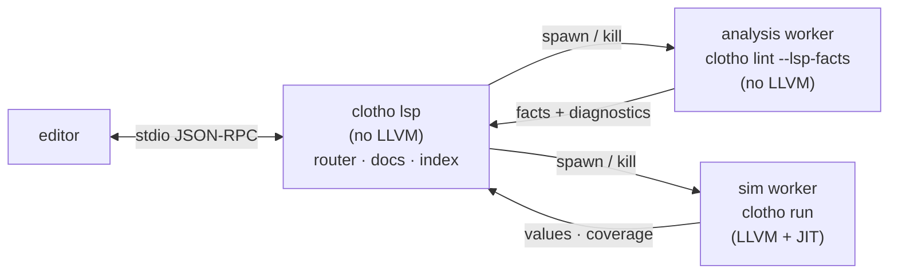

# Bringing up a language server

Scope out `clotho lsp`: a stdio JSON-RPC language server over the existing
frontend, grown feature by feature. Expands `synthesis-and-lsp-scoping.md` §6.7
(the two-tier split) and S8 (the stage), which are two paragraphs and a table row.

Status: **L0 has landed.** `clotho lsp` (`src/lsp/`, target `clotho_lsp`) serves
the base protocol over stdio — framing, lifecycle, dispatch, `$/cancelRequest`,
position-encoding negotiation, parent-process watchdog — and publishes
`textDocument/publishDiagnostics` on a 300 ms debounce from a document store,
off a single analysis worker, with stale versions discarded. Verified in
Neovim; covered by transcript and live-pipe tests in `tests/lsp_test.cpp`.

Measured on `hazard3_core.v` (1595 lines), Debug build: **103 ms** from
`didOpen` to `publishDiagnostics`, 16 findings, zero errors, zero
`Unsupported`. §10(c)'s target is 200 ms p95 and Release is another ~3.6×
(`CMakeLists.txt:32`), so the latency budget is not yet a constraint.

Three of §1.1's blockers are settled and one was wrong; see the notes there.
§11 records the decisions those two builds resolved.

The headline: **day one is cheap and the day-one feature is the one users care
about most** (diagnostics), because `clotho lint` already *is* the headless
server backend. The expensive middle is navigation, and it is expensive for a
reason that is not Clotho's fault — slang ships no reverse index, so
offset→token→syntax→symbol is entirely consumer work. The differentiated end is
design-aware and simulation-aware features that need an IR and a
simulator. Read §2 before committing: the tier-1 market closed
in 2026 and that changes what this project should build.

---

## 1. Where we actually are

**The frontend target was built for this.** `CMakeLists.txt:216-220` says so
verbatim: "A consumer that only wants 'source text -> ir::Module +
diagnostics' (check mode, a language server) links this and never pulls LLVM
in." `clotho` links `clotho_ir_core` + `slang::slang`, no LLVM
(`CMakeLists.txt:228`). A new executable is three lines beside `clotho_cli`
(`:233-234`) and needs no new `find_package` and no new `FetchContent`.

**Diagnostics are already the LSP payload.** `Diagnostic`
(`src/Diagnostic.h:70-101`) carries `{severity, origin, code, message,
ir::SourceSpan span, vector<Diagnostic> notes, rendered}`. Spans are real
`[start,end)` ranges, preferring slang's `d.ranges.front()` and degenerating to
a point only when slang gave no range (`Lower.cpp:13705-13711`). slang's
elaboration diagnostics, slang's dataflow analysis, Clotho's ~290 lowering
guards and Clotho's own analysis findings all arrive in **one ordered vector**
(`Lower.h:56-58`). `notes` maps to `relatedInformation`; `origin` is the field
policy keys on; `rendered` is the one field an LSP must ignore
(`src/Diagnostic.h:98-99` says so).

**Error recovery landed.** `Lowerer::recover` (`Lower.cpp:1134-1155`) reports
every failing behavioural member instead of the first, sets `poisoned_`, and a
poisoned module is still **returned** for analysis with `ok = false`
(`:13985-13987`). `lint` deliberately runs ahead of the `ok` gate
(`main.cpp:441-455`) — which is exactly the broken-editor-buffer case.

**Locations survive lowering.** `LowerResult::sources` is a
`shared_ptr<const SourceContext>` that may outlive the result, documented
never-null (`Lower.h:59-62`), and resolves a `SourceLoc` to file:line:col
(`SourceContext.cpp:39-67`).

**Lowering is reentrant.** Zero `thread_local`, zero namespace-scope mutable
statics, zero mutexes in `Lower.cpp` / `Builder.cpp` / `InternPool.cpp` /
`Ir.cpp` / `Analysis.cpp`; every `static` in `Lower.cpp` is a static member
function. Two `lower_files`/`lower_driver` calls can run concurrently. The one
exception is `lower_text` (below).

**The frontend is fast enough to change the design.** hazard3 (~5k lines of
real RISC-V RTL): **51 ms for the entire frontend** — parse + elaborate + lower
+ `DesignFacts` — of which the analysis walk is 11.5 ms
(`process-legalization.md:38-43`). For comparison, yosys `proc` on the same
design is 18,500 ms. §5.3 draws the consequence.

### 1.1 Blockers, verified

1. **~~No named in-memory buffer entry point~~ — FIXED.** `lower_buffer(path,
   text)` (`Lower.cpp`) assigns the text to a `SourceManager` it owns, so the
   buffer carries the client's path, nothing leaks into slang's process-wide
   static, and the call is reentrant — `lower_text` was the one lowering path
   that was not. A manager per revision rather than a reused one, per §4.1
   option 1: slang's manager is append-only, and there is only ever one buffer
   in it, so the lost file cache costs nothing.
2. **The caller cannot supply a `Compilation`.** `lower_compilation`
   (`Lower.cpp:13796`) is inside the anonymous namespace spanning `71`-`13992`.
   `SourceContext::comp_`/`driver_` are private with no accessor
   (`SourceContext.h:101-103`) and `adopt_compilation` is a sink, not a source.
   So a server cannot elaborate once and then serve both slang-only features
   and lowering off the same AST — which is the whole architecture of §5.
3. **~~Only tops are walked~~ — MOSTLY NOT REAL, measured.** Lowering does
   iterate `root.topInstances`, but slang promotes any *uninstantiated* module
   to a top, so a self-contained open file is already analysed: `clotho lint`
   on a bare leaf module reports `inferred-latch` from Clotho's own analysis.
   The claim that "in an editor most opened files are leaf modules" get nothing
   was wrong. It bites only under an explicit `--top`, where an out-of-tree
   module degrades to `unused-def` and is never lowered.

   What is real, and what L0 actually had to solve, is the opposite direction:
   a file whose *dependencies* are absent. `hazard3_core.v` opened alone
   produced **8 fabricated `unknown module` errors**. `lower_buffer` sets
   `IgnoreUnknownModules`, which removes them. Two further fabrications fell
   out of that, and each is worth knowing before touching this code:

   * Clotho's member walk then met a `SymbolKind::UninstantiatedDef` and
     reported `unsupported-construct` at Error severity — restating "your other
     files are not open" as "clotho does not implement this". That member is now
     inert under `IgnoreUnknownModules`, and still fails loudly without it.
   * **`CompilationFlags::LintMode` is a trap here, despite the name.** It makes
     `Scope::isUninstantiated()` return true for *every* scope (slang
     `Scope.cpp:150-153`) and slang skips diagnostics in uninstantiated code, so
     setting it silently deletes the entire unused family. It was set at first,
     and `wire [2:0] foo = 4'b0000;` — assigned, never read — published nothing
     at all. Do not re-add it.

   What *does* need suppressing is narrower, and splits on soundness. slang
   binds an absent submodule's port connections as ordinary expressions, so a
   net wired to one reads as **used** (sound — the connection is a use) but
   never as **driven** (unsound — nothing says which port is an output). So
   `undriven-net`, `undriven-port` and `unassigned-variable` are ignored for a
   partial compilation and the rest of the family is kept. Measured on
   `hazard3_core.v` alone: 108 findings of the first kind, all artifacts, and
   zero false positives of the second. It now reports 17, of which the 16
   `logical-op-parentheses` match `clotho lint` exactly and the 17th is a
   genuine dead store the CLI never found — its own 8 unknown-module errors
   gate the analysis pass off entirely.
4. **No cancellation, anywhere.** Not in Clotho (grep across the lowering path
   returns only runtime/wheel hits) and **not in slang** (zero matches for
   `cancel` in its whole tree). `--error-limit` is the only throttle. §4.3 has
   the answer, and it is not a token.
5. **No reverse index, in either direction.** Clotho maps IR → location and
   never back: nothing resolves an offset to a Process/Signal/Instruction.
   slang maps Symbol → Syntax → Token → offset and never back. Both directions
   are consumer work; §6.
6. **~~No LSP position math~~ — FIXED for diagnostics.** `SourcePosition` is
   still 1-based line/column, but slang's `getColumnNumber` is
   `offset - lineStart + 1` over raw **bytes**, so the line prefix is exact and
   the server transcodes it rather than guessing: UTF-8 is the byte count,
   UTF-16 counts code units with a 4-byte lead costing two. Verified against an
   astral-plane character in both negotiated encodings. `SourceContext` also
   gained `full_path`, because `SourcePosition::file` is what a compiler
   *prints* — slang renders it relative to the process's cwd
   (`../../tmp/a.sv`), which cannot become a `file://` URI.
7. **No JSON parser in the dependency graph.** slang's `JsonWriter` is
   write-only and self-described as possibly emitting unparseable text
   (`slang/text/Json.h:19-24`). `llvm::json` parses, but its implementation is
   inside the monolithic `LLVM` shared lib, reachable only from `clotho_ir` /
   `clotho_cli` / `clotho_test` — not from an LLVM-free target. §11 decision.
8. **Diagnostic gaps for LSP:** no fix-its (Clotho's `Diagnostic` has no field;
   **slang has no fix-it type at all**, repo-wide), no diagnostic tags
   (`Unnecessary`/`Deprecated`), no severity below `Warning` — `Severity` is
   `{Note, Warning, Error}` (`Diagnostic.h:37-44`) with no Information/Hint
   tier, which §7 needs.
9. **Severity policy is unreachable from a caller.** `DiagnosticPolicy` has
   exactly one enumerator (`Lower.h:40-44`) and `apply_severity_policy` is
   called with a hardcoded `Sim` (`Lower.cpp:13818`).

---

## 2. The competitive reality, which reframes the goal

Between the writing of `synthesis-and-lsp-scoping.md` §6.7 and now, the tier-1
problem was solved by someone else, in the open, on the same frontend Clotho
uses.

**`hudson-trading/slang-server`** (MIT, C++20, actively developed, listed as a
notable user in slang's own docs at `docs/index.html:125`) ships:
diagnostics on every keystroke, hover, goto-definition, find-references across
a workspace, workspace symbols, completion for instances/macros/scope members,
inlay hints, code actions, document links, rename, call hierarchy, elaborated
hierarchy browsing, and waveform round-trip via WCP. Its declared capability
set (`src/SlangServer.cpp:190-225`) is a superset of §6.7's tier-1 list in
every respect except three, noted in §5.2. Its indexer does OpenTitan — 3955
files, 45 MB — in **0.41 s**. There is also `suzizecat/slang-lsp-tools`
(slang `docs/index.html:128`), plus Verible (the de facto formatter and style
linter) and Veridian (a Rust wrapper that shells out to slang or verible).

Two consequences, and they are the load-bearing product judgement of this doc:

**(a) "Best" cannot mean "has goto-definition".** Rebuilding tier 1 to parity
is months of work whose ceiling is *equal to a free MIT tool*. The §7.2
argument from the synthesis doc applies verbatim here — "nobody needs another
netlist emitter" is the same shape as "nobody needs another goto-definition."
The differentiated value is the part that requires an IR and a simulator, which
is precisely the part no frontend-only server can ever have.

**(b) Multiple servers per language is normal and supported.** The Zed
Verilog extension enables three SystemVerilog servers simultaneously; VS Code,
Neovim and Emacs all support it. So the honest v1 posture is *complementary,
not competitive*: ship what only Clotho can compute, let users keep
slang-server for navigation, and take navigation only where Clotho's answers
are genuinely better (§6.4). This is not a shim or a scope reduction — it is
the correct product shape, and it collapses the schedule risk that would
otherwise sit in front of every differentiated feature.

**(c) Their fork is a warning, and an opportunity.** slang-server does not
depend on upstream slang: `.gitmodules` points `external/slang` at
`AndrewNolte/slang`. The delta is small — 14 commits, 24 files, one author —
and mostly editor plumbing: `SourceManager::replaceBuffer(BufferID,
SmallVector<char>&&)`, `reloadBuffer(BufferID)`, `isLatestData(BufferID)`, and a
public `static computeLineOffsets(std::string_view, ...)`. **None of those exist
in Clotho's pin (`6933832c`), and none exist in upstream master.** §4.1.

---

## 3. What slang gives, and what it does not

Verified against the pinned tree, not from memory. Anything citing
`slang::ast::SemanticModel` targets slang ≤ v4 and will not compile — the class
was removed from the public API and survives only as a 40-line private helper
inside a slang unit test (`tests/unittests/parsing/VisitorTests.cpp:18`).

| Need | Verdict | API |
|---|---|---|
| Parse in-memory buffer, no elaboration | **have** | `SyntaxTree::fromFileInMemory` (`SyntaxTree.h:141`) — the right entry for a document; `fromText` (`:128`) guesses the construct kind |
| Editor-grade parse recovery | **have, explicitly** | `docs/parsing.dox:4-9`: "usable in editing scenarios, where 90% of the time it will be operating on broken source" |
| Diagnostics with ranges + notes | **have** | `Diagnostic{ranges, notes, code, location, symbol}` (`Diagnostics.h:126-138`); implement `DiagnosticClient::report(const ReportedDiagnostic&)` (`DiagnosticClient.h:26`) — `ReportedDiagnostic` (`DiagnosticEngine.h:32-41`) is already the LSP payload |
| Fix-its | **none** | no `SourceEdit`/`Replacement`/`FixItHint` type anywhere in slang. Code actions are synthesized by the consumer from `(DiagCode, location, ranges)` |
| Cheap per-file metadata for indexing | **have** | `ParserMetadata::fromSyntax` / `SyntaxTree::getMetadata()` (`ParserMetadata.h:63`, `SyntaxTree.h:225`): global instances, class decls, package imports, interface ports, `hasDefparams`, `hasBindDirectives` — **zero elaboration**. Plus `getIncludeDirectives()`, `getDefinedMacros()`, `getMacroRefs()` |
| offset → token, token → syntax node | **must build** | primitives only: `SyntaxNode::sourceRange()` (`:249`), `SourceRange::contains` (`SourceLocation.h:163`), `tokens_begin()/tokens_end()` (`:297-300`). Tokens have **no parent pointer** |
| syntax → symbol | **must build the cache; lookup is provided** | `Lookup::name(NameSyntax&, ASTContext&, flags, LookupResult&)` (`Lookup.h:246`), `Scope::lookupName` (`Scope.h:113`), `LookupLocation::before/after` (`Lookup.h:136-139`), `ASTContext(scope, lookupLoc, flags)` (`ASTContext.h:310`). You must maintain syntax-node → `Scope` yourself |
| use → def | **have, trivial** | `ValueExpressionBase::symbol` (`MiscExpressions.h:25`), then `Symbol::location` / `getSyntax()` (`Symbol.h:151,165`) |
| def → uses (references) | **must build** | no reverse index. `AnalysisManager::getDrivers(ValueSymbol&)` (`AnalysisManager.h:139`) covers **assignments only, not reads**. Walk with `ASTVisitor<T, VisitFlags::AllGood>` (`ASTVisitor.h:56-80`); `Canonical` matters so cached instance bodies are not double-counted |
| Hover types + doc comments | **have** | `Type::toString()` (`types/Type.h:342`), `Symbol::getHierarchicalPath()` (`Symbol.h:180`), and `SyntaxPrinter::printLeadingComments(node)` (`SyntaxPrinter.h:51`) already implements the doc-comment heuristic, behaviour pinned by slang's own tests |
| Completion primitives | **have** | `Scope::members()` (`Scope.h:203`), `membersOfType<T>()`, `getNameMap()`, `getUnelaboratedNameMap()`. Caveat: `members()` calls `ensureElaborated()`, so it is neither O(1) nor concurrency-safe on a hot path |
| Token classification (semantic tokens) | **have primitives** | `LexerFacts::isKeyword` (`LexerFacts.h:55`), `getTokenKindText`, `SyntaxFacts::isPossible*` (`SyntaxFacts.h:101-180`) |
| Formatter | **none** | no `slang-format`; `SyntaxPrinter` is a faithful round-tripper (validated invariant, `SyntaxTree.h:256`) whose only layout knob is `setSquashNewlines`. slang-server also has none and shells out (`docs/features/formatting.md`) |
| Incremental reparse | **none** | zero matches for `incremental` across slang's `include/ source/ docs/ tools/`. The only cross-parse reuse is `MacroList inheritedMacros` on `fromBuffer` (`:152`) — preprocessor state, not tree reuse. slang-server accepts this and drops the tree on every change |
| Concurrent AST reads | **yes, by convention** | `tools/threadtest/README.md`: safe after one full visitation collects all diagnostics. **`BumpAllocator::freeze()` is a debug-only assert flag** (`BumpAllocator.h:77-96`) — in release it is a no-op, so what makes it safe is the exhaustive pre-visitation, not the call. A release server touching an un-pre-visited AST corner from a worker races silently |
| `SourceManager` shared across compilations | **yes** | thread-safe behind a `shared_mutex` (`SourceManager.h:40,361`); but `Compilation::addSyntaxTree` **throws** unless every tree shares one manager (`Compilation.cpp:174-181`) |

---

## 4. The three structural problems

Everything else in this document is ordinary work. These three decide the
architecture, so they get decided first.

### 4.1 A document cannot be re-assigned to a `SourceManager`

`assignBuffer` throws on a path it has already seen:

```cpp
if (it != lookupCache.end())
    SLANG_THROW(std::runtime_error(
        "Buffer with the given path has already been assigned to the source manager"));
```
(`slang/source/text/SourceManager.cpp:440-443`)

There is no `removeBuffer`, no `clear`, no `reset`: **buffers are append-only
for the manager's lifetime.** This is *the* reason `slang-server` carries a
fork. Four options:

1. **Fresh `SourceManager` per revision.** Correct, zero patch, and loses the
   file cache for unchanged dependencies each time. At 51 ms whole-frontend on
   hazard3 (§1) this is affordable up to mid-size designs and is the right v1.
   It also invalidates every outstanding `SourceLoc`, which `SourceContext`
   already degrades safely on rather than crashing — `resolve` guards with
   `sm_->isFileLoc` (`SourceContext.cpp:53-55`).
2. **Synthetic per-revision paths.** Unbounded growth. `getMemoryUsage()`
   (`SourceManager.h:286`) exists precisely because this is a known failure.
   Rejected.
3. **Carry a patch** on the FetchContent pin. Cheap mechanically, and a
   standing merge obligation on a SHA that already needs bumping for other
   reasons.
4. **Upstream it.** The fork's four methods are small, MIT, and already
   proven in production by the leading slang LSP; upstream has no competing
   design. This is the only option that ends with nobody carrying a patch.

Recommendation: **(1) now, (4) in parallel.** They compose — (1) is the
fallback if (4) is declined, and (1) is what makes the v1 not block on it.

### 4.2 Uninstantiated modules must become analyzable

`root.topInstances` (`Lower.cpp:13915`) is the correct scope for a simulator
and the wrong one for an editor. Fix shape, in ascending cost:

- **Ad-hoc top.** For the open document, elaborate with the file's own module
  as the top. slang already has the flag set for this:
  `CompilationFlags::LintMode` "suppress[es] errors that could be caused by not
  having an elaborated design" (`Compilation.h:84`), alongside
  `IgnoreUnknownModules` (`:88`) and `AllowUseBeforeDeclare` (`:75`).
- **Dependency closure**, which is slang-server's "shallow compilation": add
  only the syntax trees of *directly referenced* modules before elaborating.
  `ParserMetadata`'s `globalInstances` (§3) gives the edge set with no
  elaboration, so the closure is computable from the index alone.
- **Whole design** when the user has named a top. This is the accurate mode
  and the only one where tier-2 facts are trustworthy — parameters propagate
  from the real instantiation, not from defaults.

All three should coexist, with the answer labelled by which one produced it.
An inferred-flop hint from an ad-hoc top with default parameters is a guess; the
same hint under a named top is a fact, and conflating them is how a tool loses
trust. See §7.

### 4.3 Cancellation is a process, not a token

Neither slang nor Clotho can abort work in flight (§1.1 #4), and retrofitting a
cancellation token through `Lower.cpp`'s ~14k lines and slang's lazy elaboration
is not a realistic ask. The answer is that **the cancellable unit is an OS
process.**



This falls out of decisions already made rather than being invented: `clotho`
is LLVM-free by design (`CMakeLists.txt:216-220`) while simulation needs
`clotho_ir` and a 250 MB LLVM link, so the split already exists in the build
graph. Consequences, all of them good:

- Cancellation is `kill(pid)`. No token, no cooperative checks, no plumbing.
- A crash in lowering — poison, an unhandled `LowerError`, a `$finish`
  longjmp corrupting the heap (`tests/Subprocess.h`, `docs/CI.md`) — kills a
  worker, not the user's editor session.
- The router stays LLVM-free and its latency is unaffected by anything the
  simulator does, which is §6.7's "a tier-2 recompute must never block a
  tier-1 hover" enforced by address space rather than by discipline.
- The workers are close to CLI invocations that already exist, so they are
  independently testable from the shell.

Cost: an IPC format for facts, which §11 folds into the one JSON decision.

---

## 5. Day one

### 5.1 Nearly free, because it already exists

The pipeline `clotho lint` runs *is* the server backend (`main.cpp:441-455`).
What is missing between it and `textDocument/publishDiagnostics`:

- JSON-RPC framing (`Content-Length`, `initialize`/`shutdown`/`exit`,
  capability negotiation) — mechanical, specified, ~600 lines.
- A document store: URI ↔ text, versions, `didChange` range application.
- `Severity` → `DiagnosticSeverity`, `code` → `Diagnostic.code`, `origin` →
  `source`/severity policy (§7), `notes` → `relatedInformation`.
- `SourceSpan` → `Range`: two `SourceContext::resolve` calls plus the **UTF-16
  code-unit conversion that does not exist today** (§1.1 #6). This is the
  classic correctness trap; get it right once, in one function, with tests over
  astral-plane and combining characters.
- The named-buffer entry point from §1.1 #1.

That is the whole of a useful v1, and the diagnostics it publishes contain
findings **specific to Clotho's analysis**: `full-case-not-full` and
`parallel-case-overlap` from the landed case-pragma checks
(`Lower.cpp:6771,6780`), judged by the *synthesis* fullness rule rather than the
simulation one, plus Clotho's inferred-latch/comb policy and its unused/shadow
findings with unused-parameter measured-and-silenced (`Lower.cpp:13771-13780`).

### 5.2 Cheap, and unclaimed by the incumbent

slang-server declares no `documentFormattingProvider`, no
`semanticTokensProvider` and no `foldingRangeProvider`
(`src/SlangServer.cpp:190-225`). Two of those three are worth taking; all of
them need no reverse index, and all but `semanticTokens` need no elaboration:

- **`foldingRange`** — `SyntaxNode::sourceRange()` per block node. One visitor.
- **`semanticTokens`** — the one item here that is *not* elaboration-free, and
  §8.12.7 has the measurement. A lexical stream is cheap and, against a client
  that sets `augmentsSyntaxTokens` and has a treesitter grammar, invisible; the
  payload worth sending is identifiers classified from the elaborated AST. It
  still needs no reverse index, because colouring walks symbol→token, not
  offset→symbol. The one LSP feature whose absence users see on every screen.
- **`documentSymbol`** — a syntax-only walk; module/port/always/function
  outline with no `Compilation` at all.
- **`documentLink`** — `SyntaxTree::getIncludeDirectives()`, free.
- **`workspace/symbol`** — `ParserMetadata` per file, crawled in parallel with
  one `SourceManager` per thread (HRT measured 10× from that alone; 0.41 s over
  3955 files). Intern paths, `unordered_map<name, SmallVector<file>>` not
  `multimap`, crawl directories rather than glob. All four of their indexer
  optimizations are documented and free to adopt.

Formatting stays punted. A formatter is not worth writing from scratch here;
Verible's is the de facto standard and shelling out to it
is what the incumbent does.

### 5.3 The wedge, stated plainly

slang-server serves core features from a *shallow* compilation on purpose —
elaborating only directly-referenced modules — because whole-design elaboration
at HRT scale cannot keep up with typing. Clotho's entire frontend, including
lowering to IR and computing `DesignFacts`, is **51 ms on hazard3**. So for
designs in the 1k–50k-line range, Clotho can answer from a **fully elaborated,
fully lowered, analysis-complete model** on a debounce, where the incumbent
answers from a deliberately partial one.

That is the positioning: *a SystemVerilog language server whose answers
come from a design model that has been elaborated, lowered, analyzed and
simulated.* [INFERENCE] on the 50k figure — 51 ms is the only measured
frontend-only number in the repo (`process-legalization.md:38-43`) and the
scaling above hazard3 is unmeasured. Measure picorv32 and coremark_cv32e40p
frontend-only before quoting any range publicly; `Timings` already has the
fields (`src/ir/Timing.h:13-20`) and no doc records the split.

---

## 6. The expensive middle

Ordered by cost, all of it consumer work slang does not help with, all of it
already solved once in MIT-licensed C++ next door.

1. **The reverse index** (offset → token → syntax → scope → symbol). Its
   parts, per §3: a sorted offset→token table with binary search (chosen over a
   hashmap for memory and open-file latency); a token→parent-syntax map, needed
   because tokens have no parent pointer *and* because macro-expanded tokens
   make source-location comparison meaningless; a syntax→`Scope` map built
   during indexing; then `Lookup::name`. Everything downstream — hover, goto,
   references, highlight, rename, completion context — is a consumer of this
   one structure. It is the single largest line item in the whole project.
2. **Macro correctness through all of it.** Goto-definition inside a macro
   body, hover on a macro argument, `` `include `` navigation,
   inactive-`ifdef` graying. Medium work, large UX payoff, and the thing that
   separates a server that works on real UVM-adjacent code from one that does
   not.
3. **Completion.** Needs a usable tree at an incomplete cursor. slang's
   recovery is genuinely good (`docs/parsing.dox:4-9`) but `isMissing()` is on
   `Token`, not `SyntaxNode` — detecting an incomplete construct means
   inspecting tokens and watching for `TriviaKind::SkippedTokens`. Plus
   `Scope::members()` triggers `ensureElaborated()` on the hot path. Hardest
   tier-1 feature.
4. **Rename.** Reference index plus care: hierarchical references, `.*` port
   connections, interfaces and modports, macro bodies. Wrong renames destroy
   trust instantly. `SyntaxRewriter` (`SyntaxRewriter.h:79`) produces a new
   tree, so emitting `TextEdit`s from `Token::range()` is the cheaper path.
5. **Multi-parameterization.** One position, N elaborated instances with
   different widths, types and existence — SV's version of the C++ template
   problem, worse because parameters change whether declarations exist at all.
   Clotho has an unusual angle (§6.4/§8.5) because it
   flattens per instance and could offer "which instance's view?" rather than
   silently picking one.

**§6.4 — where taking navigation is justified:** only where the answer is
*better*, not merely present. Three candidates: per-instance disambiguation
(above); driver/load navigation from `DesignFacts` read/write sets, which is
"where is this signal actually driven, in this parameterization" rather than a
textual reference list; and hover that states the *lowered* fact (this is a
flop, on this clock, with this reset) instead of the declared type. Each is a
navigation feature no frontend-only server can implement, so each is §2(a)
compliant. Plain textual goto-definition is not on that list.

### 6.5 What the incumbent actually does under a broken buffer

Worth knowing precisely, because it sets the bar for the hardest item above and
because the answer relocates the difficulty. Read from `slang-server` v0.2.10
(`c1e0b0c`); every claim below is a file:line in that tree.

**There is no editing-specific machinery at all.** No completion point, no source
mutation, no incremental reparse, no last-known-good fallback, and no
missing-token awareness: `Token::isMissing()` has **zero call sites**,
`SkippedSyntax` **zero references**, and `TriviaKind::SkippedTokens` exactly one
use — `SyntaxIndexer.cpp:132`, recovering `` `ifdef `` directives displaced by
parse errors so inactive-region shading stays right, never for a completion
decision. Correctness on broken input is inherited wholesale from slang's
recovery, which `docs/parsing.dox:4-9` designed for exactly this.

**Every keystroke is a full reparse plus a full re-elaboration, synchronously.**
`SlangDoc::onChange` splices the edit, calls `replaceBuffer`, then drops
everything — `m_tree.reset(); m_analysis.reset();` (`SlangDoc.cpp:243-245`) — and
`updateDoc` immediately rebuilds tree, `Compilation` *and* the dependency set
(`ServerDriver.cpp:131,153`). No debounce, no work queue, no worker thread; the
only `std::thread` in the repo is the waveform client. `Incremental` sync is
declared but incremental only at the text-splice level.

**It elaborates broken source unconditionally.** Nothing gates on
`tree->diagnostics()`; `ShallowAnalysis` forces elaboration through the
finalizing `getRoot()` (`ShallowAnalysis.cpp:105`) with
`AllowTopLevelIfacePorts | CheckUninstantiated | AllowInvalidTop` and
`topModules.clear()` (`:89-96`). Notably **not** `LintMode`,
`IgnoreUnknownModules` or `AllowUseBeforeDeclare`, so unknown-module errors are
live. And there is **no try/catch around parse or elaboration**: a throw reaches
the JSON-RPC catch-all, which for a `didChange` *notification* logs to stderr and
drops it (`JsonRpcServer.h:104-106`) — diagnostics are then silently never
published for that edit.

**The one technique worth stealing outright** is `SyntaxIndexer::getSyntaxAt`
(`SyntaxIndexer.cpp:252-285`): cursor inside a token → that token's parent;
cursor *between* tokens → **the first common ancestor of the token before and the
token after**. It never requires a node to cover the cursor, which is precisely
the mid-edit condition. Paired with `SymbolIndexer::getScopeForSyntax`
(`SymbolIndexer.cpp:71-92`), which walks the syntax parent chain to the nearest
node carrying an indexed AST symbol, a wrecked inner statement still yields the
enclosing module scope. Those two are why the thing degrades gracefully at all.

**Dispatch, by contrast, is lexical and brittle.** `CompletionDispatch::
getCompletions` (`CompletionDispatch.cpp:38-200`) is a flat if-else on the LSP
request's `triggerCharacter` plus `prev2Char()` read from raw buffer text, with
**hard-coded byte offsets**: `getTokenAt(loc-3)` for `#` and `::`,
`getTokenAt(loc-2)` for `.`. Consequences, each a concrete opening:

- `(` and `[` are declared trigger characters with **no branch**
  (`SlangServer.cpp:186-195`) and fall through to the generic case.
- `::` resolves **packages only** — `compilation->getPackage(name)`
  (`:88`) — so class scopes, enum type names and `$unit` yield zero completions
  and an `ERROR` log.
- A half-typed prefix gets no handling: the generic branch returns the entire
  in-scope set plus every indexed workspace symbol and delegates filtering and
  ranking to the client, self-acknowledged at `SlangServer.cpp:799-802`
  ("the lsp is pretty stupid with this").
- Named port/parameter completion at `foo u0 ( .` is **not implemented** —
  `docs/features/features.md:44-46` lists it as planned, open issue #422.
- [INFERENCE] `foo .` with a space puts `loc-2` on whitespace; `Token::range()`
  excludes trivia, so `contains()` fails and completion returns nothing but a
  `WARN`. Every test writes the dot flush against the identifier, so this is
  uncovered.

**Degradation elsewhere is per-query nulls, never stale.** Every navigation entry
point is a null-guard chain returning `{}` or `nullopt` (`ServerDriver.cpp:488-508,
672-731, 804-824`); there is no cache to go stale. The most robust feature is
`documentSymbol`, and for an instructive reason: it runs `SymbolTreeVisitor` over
the **syntax tree**, not the AST (`ShallowAnalysis.cpp:108-113`), so the outline
survives elaboration failure — while their own comment
(`ShallowAnalysis.h:139-141`) proposes switching it to the compilation, which
would make it *less* robust. Back the outline with syntax deliberately.

**Empirically it holds up, and the tracker says where it does not.** No issue
anywhere reports broken or half-typed syntax breaking completion, hover or goto —
strong evidence slang's recovery genuinely carries it. Every completion bug in the
history is instead one of: a wrong scope-gating decision (#274/#281, #235/#241),
**a dependency that was never elaborated so the symbol simply is not there**
(#349, #249, #416), or snippet text formatting (#320, #400). What *is* open:
#419, a stack-buffer-overrun crash on `completionItem/resolve` during ordinary
typing, minimal repro supplied; and #428, per-document shallow diagnostics
overwriting whole-build ones plus a double-parse "Directive overlaps with previous
token" — the dual-compilation model's coherency hazard. Tests are thin:
`InlayHintsMalformedSyntax` is a no-crash test, `DiagsClearedWhenAllErrorsFixed`
covers broken→fixed, and every completion test uses a *terminated* `x.;` rather
than a bare trailing `.` at end of line.

**Four conclusions for this design.**

1. **Recovery is not the differentiator.** slang gives it away and the ecosystem
   confirms it works. Do not budget for it.
2. **The real failure axis is "was the symbol elaborated at all"** — the second
   bug category above. That is a *compilation-model* question, not a parser one,
   and it lands squarely on §4.2. It is also where a 51 ms whole-design frontend
   is an advantage rather than a curiosity: their shallow closure is the thing
   that keeps losing symbols.
3. **Their gaps are addressable and named**: a real completion-point or
   token-cursor abstraction instead of `loc-2`/`loc-3` arithmetic; `::` beyond
   packages; named port and parameter completion; server-side prefix ranking; and
   `semanticTokens`, which they do not provide at all — independent confirmation
   of §5.2. The rust-analyzer **synthetic-identifier** technique (insert a dummy
   token at the cursor, parse *that*, so the cursor sits in a well-formed node) is
   unclaimed in the SystemVerilog ecosystem and works well against a hand-written
   recursive-descent parser built for editing.
4. **Their crash-while-typing bug is an architecture argument, not a code
   defect.** Synchronous work on the JSON-RPC loop with no try/catch around
   elaboration means one bad edit drops an update or takes the process down.
   Clotho is *more* exposed, not less: ~290 `fail()` sites throw `LowerError`, and
   while `recover` handles behavioural members, structural members still abort
   (§1.1). §4.3's worker split is therefore not a refinement — it is the thing that
   makes lowering safe to run per keystroke at all.

---

## 7. The trap that decides whether anyone keeps the server on

Clotho's never-silently-accept rule (PRINCIPLES.md) means ~290 lowering guards
report `DiagnosticOrigin::Unsupported` — "a legal construct Clotho does not
implement" (`src/Diagnostic.h:53-55`). In a CLI that is exactly right: the run
cannot proceed, so say so loudly. **In an editor it is hostile.** A design
using one unimplemented construct would light up with red squiggles about
Clotho's limitations, on code that is perfectly legal SystemVerilog, and the
user's correct response is to uninstall.

The fix is already anticipated by the type. `DiagnosticOrigin`'s own comment
says the field exists because "an editor wants to distinguish 'your code is
wrong' from 'this tool does not implement that yet'" (`Diagnostic.h:48-49`).
So:

- `Frontend` (slang) and `Analysis` (Clotho proved something) publish at their
  natural severity. These are statements about the *user's* code.
- `Unsupported` and `Rejected` are statements about *Clotho*. They publish at
  `DiagnosticSeverity::Hint` — or not at all by default — with a distinct
  `source` so they are filterable, plus one status-line summary ("3 constructs
  not lowered; design-level features degraded here"). They must never be
  `Error` in an editor.
- This needs the Information/Hint tier `Severity` lacks (§1.1 #8) and the
  third severity policy S4 still owes (`Lower.cpp:13818`). It is the concrete
  consumer that makes `DiagnosticPolicy`'s second enumerator real, which S4
  correctly declined to add speculatively.

The same reasoning governs tier-2 staleness and §4.2's ad-hoc-top labelling:
**a finding is trustworthy or absent.** That rule is already load-bearing in
the case-pragma checks, which stay silent on a non-constant label or an
over-wide selector (`synthesis-and-lsp-scoping.md:1249-1251`). It is the right
rule for every feature here.

---

## 8. The differentiators

The reason to build this at all. Each needs `(Ir, DesignFacts)`, the synthesis
view, or a running simulation, so none is reachable by any frontend-only server.

The organizing claim: **an LSP is the delivery vehicle for analysis that is
cheap enough to run per keystroke.** CDC, X-propagation, reset-domain,
clock-gating, floating-net and FSM-reachability checks are the batch-lint
class; `DesignFacts` computes most of that class in 11.5 ms
(`process-legalization.md:38-43`). Delivering it at the cursor, per keystroke,
is not a smaller version of that product — it is a different one, because
feedback that arrives while the author still remembers the intent is acted on
and feedback that arrives next morning is triaged.

§8.1-8.6 are the design-model features. §8.7 ports what the best software IDEs
do. §8.8 is RTL-native with no software analogue. §8.9 is the verification
surface. §8.10 picks the three that would define the category, §8.11 is the
honest prerequisite ledger.

**8.1 Inferred-hardware inlay hints.** This signal is a flop / latch / comb;
its clock, reset and enable are *these*; this `always_comb` has incomplete
sensitivity. Needs **S6** (process legalization + storage inference), already
scoped in detail in `process-legalization.md` — whose per-signal guarded
assignment lists are exactly the hint payload, and whose "fill in the mux tree"
renderer is a code action. Today a designer learns this from a synthesis log
after a batch run, if ever. In the editor, on every save, it is a different
product.

**8.2 X/Z provenance and mismatch diagnostics.** **S5**, "the differentiated
product" per the synthesis doc. Hover: why this expression can be X, with the
path. Diagnostic: this X reaches an output where sim and hardware diverge, with
the sim-optimistic/hardware-differs direction named (§4.3 of that doc).

**8.3 Simulation in the editor.** Clotho is a JIT simulator, and the sim worker
of §4.3 is `clotho run`. That buys, in rough order of cost:
- **Live values as inlay hints** — signal values at a chosen time from the last
  background run. A hardware debugger's hover-value, for RTL.
- **Code lens "run this testbench"**, with results inline.
- **Executed-branch decorations** — this branch was never taken in the last
  run. Coverage feedback without a coverage flow.
- **WCP** — slang-server integrates *as a client* to a waveform viewer; Clotho
  writes VCD (`docs/VCD.md`) and could serve as the producer, closing
  edit → simulate → inspect inside the editor.

**8.4 Synthesizability annotation.** Clotho knows exactly which of its 211
opcodes are synthesizable and the split is contiguous in the enum
(`synthesis-and-lsp-scoping.md:47-52`). "This block will not synthesize, here
is the construct" as you type, from a real classification rather than a
pattern-matched lint.

**8.5 Elaborated hierarchy + per-instance parameters.** Gated on the known
blocker: `InstanceScope` carries only `{id, name, def_name, signals, children}`
— no parameter values, no port-connection structure, no source location
(`synthesis-and-lsp-scoping.md:83-93`). Enriching it serves synthesis, caching
and the LSP at once, which is the test that stage earns its place.

**8.6 Unreachable and deadlocked FSM states.** **S9**'s diagnostics, which that
doc already says to ship before any re-encoding transform because they need
only the analysis. A real bug class, found statically, displayed on the state
register's declaration.

### 8.7 The filter: what is LSP-shaped

"Clotho can compute it" and "an editor should show it" are different claims, and
conflating them is how a language server becomes noise. Six tests, applied to
every proposal in §8.8:

1. **Is it anchored to a source range?** LSP speaks in `Range`s. A finding whose
   natural output is a trace over time, a table over the design, or a number for
   the whole run has no range to attach to, and forcing one produces a diagnostic
   nobody can act on.
2. **Is it local and actionable *there*?** If yes it may be a diagnostic. If it
   is merely *true* there, it belongs in `hover` (on demand, unlimited detail,
   zero cost when not asked for) or an inlay hint — never a squiggle.
3. **What does it cost the reader?** Diagnostics cost attention and compete with
   real errors; inlay hints cost layout and shift text; semantic tokens cost
   nothing because the reader is already looking at colour. Budget accordingly:
   the colour channel can carry a fact on every identifier, the hint channel can
   carry one per declaration, the diagnostic channel one per genuine bug.
4. **Does it need stimulus?** Anything derived from a run is stale the moment the
   buffer changes. Stale facts may appear in hover (with the run stamped in the
   footer) and in code lenses; they must never appear as diagnostics, because a
   squiggle asserts a property of the text on screen.
5. **Is it true in a testbench too?** Synthesizability, inferred latches and
   storage inference are meaningless in a TB file. Every design-level check must
   be gated on file role, or the server is unusable for verification engineers —
   who are most of the users.
6. **Would a wrong answer be worse than no answer?** §7's rule. A colour, a hint
   and a rename all assert confidence; if the analysis is approximate, pick a
   channel that reads as advisory.

Two structural facts make several proposals cheaper than they look.
`textDocument/inlayHint` takes the **visible range**, so per-position cost is
bounded by the viewport rather than the file; and `inlayHint/resolve` defers
`tooltip` and `location` until the user actually points at a hint, so the
expensive half of a fact (an X-provenance path, a driver list) is computed only
when demanded. `workspace/inlayHint/refresh` and
`workspace/semanticTokens/refresh` let the server invalidate everything on screen
when a background analysis or simulation completes — which is how a stale-tolerant
tier-2 feature stays honest without polling.

### 8.8 What earns its place, and the primitive it maps to

**(a) Hover is the primary surface.** `textDocument/hover` → markdown, on
demand, no layout cost, no attention cost, unlimited length. Most of what §8.1-8.6
describes belongs here rather than in a diagnostic:

```
ready : logic
──────────────────────────────
flip-flop, posedge clk, async rst_n, enable = wr_en & ~full
clock domain: clk_core          drivers: 1 (line 84)
may be X: yes ← rst_n before first edge      may be Z: no
area: 1 FF                       synthesizable: yes
```

One request answers "what type", "what hardware", "which domain", "who drives
it", "can it be X" — five features that would each be intolerable as a squiggle.
The run-derived line, when present, carries its own provenance: `value: 8'h2f (as
of run 14:32, t=1200ns)`.

**(b) Inlay hints, three categories, no more.** `textDocument/inlayHint`.

- *Storage kind, on the declaration.* One hint per declared signal:
  `logic [7:0] cnt;  ⟨FF @clk↑ rst_n⟩`. Use `InlayHintLabelPart.location` on the
  clock and reset names so the hint text itself is a **navigation link** — the
  spec makes such a part clickable, hoverable and right-clickable.
- *Implicit width change, at the operator or port.* `.data(bus)  ⟨32→8 trunc⟩`.
  Sparse by construction, because it appears only where a conversion happens, and
  it is a top-tier RTL bug class. `InlayHint.textEdits` is the payoff: **accepting
  the hint writes the explicit cast into the source**, turning a warning into a
  one-keystroke fix that makes the implicit explicit.
- *Resolved parameter values, at instantiation*, under the §8.8(g) instance
  context: `fifo #(.W(W)) u0  ⟨W = 32, DEPTH = 16⟩`.

Rejected from this channel: per-subexpression widths, coverage counts, execution
counts, values everywhere. All would triple the text on screen for facts the
reader did not ask for.

**(c) Diagnostics, on the right severity channel.** `textDocument/
publishDiagnostics` (push) and `textDocument/diagnostic` (pull, 3.17). The fields
that matter here are the ones that are easy to overlook:

- `relatedInformation` is a list of `(location, message)`, which is exactly the
  shape of every interesting RTL finding: *this* signal has two drivers, **here**
  and **here**; this latch is inferred because **this** path does not assign.
  A design bug is almost never one location, and this is the field for that.
- `tags: [Unnecessary]` renders **faded instead of squiggled**. This is the
  correct channel for unreachable FSM states, dead generate branches, never-taken
  case items and `` `ifdef ``-disabled regions — facts worth seeing that are not
  worth interrupting for. clangd greys inactive preprocessor regions the same way.
- `severity: Hint | Information` for advisory design findings, reserving
  `Warning`/`Error` for genuine bugs. §7's `Unsupported`-origin problem is solved
  by this field.
- `codeDescription.href` links each finding to a rule page — the mechanism
  slang-server already uses for slang's warning reference, and the difference
  between "CDC-004" and a finding a user can learn from.
- `data` is opaque and survives into the matching `codeAction` request, so a
  diagnostic can carry the precomputed fix (the missing sensitivity list, the
  missing case items) instead of recomputing it in the lightbulb handler.

**(d) Code actions are where the synthesis frontend pays off.**
`textDocument/codeAction` returning a `WorkspaceEdit`, kinds `quickfix` and
`refactor.rewrite`. These are high-precision, local, and derived from analysis
Clotho already has — exactly what a lightbulb is for:

- *Complete the case statement* — from the item-coverage expansion that already
  computes the uncovered value set for the `full_case` check.
- *Add the missing assignments* to remove an inferred latch — the guarded
  assignment list from S6 names precisely which paths are missing.
- *Add missing signals to the sensitivity list* — from `comb_fuse_verdict`'s
  read-set ⊆ sensitivity check.
- *Insert the explicit cast* for a truncation; *add a default*; *convert
  `always @*` to `always_comb`*; *expand this macro in place*.

`isPreferred` marks the one obvious fix so a single keystroke applies it;
`disabled.reason` is how an action explains why it cannot apply here rather than
silently vanishing; `codeAction/resolve` defers computing the edit until the user
opens the menu. A `source.fixAll` action fixes every sensitivity list in the file
at once.

**(e) The logic cone is a call hierarchy.** `textDocument/prepareCallHierarchy`
plus `callHierarchy/incomingCalls` / `outgoingCalls`. The client renders a
**persistent, lazily-expanded, clickable tree panel** — and the protocol never
says the edges must be function calls. Map incoming = fan-in (what drives this),
outgoing = fan-out (what this drives), and put the interesting part in `detail`:

```
▾ ready                              [fifo.sv:42]
  ▾ wr_en            comb            [fifo.sv:51]
    ▾ cmd_valid      FF @clk_core    [ctrl.sv:88]
    ▾ full           comb            [fifo.sv:60]
  ▾ rst_n            input port ⚠ domain clk_io → clk_core
```

This is IntelliJ's "analyze dataflow from here" — the single most-wanted RTL
comprehension feature, the thing designers currently do by grepping — with **no
custom client UI at all**. The one cost is that the panel is titled "Call
Hierarchy" in most clients, which is a naming mismatch users will either forgive
or won't; the alternative is a custom tree and a per-editor client.

**(f) Semantic tokens are the design-colour channel.**
`textDocument/semanticTokens` with a server-declared legend, so the token *types*
and *modifiers* can be Clotho's own (`flop`, `latch`, `comb`, `const`,
`domainA`…). Zero layout cost, and the reader is already parsing colour, so this
is the only channel that can afford to say something about *every* identifier.
A clock-domain crossing becomes a colour discontinuity mid-expression with no
diagnostic at all.

Two honest constraints. The legend is fixed at `initialize` and colour mapping is
theme-side, so custom types need a bundled theme in a client extension to look
right; and colour must be **stable** across keystrokes, because flicker in the
colour channel is worse than no colour. So this ships as a mode — "colour by
clock domain" / "by storage" / off — toggled by `workspace/executeCommand`, with
`workspace/semanticTokens/refresh` invalidating the screen on switch. Designed
in detail in §8.12.

**(g) One server-side instance context, and everything keys off it.** Not a
primitive but a state, and the answer to §6's multi-parameterization problem: the
user picks an instance path once; hover, hints, colouring and diagnostics all
resolve *in that context*, and the three `refresh` requests re-render the screen.
Standard-only mechanism: `workspace/executeCommand` to set it,
`window/showMessageRequest` for a small picker, the refresh requests to
invalidate. A real quick-pick over a deep hierarchy wants a client extension.

**(h) Readers versus drivers, for free.** `textDocument/documentHighlight`
returns `DocumentHighlightKind.Read | Write | Text`, and fires automatically when
the cursor rests on an identifier — no user action, no menu. Clotho's read/write
sets make the Read/Write distinction *semantic* rather than syntactic, so resting
on a signal highlights its drivers in one colour and its readers in another. Tiny
feature, zero interaction cost, immediately useful.

**(i) Folded code as a summary.** `textDocument/foldingRange` gained
`collapsedText` in 3.17, so a folded process can render as its own summary
instead of `{...}`:
`always_ff @(posedge clk) ⟶ 8 FF @clk↑, rst_n, enable=wr_en`.
It is the cheapest way to make a long RTL file navigable.

**(j) Outline as design summary.** `textDocument/documentSymbol` has a free-text
`detail` per symbol, so the outline can read `cnt : FF[7:0] @clk` rather than just
`cnt`. Same for `workspace/symbol`. No new protocol, no new UI.

**(k) Code lenses, rationed to one per top-level declaration.**
`textDocument/codeLens` + `workspace/executeCommand`. On a module:
`▶ simulate │ 3 instances │ ⚠ not synthesizable`. On a testbench or UVM test:
`▶ run test`. The counts double as navigation. This is also the correct home for
anything that *launches* a long job — the lens starts it, `$/progress` reports it,
and the result arrives as diagnostics or a report the CLI owns.

**(l) Signature help for port connections.** `textDocument/signatureHelp` with
`activeParameter`: while typing an instantiation's port list, show the module's
ports with the current one highlighted, its direction and its width. The same
primitive covers task/function arguments and macro arguments.

**(m) Completion, with design awareness.** `textDocument/completion`. The
Clotho-specific value is not more identifiers, it is *correct* ones: ports of the
instance being connected (with a full instantiation snippet, and `.*` expansion as
a snippet); enum members with their encoded value in `labelDetails`; and
`additionalTextEdits` to add the package import in the same keystroke that
completes the symbol.

**(n) Class and override navigation.** `textDocument/typeHierarchy` (3.17)
supertypes/subtypes for the UVM class tree, plus
`textDocument/implementation` for virtual method overrides and
`textDocument/definition` on a factory-registered type name.

**(o) Whole-design findings without spam.** `workspace/diagnostic` — the 3.17
pull model — lets the server report problems in files that are **not open**, on
the client's schedule, cancellably, with `$/progress` for the elaboration so a
slow whole-design pass looks like a progress bar rather than a hang. Without it, a
whole-design analysis either stays silent or floods the Problems panel.

**(p) Rename, where the elaborated view beats a textual one.**
`textDocument/prepareRename` + `rename` → a multi-file `WorkspaceEdit`. Clotho's
angle is correctness through hierarchical references, `.*` connections, interface
and modport members, and macro bodies — the cases where a textual rename silently
corrupts a design.

### 8.9 The verification surface, filtered the same way

Premise-gated on M4 (`TODO.md`). Note how the filter changes the shape of
each idea relative to §8.9's earlier framing:

- **Constraint conflicts → diagnostic with `relatedInformation`.** An unsat core
  is a *set of source locations*, which is precisely what `relatedInformation`
  carries: one diagnostic on the `constraint` block, related entries on each
  conflicting constraint. This is static (solve-time), local, and actionable — it
  passes every test in §8.7. The `dist`-weighting preview is hover material, not
  a diagnostic.
- **SVA vacuity → `Hint` + `tags: [Unnecessary]` on the property.** A vacuous
  assertion is not an error in the text; it is a fact about a run. Fading it and
  explaining in hover ("0 antecedent matches in run 14:32") is honest. A squiggle
  would be a lie about the buffer.
- **Assertion status → code lens on the property.** `12 pass │ 0 fail │ ⚠ vacuous`,
  stamped with the run. A failure's counterexample is a *trace*, so the lens links
  out to it (`window/showDocument`) rather than trying to render it in the editor.
- **Static SVA checks → ordinary diagnostics.** Missing `disable iff`,
  sampled-value pitfalls, `$past` before enough cycles: text properties, provable
  without a run, local, fixable. These are the verification findings that genuinely
  belong as squiggles.
- **UVM's dynamic wiring → hover, not diagnostics.** Which class the factory
  produced, which `config_db` `set` a `get` matched, which sequencer a sequence
  bound to: all run-derived and all *informational*. Hover on the `get` call
  showing the matching `set` location — with `window/showDocument` to jump — is
  worth more than any diagnostic, because the question is "what happened", not
  "what is wrong". The one exception that *is* a diagnostic: a `config_db` `get`
  that matched **nothing** in the last run, which is a real and famously silent
  bug.
- **Coverage holes → not an LSP feature.** See §8.10.

### 8.10 Adjacent products, not LSP features

Each of these is worth building and none of them is a language server feature.
Recording why, because the temptation to route them through the LSP is strong and
the result would be a worse version of both tools.

| Capability | Why it is not LSP | Where it belongs | LSP's legitimate part |
|---|---|---|---|
| **Interactive debugging**, live signal values, reverse-step | A different protocol exists for exactly this, with its own client UI for breakpoints, stepping and watches. LSP's `textDocument/inlineValue` only fires *during a debug session*, so it is an appendix to a DAP implementation, not an alternative | **DAP**, same binary | `inlineValue` once DAP exists |
| **Sanitizers** — bounds, X-provenance, scheduler-race/determinism | Require stimulus, produce a time-ordered trace, and answer "what happened over 200 cycles". There is no LSP shape for a trace, and a squiggle cannot express "these two processes raced at t=4210" without lying about the buffer | **CLI / CI** | a lens to launch; a source-anchored summary surfaced as diagnostics *from a stored artifact*, clearly stamped |
| **Refactor verification by differential simulation** | A code action must be instant and return a `WorkspaceEdit`; this takes minutes and returns a verdict. Wrong shape for a lightbulb | **CLI / CI gate** | after applying a Clotho-authored refactor, a lens offering "verify this edit", reporting via `$/progress` and then a report |
| **Coverage** (line, branch, toggle, FSM, functional) | **LSP has no coverage primitive at all.** Editor coverage gutters are client-specific APIs, not LSP. Approximating with faded diagnostics on uncovered lines would flood the Problems panel | **CLI report / client extension** | uncovered-and-*unreachable* code as `Hint` + `Unnecessary` — the reachability half is static, so it is honest |
| **CDC / reset-domain / X-propagation full reports** | Whole-design, matrix-shaped, and false-positive-prone. As squiggles they would be the noise that gets the server disabled | **CLI report** | the per-signal projection in hover and in domain colouring, where it is context rather than accusation |
| **Area, flop counts, complexity** | Not problems. Nothing to fix | **CLI report** | one line in hover; one word in a lens; `documentSymbol.detail` |
| **Simulation profiling** ("ran 4.2 M times") | Optimization data about the *simulator*, changes every run, competes with correctness data for the same pixels | **CLI `--stat`** | hover only, if at all |
| **Test-impact analysis / regression selection** | Its output is a list of tests to run, consumed by CI, not by a cursor | **CLI / CI** | a lens on a module: "covered by 4 tests" → `showDocument` |
| **Waveform viewing**, mux-tree schematics, instance-hierarchy browsing | Graphical panels. No LSP primitive renders a diagram or a tree of instances | **client extension** (slang-server's precedent: custom notifications + WCP) | an ASCII/markdown waveform or mux-tree *in hover* is expressible and surprisingly good |
| **Query language over `DesignFacts`** | A batch question with a tabular answer | **CLI** | — |

The general rule the table encodes: **run-derived and trace-shaped results belong
to the CLI; the language server may surface their source-anchored projection, and
must stamp it as an artifact rather than as a property of the buffer.** The
corollary is that anything needing a custom notification stops being portable —
it works only in editors for which someone writes a client — so a feature should
earn its custom protocol, not default to it.

### 8.11 Prerequisite ledger

Honest gating, because most of the above is premised on milestones that are not
done. Nothing here is scheduled; this is what each family waits on.

| Family | Waits on | State |
|---|---|---|
| Hover fact sheet, storage/width hints, cone hierarchy, domain colouring, Read/Write highlight, outline detail, folded summaries | `DesignFacts` + the reverse index (L4) | facts landed (S1); index is the work |
| Inferred storage, latch/sensitivity quickfixes, mux-tree hover, area | **S6** | scoped in `process-legalization.md` |
| may-X in hover, X-mismatch diagnostics | **S5**, which needs **S3** | scoped; S3 in `x-semantics.md` |
| Instance context, resolved-parameter hints, per-instance answers | `InstanceScope` enrichment (§8.5) | blocker, unstarted |
| Run-stamped hover lines, assertion/test lenses | the sim worker (**L3**) | architecture only |
| Constraint-conflict diagnostics, SVA vacuity + static SVA checks, UVM wiring hover | **M4** (`TODO.md`) | all unchecked |
| Unreachable FSM states (faded) | **S9** analysis half | scoped |

Two observations the ledger makes obvious. First, **L3 and L4 are the real
dependencies**, not the individual features: the sim worker gates everything
run-derived and the reverse index gates everything cursor-derived, and between
them they gate almost this entire page. Second, once both exist, each feature
above is small — which is the same shape S1 produced for synthesis, and is the
argument for building the substrate deliberately rather than growing it per
feature.

### 8.12 Semantic tokens: how to do it without fighting the theme

The channel is attractive because it costs no layout and no attention, and
dangerous for the same reason: it is the reader's *primary* signal, already spoken
for by syntax highlighting. Getting it wrong does not produce a bad feature, it
produces a file that looks broken.

#### The mechanics that decide the design

- The server declares a **legend** at `initialize`: `tokenTypes: string[]` and
  `tokenModifiers: string[]`. Each token is 5 integers — `deltaLine`,
  `deltaStart`, `length`, `tokenType` (index), `tokenModifiers` (**bitset**).
- The bitset is one `uinteger`, so there is a hard ceiling of **32 modifiers**.
  That is a real budget and it must be allocated up front (§8.12.3).
- Clients announce which types and modifiers they support, but both major clients
  accept a server legend beyond that list and style whatever the theme or user
  config names — which is how rust-analyzer ships custom types today.
- **`augmentsSyntaxTokens`** (client capability, 3.17) is the crux: `true` means
  client-side syntax tokens *and* semantic tokens are both used for colouring;
  `false` means semantic tokens are the **only** source. Undefined means
  unspecified. So the server must branch on it (§8.12.2).
- The encoding is *relative*, which is why typing does not repaint the file: a
  line insert changes exactly one integer, and `full/delta` sends a one-element
  edit against `previousResultId`.
- `workspace/semanticTokens/refresh` invalidates every visible editor;
  `serverCancelSupport` lets the server return `ServerCancelled` and have the
  client retrigger, which is how an in-flight request is abandoned when §4.3's
  worker is killed.

How the two dominant clients style it, which is what makes custom modifiers
viable at all:

- **nvim** derives highlight groups automatically: `@lsp.type.<type>`,
  `@lsp.mod.<mod>`, `@lsp.typemod.<type>.<mod>`, with priorities at base, **+1**
  and **+2** respectively — and its docs state outright that "semantic
  highlighting does not replace syntax highlighting". Custom modifiers are
  therefore stylable with a one-line `hi @lsp.mod.latch ...` and no extension.
- **VS Code** resolves semantic tokens through the theme, with user override via
  `editor.semanticTokenColorCustomizations` (selectors like `"*.latch"`), and an
  extension may contribute `semanticTokenTypes` / `semanticTokenModifiers` plus
  **`semanticTokenScopes`**, which maps a custom type or modifier onto a TextMate
  scope so *existing themes colour it correctly without knowing it exists*.

#### 8.12.1 The rule: type is syntax, modifier is analysis

nvim's priority ordering is not an accident, it is the intended architecture, and
it dictates the whole design:

> **`tokenType` carries what the thing *is*. `tokenModifier` carries what Clotho
> *discovered*.**

Consequences, all of them desirable:

- The base colour always agrees with the reader's expectation, because the type is
  the syntactic identity a highlighter would have assigned anyway — only more
  accurate, since slang actually resolved it.
- Design facts **overlay** at higher priority instead of replacing.
- A theme that has never heard of `latch` still renders the token as a normal
  variable. **Graceful degradation is the default**, and the failure mode of an
  unstyled design fact is "no extra information", not "invisible identifier".
- The same emission serves both a plain user and one with a bundled theme.

The inverse — a custom *type* per design property, e.g. `tokenType: "flop"` —
forfeits all of that: an unstyled custom type gets no colour at all, so a signal
can vanish into the background.

#### 8.12.2 The `augmentsSyntaxTokens` branch

Non-negotiable, and easy to miss:

- **`true`** — emit only tokens Clotho knows something about. Identifiers,
  essentially. Keywords, comments, strings and numbers stay with the client's
  own highlighter.
- **`false` or undefined** — the server is the sole source of colour, so it MUST
  emit a *complete* token stream, keywords and comments and literals included, or
  the file renders as undifferentiated text.

Implement the complete stream regardless (it is one pass over
`SyntaxNode::tokens_begin()` plus `LexerFacts::isKeyword`) and gate only whether
the non-identifier tokens are *sent*.

#### 8.12.3 Legend budget

32 modifier slots, allocated once. A workable split, with room left over:

| Group | Modifiers | Slots |
|---|---|---|
| Standard | `declaration`, `definition`, `readonly`, `defaultLibrary`, `deprecated` | 5 |
| Storage (S6) | `flop`, `latch`, `comb`, `constant`, `memory` | 5 |
| X / Z (S5) | `mayX`, `mayZ`, `undriven` | 3 |
| Clock domain | `domain1`…`domain6`, `domainAmbiguous`, `crossing` | 8 |
| Resolution | `unresolved` | 1 |
| Synthesis | `unsynthesizable` | 1 |
| Verification | `random`, `sampled` | 2 |
| — | reserved | 11 |

Types map to standard names wherever a theme's existing colour is *semantically*
right — package → `namespace`, SV interface → `interface`, typedef → `type` /
`struct` / `enum`, enum member → `enumMember`, `parameter`/`localparam` →
`variable` + `readonly` (themes already colour readonly as a constant, which is
exactly right), `$display` → `function` + `defaultLibrary`, task/function →
`function` / `method`, class member → `property` / `method`, `` `define `` →
`macro`. Custom types only where nothing fits (`module`, `modport`, `clocking`,
SVA `sequence` — note LSP's `property` means *member field*, so an SVA property
must not use it), each with a `semanticTokenScopes` fallback.

**Anchor the domain on the clock, not on the nets it drives.** The instinct to
colour every domain-attributed signal is wrong for four reasons, and each of them
points at the same fix.

1. **Density.** Nearly every identifier in an RTL file is domain-attributed, so
   the mode colours approximately everything and becomes a background wash rather
   than a signal. It also fights the baseline colouring for the same tokens.
2. **Redundancy inside a block.** Every signal assigned in an `always_ff` is, by
   construction, in that block's domain. Marking each one restates a single fact N
   times. The information lives at the *process* level.
3. **A crossing is a boundary, not a token property.** If the mark sits on the
   declaration it is wrong at every in-domain use; if it sits on each use, one
   signal has different colours in different places. The thing worth showing is
   the *edge*, not the endpoint.
4. **Ambiguity spreads.** A muxed or multiply-driven signal has no single domain,
   so an honest per-signal scheme paints `domainAmbiguous` across large regions of
   perfectly normal code.

The fix: **a domain's identity is its clock**, and a process declares its domain
in its own header. So the mode emits three marks, not N:

- **Clock identifiers carry the palette, everywhere they occur** — declaration,
  sensitivity list, clocking block, port connection. Sparse (a handful of tokens
  per file), perfectly stable, and *self-teaching*: the reader learns that blue
  means `clk_core` from the sensitivity list they were already reading. Reset
  identifiers get the same treatment for reset domains.
- **Process context comes free**, because the clock is *in* the process header —
  `always_ff @(posedge clk_core)` is already coloured once the clock is. An
  optional accent on the `always_ff` keyword itself (type `keyword` + modifier
  `domain1`, so the base keyword colour survives) is opt-in, because many themes
  colour keywords strongly enough that an accent reads poorly.
- **Ordinary signals are marked only in the exceptional case**: a read of a
  foreign-domain signal inside a process gets `crossing` at the *use site*. That
  token is genuinely rare, which is exactly what makes it an alarm instead of a
  wash.

This inverts the earlier recommendation in one respect and it is worth stating
why: **an absolute palette is now affordable.** Colouring five clock tokens per
file, rather than five hundred signals, means per-domain colours are cheap, stable
and learnable — so `domain1`…`domain6` on clocks (identity), plus one relative
`crossing` alarm on signals (exception). Absolute where it names a thing, relative
where it flags a boundary.

Two protocol facts reinforce the design rather than merely permitting it.
`multilineTokenSupport` is a *client capability*, so a single token spanning a
whole `always` block cannot be relied on; and `overlappingTokenSupport` is
likewise optional, so an enclosing token over `@(posedge clk_core)` that overlaps
the inner ones is not portable either. **Tinting a block region is not expressible
in LSP at all** — semantic tokens are per-token and there is no region-decoration
primitive. That belongs to a client extension (VS Code whole-line decorations,
nvim extmarks). Two free approximations exist in the meantime:
`foldingRange.collapsedText` can name the domain on a folded process, and an inlay
hint can supply the clock **only where it is not textually present** — an
`always_comb` whose domain comes from what it feeds, or a `cb.data` reference whose
clock lives in the clocking block. Where the clock *is* written in the header, an
inlay hint would only restate a token that is already coloured.

One narrow exception worth keeping as an opt-in sub-mode: a pure interconnect or
glue module, where per-signal domain genuinely is the subject of the file. Off by
default.

#### 8.12.4 Modes, because one dimension at a time

Storage, domain and X are three orthogonal facts competing for one channel.
Emitting all three at once produces a heat map nobody can read. So the design
colouring is a **mode**, switched by `workspace/executeCommand` and re-rendered
with `workspace/semanticTokens/refresh`:

| Mode | Default | What it adds over syntax highlighting |
|---|---|---|
| **Baseline** | **on** | Resolution-accurate types: user typedefs coloured as types, enum members distinguished from variables, `parameter` as readonly, system tasks as library functions, macros as macros — and **unresolved identifiers left plain**, which is instant typo feedback |
| **Storage** | off | `flop` / `latch` / `comb` / `constant`, **on declarations** — see below. `latch` is the alarm |
| **Domain** | off | `domain<n>` on clock and reset identifiers, `crossing` on foreign-domain reads (§8.12.3) |
| **X risk** | off | `mayX` / `mayZ`, best rendered as **underline** rather than a recolour so it can compose with one other mode |

Baseline is always on because it is strictly *more correct* than a regex
highlighter and asserts nothing beyond what elaboration proved. The three design
modes are opt-in, mutually exclusive except for the underline overlay, and
auto-disabled in testbench files per §8.7 rule 5 — `flop` / `latch` / `comb` are
meaningless there.

**The same argument narrows the storage mode.** Inside an `always_ff` every
assigned signal is a flop and inside an `always_comb` every one is combinational,
so marking each use restates what the enclosing block already says. The place the
fact is *not* available from context is the **declaration** — where the driver is
usually elsewhere in the file, or in another file entirely — so that is where
`flop`/`latch`/`comb`/`constant` belong. `latch` is the exception that also earns
a mark at the process header, because an inferred latch is a property of the
process rather than of any one signal.

Generalising, since it applies to every mode: **decorate the token that names a
property, not every token that has it.** Density falls, signal rises, and the
colouring stops competing with the baseline for the same pixels.

#### 8.12.5 Stability, which matters more than the colours

Flicker in the primary reading channel is worse than no colouring at all. Four
rules:

1. **Never emit a design modifier from an analysis that is not current for the
   buffer version being tokenized.** If the background worker has not caught up,
   emit the baseline set only. A missing colour reads as "not analyzed yet"; a
   wrong colour reads as a lie. Same as §7.
2. **Never emit a half-updated set.** Modifiers land atomically per analysis
   completion, then one `refresh`.
3. **Use `full/delta`.** The relative encoding means keystrokes produce
   single-integer edits, so the screen does not repaint.
4. **Implement `range` as well as `full`** — `range` for fast first paint on open,
   `full` so scrolling and the minimap stay consistent, as the spec advises.

#### 8.12.6 What must never enter this channel

Colour asserts confidence, uniformly and everywhere, so it is the wrong home for
anything approximate or volatile: coverage (per-line, not per-token, and changes
every run), signal values, execution counts, anything from a stale run, and any
analysis with false positives. On the syntax side the rule is *never replace, only
accent*: comments, strings, operators and literals are off limits entirely, and a
keyword may carry a modifier — the `always_ff` domain accent of §8.12.3 — only
while keeping `tokenType: keyword` so the theme's base colour survives, and only
as an opt-in. Everything else attaches to identifier tokens.

#### 8.12.7 L1 implementation scope, measured

Everything above is the product design. This is how the Baseline mode gets
built, and it starts by correcting two claims made elsewhere in this document.

**Baseline is not a syntax-only feature.** §5.2 and §9 file semantic tokens
under "syntax-only … token stream + `LexerFacts::isKeyword`", but §8.12.4's
Baseline promises typedefs as types, enum members distinguished from variables,
`parameter` as readonly, system tasks as library functions and unresolved
identifiers left plain. Every one needs name resolution. The lexical half is
also, for a modern client, worth almost nothing: nvim declares
`augmentsSyntaxTokens = true` (`runtime/lua/vim/lsp/protocol.lua:419-422`) and
ships a treesitter SystemVerilog parser, so per §8.12.2 the server should not
send keywords, comments or literals at all. **The whole payload is identifiers.**

**It does not need the reverse index, and so does not wait for L4.** Colouring
runs *forward*: walk the elaborated AST, take each symbol's and each expression's
name token, paint it. Only cursor-driven features need offset→symbol. §6 calls
the reverse index the largest line item in the project and gates L4 on it;
semantic tokens are not behind that gate.

Measured on `hazard3_core.v` (1595 lines), -O2 standalone:

| | |
|---|---|
| tokens | 10,592 — 2,865 identifiers, 776 keywords |
| parse | 13.9 ms |
| token walk | 11.6 ms |
| position math, via slang | **10.25 ms** (1.00 µs/token) |
| position math, via a line table | **0.26 ms** (0.02 µs/token) |

Four traps, each of which changes the implementation:

1. **Position math is the entire cost, and it is 39× avoidable.**
   `getColumnNumber` walks backward to the line start on every call
   (slang `SourceManager.cpp:74-80`). Build one line table over the buffer text
   the document store already holds and binary search it. L0's
   `character_column` should move onto the same index: it calls `line_text(loc)`
   per diagnostic, which is free for 17 diagnostics and quadratic-ish for 10,000
   tokens.
2. **Macro-expanded tokens report a buffer that is not the file.** In a
   `` `define ``-heavy file, 38 of 50 tokens are macro-expanded and *all 38*
   carry a different buffer id, so emitting them writes offsets into slang's
   expansion buffers. `hazard3_core.v` has **zero**, so this passes the whole
   perf corpus and fails on the first macro-heavy design — in the one channel
   that paints every line. Skip macro-buffer tokens (`SourceManager::isMacroLoc`)
   and emit the invocation from `SyntaxTree::getMacroRefs()`.
3. **Multiline tokens are the common case, not the edge.** All 14 block comments
   in that file span lines. `multilineTokenSupport` is an optional client
   capability; nvim has it, so this is correctness for other clients.
4. **Trivia carries no location.** 284 of ~6,935 have one; slang's own comment
   says the rest are "implicitly relative to the parent token". Comment offsets
   are recovered by walking backward through trivia raw-text lengths, and an
   off-by-one misplaces every comment in the file.

Free, and unavailable to any regex or treesitter highlighter:
`TriviaKind::DisabledText` is the text inside a false `` `ifdef `` branch, so
greying inactive code out costs one trivia case.

Decided:

- **Depth: resolved.** Identifiers classified from the elaborated AST, per
  §8.12.4 Baseline. The unresolved-identifier case — an identifier that resolves
  to nothing stays uncoloured — is the most useful single item on that list and
  is unreachable without resolution.
- **Pipeline: the existing analysis worker, cached per version.** One
  compilation serves diagnostics and tokens; the cache is keyed `(uri, version)`;
  a newer set triggers `workspace/semanticTokens/refresh`. Colours therefore lag
  the buffer by at most one debounce, which is what §8.12.5 rule 1 asks for
  anyway — a missing colour reads as "not analyzed yet", a wrong one reads as a
  lie. nvim already tracks document versions and drops stale responses
  (`runtime/lua/vim/lsp/semantic_tokens.lua:289-293`).
- **Protocol: `full` + `range` + `delta`.** Both §8.12.5 rules 3 and 4. Delta is
  load bearing at this size: 2,865 identifier tokens is ~14k integers per full
  response and a complete stream would be ~53k.

Prerequisite, and worth doing on its own: extract the line index shared by trap
1 and L0's diagnostic position conversion.

---

## 9. Sequencing

`L<n>` labels are local to this document; `S<n>` refer to
`synthesis-and-lsp-scoping.md` §8. Every stage ships standalone value.

| # | Stage | Needs | Cost | Standalone value |
|---|---|---|---|---|
| L0 | **DONE.** JSON-RPC + stdio + doc store + position encoding + `publishDiagnostics` | §1.1 #1,#6,#7 | small | a working linter in every editor, with findings specific to Clotho's analysis |
| L1 | documentSymbol, foldingRange, documentLink (syntax-only) + semanticTokens (**resolved**, off the L0 compilation — §8.12.7) | L0 | small | visible polish; all three unclaimed by the incumbent (§5.2) |
| L2 | Workspace indexer (`ParserMetadata`, parallel crawl) + workspace/symbol + §4.2 dependency closure | L1 | medium | cross-module findings, which the single-buffer compile of L0 cannot produce at all |
| L3 | Worker-process split (§4.3): cancellation, crash isolation, sim worker channel | L0 | medium | every later async feature; kills the retrofit risk §6.7 warns about |
| L4 | Reverse index + hover/goto/references, scoped per §6.4 | L2 | **large** | navigation, and the substrate every tier-2 hover needs |
| L5a | Storage hints + latch/sensitivity/case quickfixes (§8.8b,d) | S6, L3, L4 | small **given S6** | §8.1 — the flagship |
| L5b | may-X in hover + X-mismatch diagnostics (§8.8a,c) | S5, L3, L4 | small **given S5** | §8.2 |
| L5c | Cone hierarchy, domain colouring, instance context (§8.8e,f,g) | L4, §8.5 | medium | design comprehension with no custom UI |
| L5d | Run-stamped hover, assertion/test lenses (§8.8a,k) | L3 | small | the sim in the loop, honestly labelled |
| L6 | Completion, rename, signature help (§8.8l,m,p) | L4 | large | the last of the parity surface; the point at which slang-server is subsumable |
| — | **DAP debug adapter** — separate protocol, same binary (§8.10). **D0 has landed**; see `docs/design/dap.md` for its own D0–D5 staging | — | medium | an RTL debugger; not an LSP stage |
| — | **Sanitizers, coverage, CDC/area reports** — CLI (§8.10) | — | — | the LSP only surfaces their source-anchored projection |

Ordering claims worth arguing over:

- **L3 before L4, not after.** It is cheap while the server is small and
  brutal to retrofit once features hold state across a recompute — the exact
  failure §6.7 names ("must never share a lock"). It also converts "no
  cancellation exists in either codebase" from a blocker into a non-issue.
- **L4 is load-bearing, not deferrable — if the goal is to subsume.** The
  reverse index is the join between "where the cursor is" and "what the design
  does", so it gates every hover, inlay hint and colouring in §8, i.e. almost
  everything that makes this project worth doing. The gutter-and-lens features
  (diagnostics, coverage, code lenses, the §8.10 trio) do *not* need it, which is
  what makes L0-L3 shippable first — but treating L4 as optional caps the product
  at "a linter with a simulator attached." Build it deliberately, once.
- **L5a/L5b before L6.** They are the reason the project exists, they are small
  *conditional on S5/S6 landing*, and they are the only stages whose value does
  not depend on beating an incumbent. If everything after L5 slipped, Clotho
  would still tell you what hardware your code
  infers and where X will bite you.
- **L2 is not optional.** Without it the server is silent on exactly the files
  users open. It is the smallest stage that changes "impressive demo" into
  "usable daily."
- **Subsumption is earned by the moat, not by the parity.** The features
  slang-server could copy are the ones Clotho should build last; the ones needing
  a simulator or an IR it cannot copy at all. So every stage that widens the moat
  also lowers the cost of the eventual parity work, because by then the parity
  features are the only reason anyone still runs two servers.

---

## 10. What "best" would have to mean, measurably

A claim needs a test, so: **(a)** design-aware answers a frontend-only server
cannot produce (§8) — count of feature classes delivered;
**(b)** correctness on real designs — the sv-tests suite and the perf corpus
(picorv32, hazard3, coremark_cv32e40p) navigable and diagnostic-clean, with
zero `Unsupported` noise reaching the user (§7); **(c)** latency —
publishDiagnostics under 200 ms p95 on hazard3, measured, not asserted, against
the 51 ms frontend budget; **(d)** index — OpenTitan-scale crawl within 2× of
0.41 s, since that number is published and therefore the bar; **(e)** trust —
every finding either provably correct or absent, per §7.

Not on the list: feature-count parity with slang-server. §2(a).

---

## 11. Open decisions

1. **~~JSON~~ — RESOLVED: glaze, by FetchContent** (`v8.0.0`, pinned like every
   other dep). Header-only and C++23, so an LSP structure is an ordinary
   aggregate and the wire format falls out of its member names — there is no
   second schema to keep in sync, which is the failure mode both a hand-rolled
   parser and a macro-driven one have in a protocol this wide. Faster than
   nlohmann in both directions, and unlike simdjson it does not collapse when
   object keys arrive out of the expected order, which is normal for LSP
   clients. It stays PRIVATE to `clotho_lsp`: no header names a JSON type.
2. **The §4.1 buffer patch:** rebuild the manager per revision now and pursue
   upstreaming, or carry the patch immediately. Recommendation in §4.1.
3. **~~Whether L4 happens at all~~ — RESOLVED: it happens.** The intent is to
   subsume slang-server eventually so Clotho is a good out-of-the-box answer,
   and §8.11 shows the reverse index gates every cursor-anchored differentiator,
   not just the parity features. What stays open is only *when*: complementary
   first (§2b), L4 built deliberately once the L0-L3 substrate proves the server
   is worth keeping open.
4. **~~Testing~~ — RESOLVED: transcript-driven subprocess** (`tests/lsp_test.cpp`,
   inside the existing `clotho_test`). Framing, response identity, error codes
   and exit status are only observable from outside the process, so a test that
   called the dispatcher directly would pass with the framing broken. Feeding
   the transcript from a regular file also makes read(2) batching deterministic,
   which is what lets the cancellation case be tested at all.
5. **~~Where the LSP lives in the CLI~~ — RESOLVED: `clotho lsp`, one binary.**
   The server code is its own target (`clotho_lsp`) that links the frontend and
   nothing below it, so the build still fails if it ever reaches for LLVM and a
   slim `clotho-lsp` router for §4.3 stays three CMake lines away. One binary
   also means the worker split spawns itself through `argv[0]` with no path
   discovery. The command takes **no** arguments today: accepting `-D`/`-y`/`-f`
   and ignoring them until there is a workspace config would be exactly the
   silent acceptance PRINCIPLES.md forbids.
6. **Workspace configuration — DEFERRED, deliberately, and here is what it
   costs.** L0 compiles the open buffer alone under `IgnoreUnknownModules`, so
   it needs no configuration at all and every self-contained file is fully
   analysed. What it cannot produce is any finding that requires the
   instantiating context — port width mismatches across a boundary, widths that
   depend on a parameter the parent overrides — and parameters take their
   declared defaults, so an inferred-hardware answer describes the module in
   isolation rather than as the design instantiates it. Per §4.2 that
   distinction must be *labelled* once tier-2 answers exist, not silently
   conflated.

   Clotho still has no config file and no project concept; file sets and
   include paths are 100% slang's `SourceLoader` flags, which the CLI never
   inspects (`main.cpp`). The options remain a filelist, `clotho.toml`, or
   reading an existing `-f`. slang-server solved it with a config schema and a
   filelist/top picker; note tomlplusplus is already in the graph but PRIVATE
   to slang, so it is not a free dependency. This is L2's problem.
