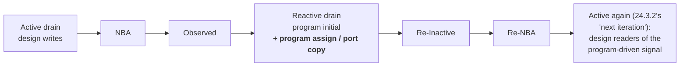

# Program blocks (IEEE 1800 Clause 24)

Status: **implemented, with one construct refused.** Elaboration, the
Reactive-region `initial`, `#0` / `#delay` / `@` / `wait` suspension, `fork`, the
implicit `$finish`, ports in every direction, `assign`, reactive net resolution,
concurrent assertions, per-program termination of descendant threads (24.3),
`$exit` (24.7) and the thread-carried home region all work
(`tests/program_test.cpp`, 70 cases; `docs/TODO.md` "Program blocks"). The one
shape that does **not** is a clocking block or concurrent assertion whose
clocking event is a *program* signal, which is refused loudly rather than
scheduled a time slot late — §10, the last known gap in the clause.
This document is the **scope**: §2 records the measured state per shape and §9
per phase, both maintained per row by whoever owns the phase, so read those
rather than this paragraph for what is left.

Everything below is grounded in the clause text (quoted from IEEE 1800-2017,
whose clause 24 is unchanged in substance) and in measured behaviour of the
current build. Clause numbering caveat in §8.

---

## 1. What Clause 24 actually requires of a port

The recorded reason for refusing program ports was **wrong**, and it is why the
work looked bigger than it was. The comment that stood where `lower_instance`
now classifies port kinds (§4 A3) said

> a program's ports carry the clocking-block/skew semantics of LRM 24.3

and `docs/design/clocking-blocks.md` repeated it ("Port skew needs the clockvar
machinery"); both are corrected now. There is no such thing. 24.3 says the
opposite:

> Program port declaration syntax and semantics **are the same as those of
> modules** (see 23.2.2).

Skew belongs to a clocking *item* (14.4), never to a port. A clocking block
inside a program may of course sample a port — that is the canonical testbench
shape — but that block is the landed Clause 14 machinery reading an ordinary
program-scope signal; the port itself contributes nothing to it.

What a program port *does* carry is a **region**, and 24.3.2 ("Operation of
program port connections in the absence of clocking blocks") states it exactly:

> Program ports are program-scope objects. They are always connected to design
> objects (nets and variables), since programs can only be instantiated in
> design scopes.
>
> Sequential code declared in programs always executes in the reactive region
> set. Thus, variables on the other side of a program port connection are
> **updated in the reactive region set**. Similarly, the driving and resolution
> of nets on the other side of a program port connection also occurs in the
> reactive region set. Such driving and resolution occurs immediately after an
> event causes a change to a driver on a program net. Design processes sensitive
> to those cross-region variables and nets are scheduled for wake up in the
> **active** region set.

and 24.3.1 gives the same answer for the input direction and for any continuous
assignment inside a program:

> Statements and constructs within a program block that are sensitive to changes
> (e.g., update events) on design signals are scheduled in the Reactive region.
> […] The continuous assignment `assign tclk = clk;` would also be scheduled in
> the Reactive region.

So the whole semantic content of a program port is one sentence:

> **A program port's copy process is a continuous process with a Reactive home,
> in both directions. Its stores wake design readers into Active.**

24.3.2's own worked example is the acceptance test:

```systemverilog
module m;
  logic r;
  wire dw1, dw2;
  initial begin r = 0; #10 r = 1; end
  assign dw1 = r;
  p p_i(dw2, dw1);
  always @(dw2) $display("dw2 is %b", dw2);
endmodule

program p(output pw2, input pw1);
  assign pw2 = pw1;
endprogram
```

> it is necessary for simulators to perform multiple iterations over the entire
> loop […] the `assign` statement in program `p` shall not be executed until the
> Reactive region. And when it executes and triggers activity on the `always`
> procedure in module `m`, that `always` procedure is not executed until the
> Active region in the **next iteration** of the overall scheduling loop.

Clotho's region loop already performs that outer iteration (`emit_active_run`
re-settles the active set after the reactive drain — this is how an Observed
store and a Re-NBA drive already become visible in the same slot). Nothing new
is needed in the scheduler **for this iteration**. It does not follow that the
whole outer loop is covered: 24.3.1's other one — back through the **Observed**
region, for a clocking block or an assertion clocked by a program signal — is
genuinely missing, and is **§10**, where it is now a loud refusal rather than a
silent one-slot-late answer. The reactive re-settle (`reactive.done`) closes only
to the active drain (`check`), never back to `wheel.check`.

## 2. Measured state of the art

Every row below was run against `build-dbg/clotho run` while writing this
document. "silent" means clotho accepts the source and produces a wrong
schedule — the failure mode the project forbids.

| Shape | Result | Verdict |
|---|---|---|
| `initial` in Reactive, suspend/resume on `@`, `wait`, `#d`, `#0` | correct | ok |
| implicit `$finish` when the last program `initial` ends | correct | ok |
| program with no `initial` (only `final`) → no implicit finish | correct | ok (24.3: "if there is at least one initial procedure") |
| nested program in a module, never instantiated → implicitly instantiated | correct | ok (24.3) |
| program in an interface; `generate` inside a program; program instance array | correct | ok |
| variables, functions, non-suspending tasks, classes, mailboxes in a program | correct | ok |
| NBA from program code → applied after the module's NBA, invisible across `#0`, visible same slot | correct | ok (24.3.1 Re-NBA) |
| concurrent assertion inside a program, clocked by a **design** signal | correct | ok |
| clocking block + `default clocking` + `##n` inside a program, clocked by a **design** signal | correct | ok |
| design code referencing a program signal / calling a program subroutine | slang error | ok (24.3, 24.5) |
| `always` in a program, nested program, module instance in a program | slang error | ok (24.3) |
| **program with ports (value, interface, modport, `.*`, `bind`)** | ~~loud refusal~~ → correct | **gap A, landed (§4 A1/A3/A4/A5)** |
| **`assign` inside a program** | ~~silent, wrong region~~ → correct | **gap B, landed (§3)** |
| **descendant threads of a program's `initial`s not terminated** | ~~silent, wrong~~ → correct | **gap C, landed (§5.1)** |
| **suspending task called from a program** (incl. a design task, 24.5's own example) | ~~loud refusal~~ → correct | **gap D, landed (§6.1)** |
| **`$exit`** | ~~loud refusal~~ → correct | **gap E, landed (§5.2)** |
| **program driver of a multiply-driven (resolved) net** — port or hierarchical `assign` | ~~loud refusal~~ → correct | **gap A, landed (§4 A5)** |
| top-level program *with* ports, implicitly instantiated | accepted (ports unconnected) | correct, and no longer accidental — §4 A3 |
| **clocking block / concurrent assertion inside a program clocked by a PROGRAM signal** (a port, or anything the program's own code writes) | ~~silent, one slot late~~ → loud refusal | **gap F, refused not fixed (§10)** |

Gap B, reproduced (the LRM's 24.3.2 example expressed without ports, since ports
were still refused when this was measured — §4 A3 landed them, and
`tests/program_test.cpp` now carries the example *with* its ports):

```systemverilog
module t;
  logic r = 0;
  wire dw1, dw2;
  initial #10 r = 1;
  assign dw1 = r;
  always @(dw1) $display("A dw1=%b", dw1);
  always @(dw2) $display("B dw2=%b", dw2);
  p pi();
  initial #40 $finish;
endmodule
program p;
  assign t.dw2 = t.dw1;                                   // 24.3.1: Reactive
  initial begin @(t.dw1); $display("R reactive"); end
endprogram
```

clotho prints `A`, `B`, `R`. LRM-correct is `A`, `R`, `B`: the program's
continuous assign runs in Reactive, so `dw2` changes there and `B` cannot run
until the next Active iteration. The assign is lowered by
`add_continuous_process` (`src/Lower.cpp:8025`) as `Activation::Always`, with no
regard for `in_program_` — module semantics, silently.

Gap C, reproduced:

```systemverilog
program a;
  initial begin
    @(posedge t.clk);
    fork begin #30 $display("A ORPHAN ran"); end join_none
  end
endprogram
program b; initial #50 $display("B done"); endprogram
```

clotho runs the orphan at 35. 24.3 requires it dead at 5:

> When all initial procedures within a program have reached their end, that
> program shall **immediately terminate all descendent threads** of initial
> procedures within that program.

With a single program the implicit `$finish` masks this (it empties the rings),
which is why the landed tests do not see it. With two programs it is a plain
wrong answer.

**Oracle note.** iverilog 13 is *not* usable as an oracle for Clause 24. On the
gap-B case it prints `R`, `A`, `B` — the program `initial` ahead of an Active
`always` on the signal it waits on, which contradicts 24.3.1 outright; on the
gap-C case it runs the orphan *and* never performs the implicit `$finish` at
all. It implements neither the reactive region set nor 24.3's termination rules.
Verilator is cycle-accurate and excluded by policy. Clause 24 verification
therefore derives from the LRM text (§1 quotes) and from clotho's own region
order, which the landed `tests/program_test.cpp` and `tests/clocking_test.cpp`
already pin against Active-region cascades.

## 3. The one missing primitive: a Reactive-home continuous process

Gaps A and B are the same missing thing. Clotho has exactly two flavours of
Reactive-region body today, and neither is a continuous process:

- `Activation::Reactive` — a program `initial`: seeded onto the reactive ring
  (`src/ir/LlvmBackend.cpp:11990`), **never subscribed**, one-shot.
- reactive *pend* thunks — an assertion action block, pushed by
  `Inst::Tag::ReactivePend`.

A program's port copy or continuous assign needs a third: re-armed on a
sensitivity list like `Activation::Always`, but reactive-home. The machinery for
the "reactive-home" half already exists and is general:

- `parked_handle` (`src/ir/LlvmBackend.cpp:11434`) tags a parked coroutine handle
  with `kReactiveHomeTag` when `reactive_home()` is true;
- `emit_wake_push` (`:11478`) reads the tag back and selects the ring, so any
  waker — a static subscription scan, the wheel trampoline, a task epilogue —
  already routes to Reactive without knowing anything about programs;
- the reactive drain already discriminates thunk-tagged pointers (`:12281`,
  "the two rings stay interchangeable"), so a comb-fused reactive group works.

Two claims in the list above were **wrong when measured**, and phase A2 fixed
both; A3 inherits the corrections.

1. **A static subscription is NOT tagged by `parked_handle`.** Only an
   *intra-body* wait is (`emit_dynamic_register`). A process with a static
   sensitivity list is subscribed once, from the seed loop, with the bare ramp
   handle, and its always-loop park never re-records it (`emit_wait_suspend`
   only suspends) — so the subscription record is the *only* place a
   continuously-active process can state its home. Left untagged, every wake of
   a program's continuous assign pushes it onto the **active** ring, i.e. the
   whole feature silently does nothing. The seed loop now tags it
   (`tag_reactive_home`).
2. **A reactive-home group must not be thunk-eligible.** `kReactiveHomeTag` is
   bit 1 and the thunk tag is bit 0, and the scheduler's reactive test is "bit 1
   set AND bit 0 clear" precisely because the two are documented as mutually
   exclusive. A pointer carrying both reads as neither, and the drain's thunk
   path would call two bytes past the function. `compute_fusion_groups` excludes
   reactive-home groups from `thunk_group_`; a comb-fused reactive *coroutine*
   group is still fine, which is what the third bullet above actually buys.

What is missing is only the *classification* and two seed-loop branches:



Design decision: **a `bool reactive_home` on `ir::Process`, not a new
`Activation`.** `Activation` already encodes *when* a body runs and is switched
on in nine places; the home region is orthogonal to it, and every existing
`Activation::Always` path (subscription, `self_start` settle, comb fusion,
trigger masks, `ProcessFacts`) must keep applying verbatim. A new enumerator
would fork all of them. Concretely:

| Site | Change |
|---|---|
| `ir::Process` (`src/ir/Module.h:210`) | add `bool reactive_home = false` |
| `add_continuous_process` (`src/Lower.cpp:8025`) | set it from `in_program_` |
| seed loop (`src/ir/LlvmBackend.cpp:11984`) | `self_start` push → `emit_reactive_push` when reactive-home, so the time-zero settle happens in slot 0's Reactive |
| subscribe loop (`:12013`) | unchanged predicate, but the recorded handle must be tagged — see correction 1 above |
| `reactive_home()` (`:11399`) | include the current process's flag |
| `compute_fusion_groups` | make the group key home-homogeneous — never fuse a reactive-home process with an Active one |
| `has_program()` (`:6901`) | must also report a reactive-home process, so `design_uses_reactive_` is set for a program that has only an `assign` |
| `build_program_fns` (`:6982`) | seed from reactive-home processes too |
| `compute_fusion_groups` thunk pass | exclude a reactive-home group — see correction 2 above |
| `build_reactive_fns` (`:7125`) | scan reactive-home bodies for a `Delay` too, so `emit_zero_delay_push`'s re-inactive batch exists whenever `reactive_home()` can route to it |
| `lower_continuous_assign` | a program driver of a **resolved** net was refused here, because its slots are written in Reactive while an Active-home resolver folds them, one region later than 24.3.2. **Retired by A5**, which makes such a net's resolver reactive-home; the same question ports raise, reachable without ports via a hierarchical `assign` |

Cost to a design with no program: one `bool` in `Process` (fits existing
padding), one already-taken branch in the seed loop. No new region, no new
runtime entry point, no IR opcode.

## 4. Ports: the phased plan

### Phase A1 — interface and modport ports (as built)

`program test ( interface device_ifc );` is 24.3's own second example and the most
common real shape. It cost nothing, as scoped: `wire_ports` already `continue`s on
`pc->port.kind == SymbolKind::InterfacePort`, because an interface port is resolved
by symbol canonicalization onto the shared interface signal
(`docs/design/interfaces.md`), so there is no copy process and therefore no region
question — the program's Reactive code reads and writes the interface signal
exactly as it does through a hierarchical name. A **modport** port takes the same
arm: slang gives it the same `InterfacePortSymbol` kind, and
`canonical_value_symbol` collapses the modport member onto the underlying signal.

Two things the scope got wrong, both cosmetic:

- there was nothing to "narrow the guard to". A3 and A4 landed in the same wave, so
  the guard has no per-kind case left at all — see A3.
- the line reference (`src/Lower.cpp:9334`) named the comment above the `continue`,
  not the `continue`.

Landed: no `src/` change; `tests/program_test.cpp` "a program reads an interface
port" and "a program reads a modport port".

### Phase A2 — the reactive-home continuous process

**Landed.** §3, verified through gap B (a program `assign`), which is observable
without any port. This was the load-bearing phase and it fixed a silent
miscompile on the way. Two of §3's own claims were wrong when measured; the
corrections are recorded there and A3 inherited them.

Size: ~120 lines across `src/Lower.cpp`, `src/ir/Module.h`,
`src/ir/LlvmBackend.cpp`, `src/ir/Analysis.cpp`; ~120 lines of tests.

### Phase A3 — value ports, single-driver (as built)

`wire_ports` runs unchanged except that every copy it emits for a program child is
reactive-home. That is one extra argument at its three `add_continuous_process`
call sites plus the classification itself:

```cpp
const bool child_is_program = child.getDefinition().definitionKind == slang::ast::DefinitionKind::Program;
```

asked of the **child definition**, not of `in_program_`: `wire_ports(child)` runs
after `lower_instance(child)` has restored that flag, so `in_program_` there is the
parent's answer and is always false — 24.3.2, "[program ports] are always connected
to design objects (nets and variables), since programs can only be instantiated in
design scopes". `add_continuous_process` ORs the two, so a program's own `assign`
(A2) and its port copies reach the same field by different routes.

Both directions are reactive-home, for two different sentences. 24.3.2's covers the
output direction; the input direction is 24.3.1's own `assign tclk = clk;` — a
construct inside the program sensitive to a design signal — which is worth knowing
when reading either comment, because a reader who has only 24.3.2 in mind will
think the input copy is unjustified.

**The guard is gone entirely, not narrowed.** Every port shape a program can have
is either implemented or refused by a check that already lives where the answer is
known, so `lower_instance` keeps only the `is_program` flag and a comment
classifying the four kinds. Two consequences:

- the **top-level program with ports** hole closes by disappearing rather than by a
  special case: a top instance has no `PortConnection`s at all, so there is nothing
  to copy and nothing to classify. The scope said "after A3 the question
  disappears", which is right, but the reason is the guard's removal.
- the one refusal the scope predicted became **two**, both in `wire_ports` at the
  branch heads that already compute the resolved-net answer, so they cost nothing
  on the common path:
  - "a \`program\` output port driving a multiply-driven (resolved) net is not
    supported" — the design-side net, exactly A5's shape and word for word A2's
    argument in `lower_continuous_assign`;
  - "a \`program\` input port whose net has another driver is not supported" — the
    mirror on the program side, where the stale reader is the program's own Reactive
    code. Reachable only from another program (24.3 forbids a design reference to a
    program signal but allows program-to-program hierarchical references), and it is
    the one shape in this phase whose reachability was not confirmed against slang.

  **Both are retired.** A5 landed the resolution region they were deferring to, and
  confirmed the second shape *is* constructible — the very test that needled that
  refusal was building it. Neither branch head refuses anything now; each passes
  `child_is_program` to `alloc_driver_slot` instead (§4 A5).

Every other `wire_ports` / `build_inout_aliases` refusal applies to a program
verbatim and needed no program wording. One message did: the container-port one
said "module port connection", and a program port now reaches it, so it reads
"a dynamic-array, queue or associative-array port connection is not supported"
(the needle in `tests/legalize_test.cpp` moved with it).

A gap this phase **found and did not fix**, escalated as its own ticket and now
**refused loudly** rather than silently mis-scheduled: a clocking block, or a
concurrent assertion, whose clocking event is a *program* signal — a port, or
anything the program's own code writes — fires one pass through the scheduling
loop late, because clotho's reactive drain never re-enters the Observed region.
It pre-dates ports (a program `initial` or `assign` writing the clock reaches it
identically), so it is not a regression, and a port is only the third route into
it. The clause text, the three region-loop block names, both candidate fixes and
why each is rejected, and what a real fix needs are all in **§10**; nothing about
it is repeated here, so §10 is the only copy to keep true.

Landed: ~130 lines in `src/Lower.cpp`, nearly all of it comment and refusal text
(the executable change is one `const bool`, three extra arguments and two `if`s);
~490 lines in `tests/program_test.cpp`, 17 cases covering 24.3.2's example, both
directions, interface and modport, a clocking block sampling a port, `inout`,
24.3's declaration shape, unconnected, `.*`, non-ANSI, `bind`, width coercion, and
four refusals by needle.

### Phase A4 — `inout` and `ref` program ports (as built)

24.3's first example is `program test (input clk, input [16:1] addr, inout [7:0]
data);`, and it needed no executable change at all. Clotho implements
`inout`/`ref` by **collapsing storage** (`build_inout_aliases`): the child-side
symbol becomes the parent's signal and no copy process exists. The scope called
that "accidentally correct" for a program; it is better than accidental — with one
shared signal there is no process to put a region on, the program writes that
signal from its Reactive code, and 24.3.2's "design processes sensitive to those
cross-region variables and nets are scheduled for wake up in the active region set"
is then just the ordinary wake path. The whole-signal restriction stays, and its
message needs no program wording.

An event port collapses the same way in every direction (LRM 15.5.5), so it is free
for a program too, though no test covers that shape yet.

Landed: comment only in `src/Lower.cpp`; `tests/program_test.cpp` "a program drives
an inout port and the design reads it" and "LRM 24.3's declaration shape lowers and
reads in Reactive".

### Phase A5 — reactive net resolution (as built)

**Landed.** The decision, which is the whole of this phase:

> **A resolved net with at least one program-side driver gets a reactive-home
> resolver.**

24.3.2 is the authority, and it legislates the net rather than the driver:

> Similarly, the driving and **resolution** of nets on the other side of a program
> port connection also occurs in the reactive region set.

**The consequence, which is the reason this needed a written decision.** A
multiply-driven net is folded by exactly ONE resolver process
(`emit_wire_resolvers`, one per net), so a net has exactly one resolution region.
Moving it to Reactive therefore moves the resolution of that net's **design-side**
drivers as well: a design cascade that runs through such a net now sorts after the
reactive code of the same slot, and its design readers wake in the next Active
iteration. That is precisely the ordering 24.3.2's own example asks for on the
program-driven edge — it is now applied to every edge of the net.

That is a real semantic choice and not a free one, and it was taken because the
clause does not distinguish which driver changed. It puts the resolution of such a
net in the reactive region set, full stop. The alternative would be **per-driver
resolution regions** — two resolvers folding one net, an Active one and a Reactive
one — which no sentence of the LRM asks for and which has no defined answer for
how two partial folds combine into the net's single value. The blast radius is
bounded by construction: a net with no program driver is untouched (pinned by the
control test), and a program can only reach a design net it is connected to or
names hierarchically.

**Mechanism**, and it is smaller than the scope predicted because A2 had already
made `reactive_home` work end to end:

| Site | Change |
|---|---|
| `program_driven_nets_` (beside `resolved_nets_`) | the subset of resolved nets with a program-side driver |
| `alloc_driver_slot` | takes a trailing `bool program_driver = false` and records `program_driver \|\| in_program_`. Every driver of a resolved net passes through here, so no caller has to remember to say so — the same split, for the same reason, as `add_continuous_process` |
| `wire_ports`, both branches | pass `child_is_program` (the flag A3 already computed) to `alloc_driver_slot` |
| `register_net_force_site` | records the net when `in_program_` — see below |
| `emit_wire_resolvers` | `.reactive_home = program_driven_nets_.contains(net_u)`. Nothing else about the resolver changes |

`force` needed its own line because it is the one procedural continuous
assignment that can reach a net (`assign` on a net is illegal and slang rejects
it), and it does **not** go through `alloc_driver_slot`: a net force is a
resolver-level overlay (`NetForceSite`, `docs/design/force-release.md` phase 1.5)
whose `active` / `val` a program's Reactive thread writes. Left unrecorded, the
resolver would re-fold them in the next Active — the identical one-region-late
defect the driver slots would have had. `add_pca_reeval`'s re-eval process already
ORs `in_program_` through `add_continuous_process`, so it needed nothing.

**Reachability restored.** All three refusals sat *in front of* checks that own
narrower shapes, so removing them put those checks back in the program's path
rather than leaving a hole: `aggregate driver of a multiply-driven net` in both
`wire_ports` branches, and — through `emit_resolved_driver` — `unpacked-array or
unpacked-struct multiply-driven net`, `dynamic or unpacked-array partial driver`
and `delay on a partial driver of a multiply-driven (resolved) net`. Each still
fires for its own shape, now including through a program.

**The input-port shape is constructible**, which A3 could not confirm. `assign
t.pi.pw = …` from a *second* program is accepted by slang — 24.3 forbids a design
reference to a program signal but explicitly allows "hierarchical references to
extend from one program scope to another program scope" — and it was already the
source of A3's by-needle refusal test, so the shape was reaching clotho's guard
all along.

Landed: ~60 lines in `src/Lower.cpp`, most of it the comment at
`emit_wire_resolvers` stating the consequence above; six cases in
`tests/program_test.cpp` under the "Reactive net resolution" banner (both port
directions, the hierarchical `assign`, the program-side input net, LRM 6.6's fold
unchanged, and the no-program-driver control), replacing the three by-needle
refusal tests. No backend, IR or runtime change.

## 5. Gap C — per-program termination, and `$exit` (gap E)

These are one piece of work, because both need something clotho does not have:
**the identity of a program instance at run time**. Today there is a single
global counter, `clotho.program_live`, initialised to the number of
`Activation::Reactive` processes and decremented at each body's natural end
(`src/ir/LlvmBackend.cpp:5210-5238`, `program_live_ptr` at `:7017`).

Required semantics:

- 24.3: when *this program instance*'s `initial`s have all ended, kill that
  instance's descendant threads immediately; then, when every program's threads
  and descendants have ended, implicit `$finish`.
- 24.7: `$exit()` from a thread originating in an `initial` of a program kills
  all of that program's `initial`s and their descendants. Called from anywhere
  else it "shall be ignored, and a warning may be issued" — so clotho's current
  hard error on `$exit` in module code (`src/Lower.cpp:20635`, the generic
  unsupported-system-task path) is itself non-compliant, not merely incomplete.

Available machinery:

- `ir::Process::scope` (`src/ir/Module.h:244`) already carries the
  `InstanceScope::id` of the declaring instance, so grouping the Reactive
  processes of one program instance is a frontend-side partition, no new
  plumbing.
- subtree termination exists: `disable` / `process::kill` marks a thread subtree,
  force-wakes each member once through the claim-or-flag protocol and lets each
  activation leave through its ordinary exit (`docs/design/process-class.md`,
  `docs/design/disable.md`). `$exit` and 24.3's implicit kill are that operation
  with a program instance as the root set.

The obstacle this section expected — **module dedup** — turns out not to exist,
and the paragraph that claimed it did was wrong. Two instances of one program
definition do *not* share a lowered body: the only body sharing in the backend is
`share_twin_groups`, which takes **thunk groups only** (`thunk_group_[g]`), and
thunk eligibility is `is_simple_always`, which requires `Activation::Always`
(`src/ir/Analysis.cpp:1628`). An `Activation::Reactive` process is therefore
always a coroutine of its own, one per instance — the same property
`lower_group`'s deferred-assertion note already relies on for its per-group
generation counter. So the program-instance index is a **compile-time constant
folded into each body**, and no instance-context plumbing is needed.

### 5.1 Gap C, as built

Landed. `build_program_instances` partitions the `Activation::Reactive` processes
by `Process::scope`; each program instance gets

- one `i32` in `clotho.program_inst_live`, initialised to that instance's
  `initial` count, and
- one static control block in `clotho.program_root`, which is a **tree node and
  never a thread**.

Every program body leaves through a new `program.end` block (`emit_program_end`),
which

1. hands its live descendants to its instance's root (`rt_proc_adopt`) — needed
   because `rt_proc_complete` re-parents an ending thread's children onto its own
   parent, which is null for a statically created process, so a two-`initial`
   program would lose the first one's children before the second ended;
2. decrements the instance counter and, at zero, runs `lower_proc_kill(root,
   with_self=false)` — 24.3's first sentence is exactly the `kill` / `disable
   fork` subtree abort with a program instance as the root set, and rooting it at
   the node rather than at the `initial`s keeps the walk off the `initial` that is
   itself ending (it would otherwise publish KILLED instead of FINISHED) and
   keeps `wait fork` / `disable fork` inside an `initial` seeing only that
   thread's own descendants;
3. decrements the design-wide `clotho.program_live` and, at zero, performs the
   implicit `$finish` exactly as before. The design-wide counter still counts
   `initial` procedures only, which is sound *because* of step 2: once every
   `initial` has ended, every descendant of one has already been terminated, so
   "all their descendent threads have ended" reduces to "the counter is zero".

`program.end` is also where a program `initial` aborted by `disable` or
`process::kill` leaves (`proc_abort_exit`): such a procedure has "reached its
end" for the clause. `$finish` still branches straight to `coro.final` and is
deliberately **not** counted — it has already ended the simulation.

Cost to a design with no program is nil: both globals are created on first use by
a program body, and `design_uses_process_` — which the subtree walk needs, since
the walk *is* the control-block tree — is turned on for a program only when the
design can actually fork (`has_program_initial() && design_forks()`), so a
program with no `fork` anywhere still emits no control blocks.

One shape is **not** covered and is recorded rather than hidden: a thread that is
marked before it has ever run still executes its head segment. `pcb->acts` is
linked in the body, not the ramp, so the mark walk finds no activation to
force-wake for a just-spawned `join_none` child. That is fixed for a fork child
(an abort test on body entry, `lower_task`), which is where LRM 24.3 can hit it;
the same gap for other never-started activations is untouched.

### 5.2 Gap E — `$exit`, as built

Landed, and it is exactly what gap C left it: `lower_proc_kill` over the per-
instance root **plus** the instance's `initial` procedures themselves, whose
process indices `build_program_instances` partitions.

`$exit` is a new `Inst::Tag::ProgramExit` — appended at the END of the enum, like
`ClassImplements`, so tag numbering and `sva_test`'s monitor digests are
untouched — with **no payload**. 24.7 scopes the effect by the thread ("from a
thread or its descendent thread originating in an initial procedure of a program
block"), never by the lexical site, so the owner is a property of the body the op
lands in and the backend reads it off `cur_program_inst_`:

| body | owner |
|---|---|
| program `initial` | its own instance (`program_inst_of`) |
| fork child, task, function | `build_program_exit_owners`, a per-`FunctionId` closure seeded per instance from that instance's `initial`s |
| any process that is not a program `initial` | none — 24.7's "shall be ignored" |

Two decisions worth keeping.

**`$exit` counts nothing.** It marks each of the instance's `initial`s
(`with_self`, since the clause terminates the procedures and not merely their
descendants) plus the termination root, then branches to its own
`proc_abort_exit()`. Every marked `initial` reaches `program.end` through the
ordinary abort path, so the per-instance and design-wide countdowns stay in one
place and each procedure is counted exactly once — `rt_proc_mark_kill` skips a
thread that is already FINISHED, KILLED or marked, and the force-wake is
claim-or-flag. Counting at the `$exit` site instead would need a second "has this
one been counted?" flag per procedure. This is also why `lower_proc_kill` gained
`branch_on_self`: its `with_self` self-branch fires right after the matching
root's walk, which would strand the walks after it when several roots are killed
in a row.

**Two refusals survive, both loud.** A subroutine no single instance owns cannot
name a thread, and is refused with a `TODO` pointing at per-thread program
identity (§6's thread-carried home is the mechanism that would supply it). The
owner closure's second seed — every process that is *not* a program `initial` —
is 24.7's own test rather than an approximation: the clause keys on where the
calling thread **originates**, so a design process and a program's own
reactive-home continuous process (24.3.1) both land on the ignored arm, because
neither is an `initial` procedure and nothing spawns either from one. A
subroutine shared between an `initial` and such a process therefore has two
answers even when both callers sit in the same program instance, which is exactly
the ambiguity. That path is unreachable today for a narrower reason worth
recording, since phase A3's port copies are equally expression-only: an
expression can call a **function**, and `$exit` in a function is already refused
outright. And
`$exit` inside a **function** is refused: a function has no abort exit, and the
abort poll that would carry the termination to its caller is emitted only after a
suspending op, which a plain `Call` is not (the shape that would carry it is the
`may_finish_` closure `$finish` already uses).

A design-code `$exit` is ignored, per the clause, and the frontend warns
(`program-exit-ignored`) for the one case it can decide statically: a call
lexically in a design process, which no program thread can ever reach. A call in
a design *subroutine* is left to the backend, which ignores it when no program
`initial` reaches that subroutine.

Size: ~250 lines, plus tests. Independent of the port work — no shared code —
so it can run in parallel with phase A.

## 6. Gap D — the home region belongs to the thread

This is the gap that blocks real testbenches, and 24.5 is written as if to
specify the fix:

> When a task within a design module is called from a program, it shall use the
> reactive region set for its scheduling activities.

and 24.3.1:

> Once a program process starts a thread of execution, all subsequent blocking
> statements in that thread are scheduled in the Reactive region. This includes
> subroutine code called by the thread, even if the subroutine code is declared
> in a module, package, or interface. Effectively, a section of sequential code
> anywhere in the design or testbench **inherits the scheduling region of the
> thread that calls it.**

### 6.1 As built

Landed. The classification is `build_shared_home_fns`, run from `run()` right
after `build_program_fns` and **before `declare_function`**, because it decides a
signature. It intersects two closures over the call graph:

- **R**, reactive-home: seeded from `build_program_fns`' and `build_reactive_fns`'
  results — a program `initial`, a program's continuous assign / port copy, an
  assertion action block, and everything they call — plus the reactive-home
  processes' own call edges.
- **A**, active-home: every other process, plus `build_reactive_fns`' original
  catch-all (a function outside R contributes its callees), so a chain nothing
  else reaches still lands somewhere.

`shared_home_fns_ = R ∩ A` is exactly the population with no lexical home.
`reactive_home_fns_ = R` gives the lexical answer for the rest, and replaces
`in_reactive_body_` and `in_program_fn_`, which `reactive_home()` used to OR
together — one flag now, `in_reactive_home_fn_`.

Both closures expand **virtual dispatch to every body that can occupy the slot**,
the union `build_rng_fns` already takes, rather than `ir::collect_callees`'
statically bound target. Required, and required on both sides: an override reached
only through a handle would otherwise be in neither closure and would fold the
Active home, resuming a program's thread in the wrong region silently. Because the
union is taken from the ordinary roots too, over-approximation is safe — a slot
both kinds of code dispatch on marks all its overrides *shared*, and a shared body
asks its caller rather than folding anything.

The home reaches the callee as a **conditional trailing-of-the-prologue `i8`
parameter**, `home`, sitting immediately after the gated `proc` pointer in both
`declare_function` and `declare_task` (`home_param_index`). Gated design-wide on
`design_uses_home_arg_` (= "some body is shared"), for the same reason `proc` is:
one vtable slot, one `FunctionType`, no per-callee bit may vary it. A design with
no shared body emits exactly the signatures it did before.

Not in the task record. That record's single pointer slot is the caller's *parked
handle* and is deliberately null until the async path — `lower_task_call_inst`
stores it only after the first resume, so a synchronously completing task must not
look parked — and writing a home there early would break that protocol.

`home_ptr()` now seeds from `home_arg_` when there is a caller and from the
lexical answer only for a **process**, which is a thread root. `current_home()` is
the one accessor: a folded constant when the home is not thread-carried, the frame
slot in a coroutine, and the incoming parameter in a plain function, which cannot
suspend and so needs no spill. `callee_home()` is `current_home()` at a call site
— which is what makes the inheritance **transitive**: a task hands on what it
inherited, by induction over the call chain, and past an `expect` too, since that
store lands before any later call reads the slot.

`expect` (LRM 16.17) is no longer a special case: it is a `store` to the same slot
(`lower_expect_wait`), and a shared body that also runs one seeds from its caller
and is then overwritten — later store wins, which is precisely 24.3.1's "all
*subsequent* blocking statements in that thread".

Two destinations are chosen by a **branch** rather than a tag, because they are
different data structures: `emit_zero_delay_push` (Re-Inactive batch vs Inactive
queue) and `emit_region_push` (reactive ring vs active ring). `emit_by_home` folds
to one arm unless the home is thread-carried. `parked_handle` stays branch-free —
it ORs `current_home()` straight onto the pointer.

Three call sites do **not** inherit, and each says why at the site:
`lower_reactive_pend` passes the constant `kReactiveHomeTag` (LRM 4.4.2.5 hands an
action block to the Reactive region whatever region decided the verdict), and the
`$monitor` ramp and the DPI export thunk pass `0` (no calling thread at all).

Both refusals are gone. `emit_suspend` is now a single primitive — the old
`emit_suspend`/`emit_suspend_raw` split existed only to skip the refusal, and its
four `_raw` callers were folded in. The fork-child exemption went with it, and its
argument was wrong anyway: it said a child body belongs to one fork *site*, but the
home is a property of the spawning *thread*, and a child of a shared task is itself
shared and inherits at spawn like any other callee.

`reject_shared_reactive_suspend` turns out to have been **unreachable**, not merely
conservative: its `shared` predicate could only fire for a body reached both from a
`ReactivePend` and from ordinary code, and the frontend's `ReactiveSafetyChecker`
refuses *any* user-task call in an action block — for an unrelated reason it still
holds (it cannot trace the body for a `forever`, an intra-assignment delay or a
deferred immediate assertion). Its sharing clause is deleted from that comment and
from its diagnostic; the untraced-body clause stays.

One adjacent defect was fixed on the way: the `$monitor` ramp's `FunctionType` is
reconstructed rather than read off a declaration (the callee arrives as an opaque
pointer from the runtime), and it did not track `declare_task`'s gated `proc`
parameter — a design with both `$monitor` and process control built a call whose
argument count did not match its signature. Both gates are honoured now.

Cost to a design with no shared body: nil, including the ramp signature. Cost to a
shared body: one `i8` parameter per call, one store at ramp entry, one `i8` load
per park.

## 7. Verification plan

- `tests/program_test.cpp` grows per phase. Every case is an ordering
  observable, since the region is only visible as print order against an
  Active-region cascade — the discipline the file already uses.
- 24.3.2's example is the acceptance test for phase A3, and its reduced form
  (§2, gap B) for phase A2; both assert `A`, `R`, `B`. **Both
  landed.** A2's are four ordering cases plus a refusal: a program-local
  `assign` read by the program's own `initial`, the `A, R, B` ordering case, the
  time-zero settle landing in Reactive, and a **module** `assign` in the same
  design still running in Active as the control. A3's is "LRM 24.3.2's example:
  a design reader of a program output port runs in the next Active", structure
  for structure with the printed example, plus 16 more port cases: both value
  directions, interface and modport, a clocking block sampling a port, `inout`,
  24.3's own declaration shape, unconnected, `.*`, non-ANSI, `bind`, width
  coercion, and four refusals by needle.
- Gap C: **landed.** The two-program orphan case from §2 (the orphan never runs
  while the second program runs on), transitive termination through a grandchild,
  a sibling `initial` still running so descendants must survive, per-instance
  isolation across two programs, an `initial` aborted by `disable` and one killed
  by `process::kill` still counting down, and a `wait fork`-joined child left
  alone — `tests/program_test.cpp`, the "per-program termination" banner.
- Gap E: **landed.** `$exit` from an `initial`, from a fork child, and from a task
  of the calling program; two programs where only one exits; design-code `$exit`
  ignored per 24.7's second sentence; plus by-needle tests for both surviving
  refusals (no single owning program, and `$exit` in a function). The clause's
  second sentence is additionally covered from outside the suite by
  `sv-tests/tests/chapter-20/20.2--exit.sv`, a bare `$exit` in a module `initial`,
  which this work turns from an error into a pass.
- Gap D: **landed.** 24.5's `task T` example, a class method that waits, a task
  called from *both* a program and a module in one design (each caller keeping its
  own region), two-level transitive inheritance, an action block beside a shared
  task, and a module-only task pinned to Active — `tests/program_test.cpp`, the
  "home region belongs to the thread" banner.
- Every refusal that survives a phase keeps a by-needle test, as the file already
  does. Phase A traded one blanket refusal for four narrower ones, all needled.
- `--emit llvm` byte-identical on a design with no program, for each phase.

## 8. Clause-numbering discrepancy (resolved)

In IEEE 1800-2017, clause 24 is: 24.3 the construct (containing the implicit
`$finish` paragraph), 24.3.1 scheduling, 24.3.2 port operation without clocking
blocks, 24.4 eliminating races, 24.5 blocking tasks, 24.6 anonymous programs,
24.7 program control tasks (`$exit`). Clotho's in-tree comments and
`docs/TODO.md` cite **24.5 for `$exit`** and **24.6 for the implicit `$finish`**,
which match neither. Either 1800-2023 renumbers the clause or the citations are
wrong. **Resolved: the citations were wrong, and are fixed.** The clause numbering
above is the one shared by 1800-2012 and 1800-2017 and is what the tree now uses:
the implicit `$finish` and the descendant-termination rule are **24.3**, `$exit` is
**24.7**. Every in-tree comment, `docs/TODO.md` entry and test comment that cited
24.5 for `$exit` or 24.6 for the implicit `$finish` has been corrected; the
surviving 24.5 citations are about blocking tasks, which is genuinely 24.5.

## 9. Summary of the scope

| Phase | Gap | Silent today | Blocking | src lines |
|---|---|---|---|---|
| A1 interface/modport ports | A | no | — | ~15 → **0, landed free, §4 A1** |
| A2 reactive-home continuous process | B | ~~**yes**~~ → fixed | A3 | ~120 — **landed, §4 A2** |
| A3 value ports, single-driver | A | no | — | ~80 → ~130 mostly comment, **landed, §4 A3** |
| A4 `inout` / `ref` ports | A | no | — | ~30 → comment only, **landed, §4 A4** |
| A5 reactive net resolution | A | no | — | ~150 → ~60 mostly comment, **landed, §4 A5** |
| C+E per-program termination, `$exit` | C, E | ~~**C yes**~~ | — | ~250 — **landed, §5.1/§5.2** |
| D thread-carried home region | D | no | — | ~200 — **landed, §6.1** |

Recommended order was **A2 first** (a live silent miscompile and the prerequisite
for A3), then A1/A3/A4 for ports, with C+E and D in parallel against different
files. That is what happened, and A5 closed the port work last, as the written
policy decision it was scoped to be rather than a port shape (§4 A5). **Every
phase of this scope has landed**, and the one gap it did not scope — a program
signal as an Observed-region body's clock — is §10.

## 10. Gap F — an Observed-region clock written in Reactive

Status: **refused loudly, not fixed.** This is the last known gap in clause 24,
it is the one gap of clause 24 that is not a phase of §4's scope, and the refusal
is a deliberate stopping point rather than an unfinished repair — the reasoning
is §10.3, and both candidate fixes are worse than the refusal today.

### 10.1 What the LRM requires

24.3.1, in full, is the whole specification of this case:

> Concurrent assertions are allowed in program blocks. Concurrent assertions
> have invariant scheduling semantics—whether present in program code or design
> code. Assertions always sample the values available while processing the
> Preponed region, and they are always evaluated when processing the Observed
> region. **If an assertion is clocked by activity on a program object (not
> recommended), the scheduler will iterate from the reactive region set back
> around the outer loop in Figure 4-1, through the Observed region, where the
> assertion is evaluated.**

A clocking block is not named there, but it is the same construct for the same
reason: its sampling body is an `ir::Activation::Observed` process too
(`docs/design/clocking-blocks.md` §2), so the clause's mechanism is what it needs
as well.

"A program object" is 24.3's own defined term, and it is defined by declaring
scope with the ports explicitly folded in:

> Variables declared within the scope of a program, including variables declared
> as ports, are called program variables. Similarly, nets declared within the
> scope of a program are called program nets. Program variables and nets are
> collectively termed program signals.

and the dual is just as tight, which is what makes the recommended shape easy to
recognize:

> The dual of a program signal is a design signal. Any net or variable declared
> within a module, interface, package, or `$unit` is considered to be a design
> signal.

### 10.2 The mechanism, with the three block names

All three are in `emit_active_run` (`src/ir/LlvmBackend.cpp`):

| Block | What it does | Where it can go |
|---|---|---|
| `wheel.check` | runs `emit_observed_run`, then the Observed/Postponed flushes | `check` (the active drain) when the active ring is non-empty, else `observed.settled` and on into the reactive drain |
| `observed.settled` | the fall-through when Observed woke nothing | straight on to the Observed/Postponed flushes and the reactive drain |
| `reactive.done` | the reactive drain's re-settle, after Re-Inactive and Re-NBA | `check` when the active ring is non-empty, else `reactive.settled` → Postponed → the wheel |

So Observed ↔ Active is a closed loop, and it is why an Observed store and a
Re-NBA drive already become visible in the same slot (§1). But `reactive.done`
**never returns to `wheel.check`**. Once the reactive drain empties, Observed is
not re-entered in that slot.

That is exactly the iteration 24.3.1 asks for, and its absence is a one-slot-late
answer for any Observed body whose clock is written in the reactive region set.
Every route into it is reactive-home by 24.3.1's own sentences: a program
`initial`, a program's continuous `assign` (§3), and an `input` port copy (§4 A3).
A program port is therefore not a special case but the third route, and the gap
**pre-dates** all of the port work — a program `initial` writing the clock reaches
it identically.

**Why it never surfaced.** It bites only when *nothing in the Active region reads
the same signal*. Any Active reader's wake leaves the active ring non-empty at
`reactive.done`, control goes to the active drain, that settles, and `wheel.check`
re-runs Observed — so the edge is caught by accident. A test for it must have the
program signal clock the Observed body and nothing else, which is what the four
refusal cases under `tests/program_test.cpp`'s "A clocking event on a program
signal" banner are built to be.

### 10.3 Both candidate fixes, and why each is rejected for now

**1. Point `reactive.done`'s else-edge at `wheel.check`.** Rejected: it **hangs**.
`wheel.check`'s own re-settle leaves only via `check`, and only when the active
ring is non-empty; a reactive→Observed edge pops no ring entry, so it bumps no
oscillation counter and the loop `wheel.check` → Reactive (empty) → `reactive.done`
→ `wheel.check` spins without ever tripping the guard that aborts a
non-converging slot. The Active-side re-entry after Observed is safe only because
the active drain counts activations. A hang is a worse failure than a refusal, and
a silent hang in a testbench is the worst of the three outcomes on offer.

**2. Re-enter Observed conditionally** — "did reactive code write something an
Observed process samples". Rejected *for now*, and it is the shape a real fix
takes. The cost is that it re-runs **every** Observed body a second time in the
slot, and the two kinds of Observed body do not survive that equally:

- a **clocking block** does. It detects its own edge from the live clock against
  `clocking_clk`, a one-slot latch it updates on every pass, so a second pass sees
  no edge; and `clocking_fired` — the "my event occurred in this time step" latch
  that `##0` tests and that matures a drive — is deliberately sticky within the
  step and cleared per step by `finalize_preponed`. This is already relied on:
  `wheel.check`'s existing Active-side re-entry re-runs the block today.
- an **SVA monitor** does **not**. It detects its clock edge from the **Preponed
  shadow**, which by construction does not change within a step, so a second pass
  sees the same edge and steps the automaton **twice for one clocking event** —
  a wrong verdict, not a late one.

So a real fix needs two things this ticket does not build:

1. **A per-monitor per-step latch**, the monitor's analogue of `clocking_fired`,
   cleared by `finalize_preponed` alongside it. That is clause 16 work in the
   monitor codegen, not clause 24 work in the region loop.
2. **A termination argument for the extra Observed pass.** Whatever condition
   gates the re-entry has to be shown to go false in bounded time, or to bump the
   oscillation counter so the existing guard can abort. Fix 1's failure is exactly
   the absence of this.

The clause itself is the reason neither is urgent: it calls the construct "not
recommended", and 24.4 tells a testbench what to do instead —

> Programs that read design values exclusively through clocking blocks with
> clocks that are design signals are insensitive to read-write races.

— which is the shape the landed tests use and which stays fully supported.

### 10.4 As built

One shared predicate answers the question for both constructs, because it is one
question: `program_clock_signal` in `src/Lower.cpp`, over `is_program_signal`,
which canonicalizes (`canonical_value_symbol`) and then walks to the **first
enclosing `InstanceBodySymbol`** and asks whether its definition kind is
`Program`. Canonicalizing first is what keeps the recommended shape legal: a
signal reached through an interface port or a modport collapses onto the interface
instance's own storage, which 24.3's dual sentence calls a design signal. Stopping
at the first instance body is required because climbing past one reaches the
*declaration* site rather than the enclosing instance.

The walk is over the event **expression**, not a single symbol: slang's
`SignalEventControl::expr` is an `Expression`, so a composite clock
(`@(posedge (a & b))`) has no one symbol to interrogate. It is refused when *any*
operand is a program signal, since every operand drives the synthesized event net
(`synth_event_net`) and one reactive-home operand puts the whole edge a slot late.

Two sites, two messages, because the two constructs need telling apart — the
clocking-block fix and the monitor fix are different work (§10.3):

| Site | Message names |
|---|---|
| `collect_clocking_block`, right after `clocking_event(cb)` | "a clocking block clocked by the program signal \`…\`", "the block samples in the Observed region" |
| the concurrent-assertion clock resolution, right after the posedge/negedge check | "a concurrent assertion clocked by the program signal \`…\`", "the assertion is evaluated in the Observed region" |

The clocking-block check is in **Collect**, beside the event-shape checks that are
already there for the same stated reason: it fires before any reader resolves a
clockvar of the block, and because it refuses before `clocking_.emplace`,
`lower_clocking_block` and `lower_clocking_drives` take their existing "Collect
refused this block" early return and every outside reference (`@(cb)`, `cb.sig`,
`##n` through a `default clocking`) lands on `clocking_state`'s loud "reference to
a clocking block that could not be lowered". No new failure path was needed.

**Only reachable inside a program**, which is worth stating because it bounds the
blast radius to zero for design code: 24.3 makes a reference to a program signal
"from outside any program block" an error and slang enforces it (`cannot reference
program item from outside of a program`). The clause does allow program-to-program
hierarchical references, and the scope walk answers those correctly. An anonymous
program (24.6) cannot reach either site — its grammar admits no variables, nets or
clocking blocks.

**One deliberate over-refusal, recorded rather than hidden.** An `inout` / `ref`
program port collapses onto the design's own storage (`build_inout_aliases`, §4
A4), so clocking off one is *safe* whenever no program code writes it. Deciding
that needs a driver analysis this site does not run, 24.3 calls it a program
signal regardless, and over-refusing a construct 24.4 tells a testbench not to
write is cheaper than getting it wrong silently. If a real design wants it, the
narrowing is to consult `inout_alias_` — but the ordering of `build_inout_aliases`
against the program's own Collect would have to be established first.

### 10.5 Verification

`tests/program_test.cpp`, the "A clocking event on a program signal (LRM 24.3.1)"
banner: four refusals by needle — a clocking block clocked by a program **port**
and by a program-local **variable** the program's own code writes, and an
assertion clocked by each of the same two — with the port cases needling the
construct half of each message and the variable cases the region half. Plus two
positives, since the point of the refusals is that the recommended shape keeps
working: an assertion inside a program clocked by a hierarchical **design** signal
(its boolean is a program signal, which is untouched — only the clock decides the
region), and a `default clocking` declared in a program driving `##n` off a design
clock, which is the case that would catch an over-refusal in `clocking_event`'s
shared path. The landed "a clocking block in a program samples an input port"
case is the third positive and is unchanged: its clocking event was already a
hierarchical design signal, and its comment already said why.
