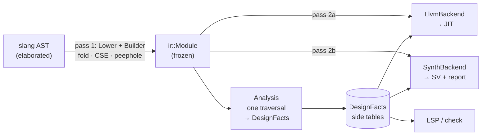

# Subsuming synthesis and language-server capability

Scope out extending Clotho from "SystemVerilog simulator" to a single frontend +
IR serving three consumers: **simulation** (today), **target-independent
synthesis** (normalize SV, syntax-level and target-independent optimization,
verification, emit for downstream target-dependent tools; no timing, no tech
mapping), and a **language server** informed by both engines.

Status: scoping / brainstorm. Nothing started. No prior notes existed anywhere in
the repo — `synthesis` in `src/` and `docs/design/` always means "Clotho
synthesizes IR" (a temp net, a `$strobe` task), never logic synthesis; there is no
`netlist` writer, no `--check`/`--lint`/`--elaborate-only` mode, and no LSP code.

**Architectural invariant (non-negotiable): no IR rewriting.** Two lowering
passes, AST→IR and IR→backend. Everything else is a read-only analysis producing
side tables, a build-time peephole in `Builder`, or a decision made at emit time.
Rationale and consequences in §2; what this cuts is enumerated in §2.4. If a
future need genuinely demands rewriting, the answer is an *ephemeral*
purpose-built IR (an AIG for Boolean optimization, say) that is built, consumed
and discarded — never a second persistent IR with a pass pipeline over it.

Read §6 (limitations) before committing to anything. The output-format question
(§6.4) is the load-bearing product risk and is independent of how well the
internals go.

---

## 1. Where we actually are

The parts that decide this design, not a general tour.

**The IR core is already the right shape and already dependency-clean.**
`Ir`/`Module`/`Builder`/`Printer`/`ZElision`/`InternPool` contain zero
`#include <llvm`, zero `#include <slang`, zero runtime includes; the only
dependency is header-only `unordered_dense`. `clotho_ir` links LLVM `PUBLIC`
(`CMakeLists.txt:115`) but only `LlvmBackend.{h,cpp}` and `Jit.cpp` use it.
Splitting an LLVM-free `clotho_ir_core` is a pure CMake move of five filenames.

**Control flow is fully structured, with no escapes.** Five region-bearing tags
(`Cond`, `Switch`, `Loop`, `SelectLazy`, `NamedBlock`) over `ExtraSlice` index
runs; five terminators (`Ret`, `RetVoid`, `Break`, `Continue`, `Disable`) that
bind *implicitly and lexically* — no computed branch, no `goto`. `Disable` is the
one that carries a label, and it still binds lexically: `NamedBlock` exists only
for a block some `disable` in the same unit names, and the label selects which
enclosing one to leave (LRM 9.6.2, `docs/design/disable.md`). The forms that
would break structure — a remote target, a task target, `disable fork` — stay
rejected in `lower_disable` (`Lower.cpp`). A netlist-first design would
*recover* if/case structure from a CFG; Clotho never loses it. `Cond`/`Switch`
are muxes already.

**The opcode surface splits cleanly.** 219 `Inst::Tag` enumerators; 72 (33%) are
synthesizable dataflow + structured control (`tag_info().synthesizable`), 147
(67%) are simulation-only, and
the ignorable two-thirds is *contiguous* in the enum — strings (22), file I/O
(19), containers + ordering (35), reals (19), display/monitor (7), VCD (6),
time/random (7), sim control (5), timing/concurrency (7), plusargs (2), class (2).

**~18 analyses already exist, scattered across two places.** This is the single
biggest cleanup opportunity and §3.1's whole subject.
- `ZElision.cpp`, as three separate whole-module walks: `compute_may_z`
  (monotone fixpoint over storage nodes), `compute_undriven`,
  `compute_partial_undriven` (per-bit masks).
- `LlvmBackend.cpp`, as private methods of the lowering class, none reusable:
  `nba_classify_ir`, `ptr_arg_signals`, `body_writes`, `is_simple_always`,
  `comb_fuse_verdict`, `compute_subscription_order`, `compute_fusion_groups`,
  `design_uses_{strobe,monitor,observed,defer}`, `report_dedup_stat`,
  `lvalue_has_dynamic_select/_subselect/_elem_select`.
- Planned: `compute_may_x`, which `never-x-inference.md:42-49` explicitly intends
  to write as a **verbatim copy** of the `compute_may_z` scaffold.

Several of these are synthesis analyses that happen to have been built for
performance: `comb_fuse_verdict` mechanically verifies **read set ⊆ sensitivity,
not trusting the frontend's inference** — that *is* the incomplete-sensitivity
mismatch check. `compute_undriven`/`compute_partial_undriven` are floating-net
detection. `compute_may_z` is tristate inference. `clock-wave.md` specifies clock
domain identification `D(c, e)`.

**The X-mode mechanism has a working precedent, now deleted.** `domain-spec`'s
`assume_clean_` + `domain_fake` was a *single bit* that made
`type_of`/`from_ref` report every 4-state value type as 2-state, routing the whole
body through the native 2-state operator paths; it lowered a second "fast body"
per group behind a reader-side cleanliness guard. The feature was removed
(domain-spec.md), so §3.3 reinstates that bit rather than reusing live code —
the shape is proven and recoverable from git history.

**Blockers.**

1. **Hierarchy is lossy and definitions are duplicated per instance.** Signals
   flatten into one module-wide table with dotted-path names. `InstanceScope`
   carries only `{id, name, def_name, signals, children}` — no parameter values,
   no port-connection structure, no generate-block nodes, no module/interface
   kind, no source location. A definition instantiated twice is lowered twice
   (signals *and* processes); dedup is backend-only, hash-based, with admitted
   instance-sensitivity blockers. Port connections became continuous-copy
   processes (`Lower.cpp:4850`); inout/ref ports alias to the parent's signal with
   no record; multi-driver nets are structurally rewritten into N synthetic slot
   signals plus a synthesized resolver process; gates are folded to expressions at
   lower time.
2. **One error, then abort.** `~290` `fail()` sites throw `LowerError`, caught once
   at `Lower.cpp:13443`. `LowerResult::diagnostics` is a flat rendered
   `std::string` — no codes, severities, ranges, or notes.
3. **`SourceLoc` is write-only.** Stored on every instruction
   (`[buffer:28 | offset:36]`), but `to_slang_location` has exactly one caller in
   the repo — a unit test. Start offsets only, so no spans. The `SourceManager`
   that could decode it is a stack local destroyed when `lower_*` returns.
4. **One-shot batch, no reuse, no cache.** Fresh `Compilation` per call;
   `lower_compilation` is file-static. No object cache exists yet.
5. **Attributes are invisible.** `(* ... *)` is parse-through only
   (`TODO.md`). Synthesis pragmas are how designers steer synthesis, and
   Clotho cannot see them. Hard prerequisite, not a nice-to-have (§6.5).

---

## 2. Architecture

### 2.1 Do not build a netlist IR

RTLIL is a cell netlist *because Yosys targets tech mapping*. Strip timing and
target dependence — as the scope does — and what remains is normalize, infer
registers, optimize dataflow, verify, emit. That output is closer to Clotho's IR
than to a netlist. The delta is not opcodes; it is where the work happens.

**Keep one IR.** A second persistent IR doubles the frontend maintenance
obligation, breaks cache sharing, and destroys the pre/post co-simulation win that
is the main reason to do this at all.

### 2.2 Three places work can happen, and only three

The no-rewriting invariant is not a restriction to work around; it is a placement
discipline. Every transformation must land in exactly one of:

**(a) Build time, in `Builder` — the Cranelift/ægraph position.** Bottom-up
construction plus hash-consing means **an operand is already canonical before its
user is emitted**, so a local rewrite rule applied at emit time is *already at
fixpoint* with respect to other local rules. You get the effect of iterating
peephole + CSE + constant folding to convergence, in one pass, with no traversal.

This is where these live:
- Constant folding; identity/absorption/annihilator laws; strength reduction.
- CSE / GVN, from hash-consing `emit()` on (tag, payload, operands).
- `Select`/`Cond` collapse on a constant or identical-arm predicate.
- Redundant `Resize` elision; width narrowing against known operand widths.
- Load-after-Store forwarding within a straight-line region.

**One real hazard.** CSE of anything reading state is illegal across a `Store`,
an effectful `Call`, or a suspension (`Delay`/`Wait`). So hash-consing must be
keyed on a **memory generation counter** that bumps on any of those, and pure
computations only. `SpeculationScan` / `is_speculation_safe` (`Lower.cpp:641`)
already exists for the adjacent question, though note its polarity: it answers
"safe to evaluate eagerly", which is strictly stronger than "pure" (it also
excludes the trapping reads a CSE pass may legally keep).
This is the one genuine correctness risk in the plan and it
wants a differential test against `--no-fold` from day one.

**(b) A read-only analysis producing a side table.** The established pattern —
`compute_may_z` → `SignalSlot::has_z`/`narrow` at `LlvmBackend.cpp:1709`. Nothing
in the IR is touched; the backend consults the table while lowering.

Critically: **iteration to fixpoint happens in the analysis lattice, not in the
IR.** `compute_may_z` already round-robins to fixpoint. So global constant
propagation, reachability, and liveness can each iterate as much as they like and
still emit exactly one IR. This is what makes the two-pass constraint cost almost
nothing (§2.4).

This is where these live:
- **DCE.** Liveness is a backward property, so it cannot be a build-time
  peephole — but it is a single *reverse* scan over the flat SoA array, since
  operands precede users in creation order. Output: `std::vector<bool> live`. The
  backend skips dead instructions. Free.
- **Global constant nets.** A signal only ever stored one constant value →
  substitute at every `Load`. Crosses process and module boundaries, which
  build-time folding cannot.
- **Unreachable region elision.** A `Cond`/`Switch` whose predicate is constant
  *after* global const-net propagation.
- may_z, may_x, undriven, purity, read-sets, sensitivity verification,
  register/latch/cone classification, clock domains, dedup keys.

**(c) Emit time, in the backend.** The IR→backend pass may *combine and expand*
freely; it just may not write back.
- Loop unrolling (synthesis must unroll; the backend already lowers `Loop` to
  header/body/step, so a synthesis emitter unrolls instead).
- Cone fusion — emitting several single-use pure comb processes as one expression
  tree. `comb-fusion` already does exactly this for simulation, running bodies
  back-to-back in topo order.
- Register inference materialization; mux-tree emission from `Cond`/`Switch`.

### 2.3 The resulting shape

Two lowerings, one analysis, three consumers of `(Ir, DesignFacts)`.

### 2.4 What this cuts

Honestly enumerated. Less than expected, because fixpoint-in-the-lattice (§2.2b)
and combine-at-emit (§2.2c) absorb most of it.

**Genuinely cut:**
- **Technology-independent Boolean optimization** — AIG rewriting, ABC-class
  restructuring, mux-tree reshaping across cones, don't-care-based
  simplification. Needs real graph rewriting.
- **Structural sequential transforms** — retiming, resource sharing, register
  duplication/merging, FSM state *minimization* (merging behaviourally equivalent
  states changes the transition relation, not just its encoding).
- **Bit-blasting.** No bit-level netlist exists at any point.

FSM state **re-encoding** is *not* cut — see §3.8. It looks like a rewrite and is
not: the logic structure is untouched, only a signal's width and a set of constant
values change, which is a side table plus emit-time substitution. Re-encoding and
minimization get conflated constantly; only the latter needs rewriting.

All three are out of the stated scope anyway (target-dependent or timing-driven)
and are the downstream tool's job. If Boolean-level quality is ever wanted, that
is the ephemeral-AIG moment: build an AIG from the IR, run ABC-style rewriting on
it, emit from the AIG, discard it. That respects the invariant — the AIG is a
purpose-built consumable, not a second IR with a pass pipeline.

**Degraded but workable:**
- **Cross-process folding.** Processes are built independently, so build-time
  folding cannot span them. Mitigation: global const-net analysis (§2.2b) covers
  constant propagation across boundaries, and cone fusion at emit (§2.2c) covers
  merging. What is genuinely lost is *algebraic* simplification spanning two
  processes (`p1: t = a & b;  p2: y = t | a;` will not become `y = a`). Acceptable;
  that is left to the downstream tool.
- **Optimization triggered by emit-time decisions.** If unrolling a loop at emit
  time exposes a foldable expression, nothing folds it — the fold pass already
  ran. Mitigation: the emitter can apply the same peephole helpers locally as it
  materializes. Requires the fold rules live in a shared, `Builder`-independent
  helper rather than inside `Builder`'s emit methods. **Design for that from the
  start** — it is cheap up front and expensive to retrofit.

**Not cut, contrary to intuition:** iterated global constant propagation, DCE,
reachability, unrolling, cone flattening, CSE. All land in (b) or (c).

---

## 3. What to build

### 3.1 One consolidated analysis (do this first)

`clotho_ir_core/Analysis.{h,cpp}`: **one traversal** of the finished `Module`
producing one `DesignFacts` struct. Absorbs `ZElision.cpp`'s three walks and the
~15 backend-private analyses, and adds `may_x`, `observable` and liveness.

Why this is the highest-value first move:
- **It kills a planned duplication.** `never-x-inference.md` intends to copy the
  `compute_may_z` scaffold verbatim. `may_x` and `may_z` are the same monotone
  sweep over the same storage nodes with a different seed set — one two-bit sweep,
  which the doc itself already observes.
- **One per-tag switch instead of N.** The transfer switch at
  `ZElision.cpp:154-644` is exhaustive with **no `default:` arm**, deliberately:
  "so a new op fails to compile here until its z behavior is classified." That
  discipline is correct and should be the *single* place a new opcode gets
  classified — not five places, three of which are inside a 17 k-line backend.
- **One pass over the SoA arrays instead of ~18.** `Ir.h:15-18` notes the columnar
  layout means a tag-only pass never pulls payloads into cache; a merged pass
  pulls them once rather than N times.
- **It is what makes synthesis and the LSP cheap.** Both consume `DesignFacts`.
  Without it, each new consumer re-derives facts the backend already knows
  privately.
- It also removes the awkward layering where `comb_fuse_verdict` — a
  general-purpose purity and sensitivity-containment check — is only reachable
  from inside LLVM codegen.

Structure: one sweep function computing every per-instruction and per-storage
fact; facts needing no iteration (purity, read/write sets, undriven, tag presence,
liveness) settle in the first sweep; monotone lattice bits (`may_x`, `may_z`,
const-net) iterate the sweep to fixpoint. Note the **absence of an IR verifier is
correct** under this design — the exhaustive-switch discipline is a compile-time
verifier, which is strictly better, and nothing rewrites so no invariant can be
broken after construction.

### 3.2 `Builder` folding + hash-consing

§2.2(a). Serves simulation compile time and synthesis output quality from one
place. Validate against simulation first: LLVM dominates compile time (rocket:
23.3 s, 13.3 s of it ORC materialization) and tier 0 deliberately omits GVN and
mem2reg as compile-time heavies, so cheap IR-level cleanup has nothing competing
with it. [INFERENCE] on magnitude; measure before believing.

Keep the fold rules in a helper callable outside `Builder` (§2.4).

### 3.3 `--x-opt`: SUPERSEDED by `x-semantics.md`

This section proposed a single flag defined as "X resolves to 0, drop the may
plane", reusing `assume_clean_` / `domain_fake` (`LlvmBackend.cpp:8343`). The
research pass for S3 falsified its central premise and its performance claim, so
it is superseded in full by `docs/design/x-semantics.md`. Retained here only as a
record of what was wrong, because two of the errors are instructive:

1. **X→0 is not synthesis-faithful.** Synthesis has no X value at all: don't-cares
   are *consumed* at Boolean minimisation and bound to constants baked into the
   netlist, not propagated. X→0 is one arbitrary and systematically biased
   completion. The faithful mode binds each X-source once per run to a constant
   (`x-semantics.md` §2.1).
2. **The simulation-speed job does not hold.** Our own `domain-spec` data has a
   realistic core getting *slower*. The mode is justified by semantics; any
   speedup is incidental (`x-semantics.md` §4).

What survives: the mismatch-oracle framing (job 3), the observation that a
declared semantics change sidesteps `never-x-inference.md`'s coverage problem,
and the requirement for a written X-resolution table plus a recorded deviation
before anything lands. What replaces it: two orthogonal axes,
`--x=<lrm|merge|bind|force>` and `--x-init=<x|0|1|rand>`, because initialisation
and propagation are independent and the target decides the
power-up state. The `--x-opt` discussion later in this document (§6.4, §7.1) is
superseded on the same grounds; `x-semantics.md` §2.2 and §7.5 replace it, and
are sharper about which of the three divergences a differential actually proves.

### 3.4 Diagnostics with recovery, and the headless check path

Structured diagnostics (`{severity, code, range, message, notes, fix-its}`)
replacing the flat string, plus a **poison** value so lowering continues past an
unsupported construct and reports many errors instead of one.

Poison does not violate never-silently-accept: it is *loud*, it just does not
abort. A design containing poison cannot be simulated or synthesized; it can be
analyzed. That is the only way an editor buffer mid-keystroke is serviceable.

Then **severity policy over one engine** — but the map is smaller than it looks.
Most of what `Lower.cpp` sets is not policy at all: `MixedVarAssigns`,
`MultipleContAssigns`, `Redefinition`, `RedefinitionDifferentType` and
`MemberImplNotFound` are promoted because Clotho's signal model and symbol table
cannot represent the alternative, so relaxing one yields a miscompile rather than
a mode; and `AlwaysWithoutTimingControl` is downgraded on Clotho's reading of LRM
9.2.2.1, a compliance decision. Those form an invariant floor no policy may move,
and `apply_severity_policy` keeps them textually separate from the part that does
vary.

The policy axis is **semantics**, not activity: `lint` is the activity and the
policy says what it is measured against, so `clotho lint --policy=synth` asks
"would a synthesiser object?" without a synthesiser in the loop. Naming the set
after the command would leave that question unanswered.

**`Sim` is landed** and holds exactly one entry — inferred-latch / inferred-comb
as warnings, legal and faithfully simulatable. **`Synth`** promotes those to
errors and adds X-dependence, and waits for a consumer: nothing emits SV until S7
and there is no `may_x` diagnostic until S3, so a synthesis policy today would
re-rank findings for a run that cannot exist. It arrives as an enumerator, one
switch arm, and a threaded parameter.

`CheckUnused` / `CheckShadow` are **on for every command**, as warnings, and are
deliberately not policy: an unused signal is unused under either semantics, and a
finding that only appears under `lint` is one most runs never see. The analysis
walk they ride already happens for the dataflow checks.

One exception, measured rather than assumed: **unused-*parameter* is silenced.**
On hazard3, 718 of 722 unused findings were unused parameters against three
genuinely dead nets/variables — threading a config parameter set through every
module and using the subset each needs IS the idiom, so the check reported a
pattern, not a problem, at a volume that buried everything else (767 warnings
total, down to 49 once silenced). Re-enable per design with `-Wunused-parameter`.
This is §6.3's noise argument at small scale: a check whose true positives are
0.4% of its output trains users to ignore it.

Elaborate, lower, analyse, emit structured diagnostics, no codegen: that is the
headless LSP backend, and it exists today as **`clotho lint`**. `clotho build`
runs the same pipeline and reports the same diagnostics before it writes anything,
so lint is not a separate path — it is that path with no artifact and its own
exit-status rule. It shipped briefly as `clotho check`, was folded into `build`,
and came back under the name it should have had (docs/design/cli.md). Its reason
to exist separately is to be the home of the third severity policy above; until
that lands, `lint` and `build` report identically and only the output differs.

### 3.5 Source fidelity and reentrancy

Retain the `SourceManager` past lowering; capture **ranges** not just
`sourceRange.start()`; print locations in the IR dump; export an entry point
taking a caller-owned `Compilation`. `SourceLoc` values are already known to be
stale on a cache hit — any future runtime diagnostic that renders locations
must remap them — so whatever solves this must solve it for cache hits too, or
diagnostics degrade exactly when the cache works.

### 3.6 Process legalization and storage inference

Two halves of one walk, both landing in `DesignFacts`. Neither transforms
anything — under §2 "legalization" means *diagnose*, not rewrite, which is the
opposite of what the word means in LLVM ISel. Worth flagging so nobody imports
the mutating connotation.

**Legalization — is this process synthesizable at all?** Per process, reject or
flag: non-synthesizable opcodes (the 64% surface — I/O, strings, containers,
randomization, reals, VCD); mid-body suspension (`Delay`, `Wait`) outside a
recognized clock wait; `TaskCall`; mixed blocking and nonblocking writes to one
signal; more than one clock in one block; edge- and level-sensitivity mixed in one
sensitivity list; read set ⊄ sensitivity (the existing `comb_fuse_verdict` check);
`Fork`. Most of these are already computed or trivially derivable from the purity
and read-set facts §3.1 collects anyway.

**Storage inference — what hardware does each written signal become?** The unit is
**(process × written signal)**, not the process. One `always` block routinely
produces a flop, a latch and a wire. Per pair, classify and *decompose*:

| Class | Condition | Decomposition |
|---|---|---|
| Combinational | level-sensitive, assigned on every path, read set ⊆ sensitivity | value expression |
| Edge flop | single-edge sensitivity, assigned under it | clock, edge, async reset (+value), sync reset (+value), enable, next-state cone |
| Latch | level-sensitive, *not* assigned on every path | hold condition, data, enable |
| Memory | unpacked array, clocked, dynamic index | write ports, read style (registered or not) |
| None | legalization rejected it | diagnostic |

The decomposition is the valuable part, not the label — it is what the SV writer
emits, what the LSP shows as an inlay hint ("8 flops, clk posedge, async rst_n,
enable `we`"), and what a synthesizability diagnostic reports.

Note `StoreNb` vs `Store` is a *hint*, not the answer: nonblocking-assigning a
combinational signal is legal and common, and blocking-assigning inside a clocked
block infers a flop just fine. Classification must come from sensitivity shape and
assignment completeness, not the opcode.

Four payoffs: it is the synthesis frontend; it unblocks **clock-wave Direction B**
(a static schedule needs the exact flop set, and that doc's §5 blockers —
level-sensitive re-fire, observer safety, comb loops — are cone analysis problems);
it is the LSP's inlay-hint content; it is the synthesizability diagnostic.

#### 3.6.1 De-simulationizing: the real friction

The bigger obstacle is not the opcode surface — it is that **the frontend performs
simulation-shaped *structural* rewrites that a synthesis consumer must recognize
and reverse.** These are not opcodes to reject; they are synthesized IR structures
that look like logic and are not:

- **Multi-driver nets** become N synthetic slot signals plus a synthesized resolver
  process folding them through `WireRes`/`WandRes`/`WorRes`/`StrengthRes`/`NetPull`
  (`Lower.cpp:3366`, `:3509`). Synthesis must map this back to a tristate bus or a
  multi-driver error — not emit a resolution network.
- **Port connections** become continuous-copy processes (`Lower.cpp:4850`).
  Naively synthesized, every port becomes a buffer.
- **force/release** wraps *every* ordinary write to a forceable variable in a
  predicated store (`gated_store`, `Lower.cpp:4005`), emitting real
  `CaseEq`/`Land`/`Cond` branches into every writer. Naively synthesized, every
  forceable signal gains a mux in hardware. This is the worst one.
- **`PreInit`** (declaration initializers, `Lower.cpp:6036`) is a process that
  exists in no source; it maps to power-on/register-init state or must be dropped.
- **`synth_event_net`** (`Lower.cpp:5261`) invents signals and continuous processes
  for `@(posedge x.f)` and `@(arr[i])`.
- **Gate primitives** are already folded to expressions at lower time
  (`Lower.cpp:4593`), which is fine as logic — but drive strengths are gone.

Two ways to handle this, and the second is better:

1. Pattern-match and reverse each structure in the synthesis backend. Works,
   but it is fragile recognition of another pass's output, and every frontend
   change can silently break it.
2. **Move the rewrite out of the frontend and into a side table the backends
   materialize** — exactly the §2.2(b) principle, applied to the frontend. Mark a
   signal "forceable" and let the LLVM backend emit the gating; record a net's
   driver list and resolution policy and let each backend materialize resolution or
   diagnose it; record port bindings as bindings and let the LLVM backend emit the
   copy process. Synthesis then simply ignores tables that do not apply.

(2) is more work up front and strictly better afterwards: it shrinks the IR, keeps
simulation semantics where they belong (in the simulation backend), and removes an
entire class of reverse-mapping fragility. It is also plausibly a *simulation* win
— less IR to lower, and the backend can specialize gating and resolution better
than pre-baked `Cond` trees allow. **Flagged as the highest-value frontend
refactor this whole effort implies**, and it is independent of everything else, so
it can be done incrementally one structure at a time (force/release first — it is
the most invasive and the most clearly misplaced).

### 3.7 Definition-level lowering (deferred)

Lowering each `(definition × parameterization)` once, with a real port-binding
table, would give hierarchical emit, exact backend dedup, derivable merkle cache
keys, and per-definition LSP invalidation. It is also the riskiest change, and
it is what makes today's hierarchical references, interface/modport sharing
(`canonical_value_symbol` folding a modport read, a plain-port read and a direct
hierarchical read to one signal) and inout aliasing work.

**Interim that defers it indefinitely:** reconstruct hierarchy *at emit time* by
grouping flattened signals and processes back by `InstanceScope` and dedup'ing on
content hash — which is what the backend already does. Ugly, ships hierarchical
output, touches no lowering code.

### 3.8 FSM re-encoding

Reachable in this architecture, and it is the one transform I initially cut that
should come back. The reason it fits: **re-encoding changes no logic structure.**
`case (state) S_IDLE: ...` re-encoded one-hot is the *same* `Switch` over the
*same* regions — only the selector's width and the key constants differ. So it
decomposes into an analysis plus an emit-time substitution, never a rewrite.

It is also **emit-only**, which is what makes it clean: simulation never sees a
re-encoded design, so no state layout, VCD index or NBA machinery is disturbed.
The whole feature lives in `DesignFacts` + the SV writer.

#### The analysis

A signal is a re-encodable state register iff all of:

1. **It is an edge-triggered register** — from §3.6 storage inference.
2. **Its value set is a closed set of constants.** Every value ever assigned is a
   constant, or the signal's own current value (a hold). If a next-state value
   comes from an expression, a port, or memory, the set is not closed — bail.
3. **Every use is encoding-opaque.** This is the crux. Permitted uses: equality
   compare against a member of the constant set, use as a `Switch` selector whose
   keys are all in the set, and assignment of a set member. *Everything else*
   poisons it — `>`/`<`, arithmetic, `Concat`, part-select, `Resize` to a different
   width, assignment to an output port, `$display`, VCD dump, DPI argument,
   hierarchical read from outside.

All three are monotone one-way properties, so they fit the existing lattice shape
(one poison bit per signal, single non-opaque use sets it) and ride the same sweep
as `may_x`/`may_z`. No new machinery.

**Reachable-state enumeration** is a bonus on top: BFS the transition graph by
abstractly evaluating the next-state cone once per state with `state := s` and
inputs unconstrained. Over-approximate in the safe direction — a state wrongly
called reachable only costs a missed diagnostic, never a false one.

#### The shared component this needs

A small **abstract interpreter over the IR** — partial evaluation over the 4-valued
domain with unknown inputs. Worth calling out because it is not FSM-specific; one
evaluator serves global const-net propagation (§2.2b), unreachable-region elision,
reachable-state enumeration here, precise absorption-aware `may_x` (§4.3), and
`$clog2`-class elaboration folding. Build it once inside `Analysis` and use it five
ways. It is read-only by construction, so it respects §2.

#### Clotho should not choose the encoding

Picking one-hot vs binary vs gray vs Johnson is a **cost-model** decision, and the
cost depends on the target (LUT vs standard cell, FF area, routing) — explicitly
out of scope. `domain-spec.md` already set the bar by deleting a working
profitability gate as "a benchmark-tuned heuristic gating two divergent code
paths."

So the honest framing is *not* "Clotho optimizes your FSM encoding." It is:

> Clotho **proves** an FSM is safely re-encodable, **reports** its state set,
> current encoding and reachability graph, **applies** an encoding on explicit
> request, and **verifies** the result.

The request arrives as a synthesis attribute — `(* fsm_encoding = "one_hot" *)`,
which is another reason §6.5 attribute plumbing is a hard
prerequisite — or a CLI flag, or a config file. This dodges the cost model entirely
and is more useful than guessing, because the designer knows the target and Clotho
does not.

#### It is unusually well verified here

Equivalence is guaranteed by construction *if* opacity holds, and opacity is
exactly the condition that makes it end-to-end checkable with machinery that
already exists: emit the re-encoded SV, re-read it with Clotho, differentially
simulate against the original design (§7.2). Re-encoding may be the most
verifiable transform in this whole architecture, because "no observation depends
on the encoding" is precisely what the differential test measures.

#### The analysis pays for itself without the transform

Even if nobody ever requests a re-encoding, the same facts give:
- **Unreachable FSM states** — a real bug and a real lint finding.
- **Deadlock states** — a state with no outgoing transition.
- **State-exclusivity facts**, feeding `unique`/`priority` case checking and the
  §4 mismatch report.
- **LSP content** — the state graph on hover over the state register.

#### Prerequisite: enum identity is currently lost

`InternPool` has **no `Kind::Enum`** — enums lower to their base packed type — and
`SignalInfo` has no enum field. Member names survive *only* inside an `EnumName`
instruction's `EnumNameInfo` payload (`Ir.h:738`), i.e. only where `.name()` is
actually called.

Re-encoding does not strictly require enum identity (opacity plus a closed constant
set works on `localparam`-encoded FSMs too, which is a lot of real RTL), but
without it the report and the emitted SV lose every symbolic name, and candidate
detection loses its strongest hint. Preserving `signal -> enum type -> (member
name, value)` in a side table is small, and §7.2's readable output wants it
regardless.

#### What stays cut

FSM **minimization** — merging behaviourally equivalent states — changes the
transition relation, not its encoding, and genuinely needs rewriting. Likewise
Mealy↔Moore conversion and output re-encoding. Also out: multi-register and
counter-based implicit state machines, which fail the opacity test immediately
(counters do arithmetic on the state) — correctly, since that is not what FSM
re-encoding means.

---

## 4. The mismatch tool

### 4.1 Is the premise true?

The claim: post-synthesis verification is slow because it runs on
post-optimization bit-blasted netlists, but those transforms are provably correct
(or their correctness is the synthesis tool's problem); the only *designer*-
introduced pre/post differences are semantic, and semantic differences are
checkable at RTL.

**Substantially true, with a precise boundary.** The sharper framing: post-synth
simulation is conflating two jobs.

- **(i) Did the synthesis tool break the design?** Not the designer's problem, and
  simulation is a bad way to answer it — formal equivalence checking covers it
  properly, and a synthesis tool that fails here has a bug of its own. A
  designer learns nothing from (i).
- **(ii) Does my RTL mean what I think it means under synthesis semantics?**
  Entirely the designer's problem, entirely semantic, and entirely visible at RTL.

Clotho addresses (ii) and should say so explicitly. Every classic mismatch is
semantic and IR-visible: incomplete sensitivity, latch inference,
blocking-vs-nonblocking races, `casex`/`casez` don't-cares, X-optimism/pessimism,
initial-block state synthesis drops, multiple drivers, width truncation,
function/task side-effect ordering.

Worth noting the asymmetry that *supports* the claim: a gate netlist is
X-optimistic relative to RTL in most places (don't-cares resolved) but
X-*pessimistic* in others (X propagates through a mux where a behavioral `if`
would select a clean branch). So mismatch is bidirectional — which is exactly why
"post-synth sim finds bugs RTL sim hides" is a real experience. A high-level check
on *output dependence on X* catches both directions from one analysis, because it
targets the cause rather than either symptom.

**Where the claim breaks — flag these, do not paper over them:**

1. **Synthesis pragmas.** `full_case`/`parallel_case`, `translate_off`,
   `(* keep *)`, `(* dont_touch *)`. Designer-introduced, mismatch-causing, and
   *tool-specific* — not a property of the SV. Clotho can detect the class ("you
   asserted full_case; here are the missing keys") but cannot be authoritative
   about what a given synthesis tool does. **Flag-only, never a verdict.** And
   attributes are currently invisible (§1.5) — hard prerequisite.
2. **Reset coverage.** Simulation starts registers at X; hardware starts at an
   arbitrary-but-definite value. An incompletely-reset design differs pre/post.
   This *is* semantic and *is* the thing to catch, but sound detection needs
   reset-before-read temporal proof, which `never-x-inference.md` §6 rates 2–4
   weeks at high risk. Expect UNPROVEN verdicts here, and say so.
3. **Inference divergence between tools.** Nothing requires two tools to infer the
   same hardware from one block. Out of scope for target-independent, correctly — but it
   scopes the verdict to *Clotho's* inference, not any downstream tool's.
4. **Blackboxes / encrypted IP / technology primitives.** Post-synth netlists
   contain behavior Clotho never saw. Uncoverable, full stop.
5. **CDC, skew, multi-cycle paths.** Genuinely found by post-synth simulation,
   genuinely timing-related, genuinely out of scope. **The tool must not claim to
   replace post-synth sim for these.** Overclaiming here would poison trust in the
   parts that do work.

Net: Clotho does not replace post-synthesis simulation. It replaces *the reason
most post-synthesis simulation is run*, at RTL speed, with a causal explanation,
before synthesis has ever been invoked.

### 4.2 Making it concrete

Three kinds of evidence, one report format, shared by CLI/CI and the LSP. Named
rather than numbered, to keep them distinct from the LSP tiers in §6.7.

**(a) The static report — always, free.** Falls out of `DesignFacts` (§3.1). Its
job is to *prove clean and explain*, not to detect (§4.3): every X/Z source located
with its provenance chain and propagation reach; `observable` closure so the
sanitizer knows where to instrument; incomplete sensitivity lists (the existing
`comb_fuse_verdict` check, surfaced); inferred latches with hold conditions;
non-full/non-parallel `case` with the missing key set; multiply-driven nets;
partially-undriven bit ranges; registers with no reset path. Per-item verdict:
**PROVEN-CLEAN / MISMATCH / UNPROVEN (+ why)**, with granted don't-cares reported
separately from modeling artifacts.

**(b) The X-divergence sanitizer — the detector.** Do *not* build it as "run twice
and diff the logs" (§4.3 explains why a two-mode diff is sound for detection and
worthless for absence). Build it as a **sanitizer**: one instrumented run flagging
X-valued control decisions, case-equality consumption, vacuous checks, latent
capture, and X at outputs — reporting at the divergence point with (a)'s provenance
attached. Single run, immediate causal report, no golden file. Instrument only what
(a) could not prove clean.

Why it is cheap here and nowhere else: one frontend run, one elaboration, one
shared L1 cache entry, both semantics available from the same IR via a single bit
(§3.3), in one process — and the runtime X test is an instruction sequence
`domain-spec` already emits. This is UBSan for X-semantics.

**(c) Coverage of the check.** "Analysis covered N of M X-sources; K
registers unproven for reset; P constructs are blackboxes." The failure mode of a
checker like this is false confidence, so the coverage report is not optional.

The workflow value: this runs in CI on every commit at RTL simulation speed, and
because it is per-line and per-bit it is an LSP diagnostic for free (§5.5). That
is the concrete user benefit — a mismatch class that today surfaces in a
multi-day post-synth regression surfaces in the editor, with the cause named.

### 4.3 "Output dependence on X", precisely

This is the mechanism the whole tool rests on, and it deserves stating exactly
because the naive version is a known failure mode: a diagnostic that
reports every X reaching every output drowns users in noise and gets switched off.

#### Two kinds of X, two different verdicts

Conflating these is the first mistake. They need separate treatment throughout —
seed set, report, and recommended fix.

- **Granted don't-care.** The designer wrote `default: y = 'x;`, or left a `case`
  incomplete. This is a *deliberate degree of freedom* handed to the tool.
  Synthesis exploits it; simulation propagates a concrete X. Verdict when it
  reaches an observable: not necessarily a bug — the designer is asserting the
  value does not matter there. Report, do not condemn.
- **Modeling artifact.** Uninitialized register, div/mod by zero, out-of-bounds
  select, multi-driver contention. Hardware has a definite (if design-time
  unknown) value; simulation invents an X that does not exist. Verdict: usually a
  missing reset or a missing guard, and the fix is in the RTL or the testbench, not
  in the synthesis flow.

`never-x-inference.md` §4's seed taxonomy already separates these sources. It just
needs to carry the distinction through to the report.

#### The formal question

Not "is there an X at an output" but: **is the design's observable behaviour
invariant across every completion of its incompletely-specified function?** A
synthesis tool implements *some* completion, and nothing requires two of them to
pick the same one. If behaviour is invariant, no completion can surprise you and
post-synthesis simulation has nothing to find. That framing is what makes the check
tool-independent, which is essential given §4.1's carve-out that Clotho cannot
speak for any particular synthesis tool's inference.

#### The static formulation, and why it is not enough

Two monotone bit-vectors over signals, both riding the §3.1 sweep:

- `may_x[sig]` — **forward** from X sources. Exists as a design.
- `observable[sig]` — **backward** from observation points: top-level output ports,
  `$display`/VCD arguments, assertion expressions, DPI arguments, anything the
  testbench reads hierarchically. Must be a transitive closure *through sequential
  edges*, because an X latched into a register today is latent and can surface as an
  output many cycles later.

Divergence candidate = `may_x[sig] && observable[sig]`. Cheap, and it composes with
the existing machinery — note only that the two run in opposite directions, so this
is two sweeps over one walk, not one sweep.

**It is necessary and wildly insufficient.** `y = x_val & 1'b0;` has
`may_x[x_val]` true and `y` observable, yet LRM gives 0 and every synthesis
completion gives 0. The X is *absorbed*. Every real design has X sources reaching
outputs through absorbing paths, so shipping this intersection as a diagnostic is
precisely the tool nobody uses.

**A concrete consequence for §3.1: `may_x` as designed is too coarse for this
use.** `never-x-inference.md` §5 specifies "never-x iff all operands never-x",
which does not model absorption — correct and sufficient for its own purpose
(storage narrowing only needs a sound over-approximation; imprecision merely
narrows less), but wrong here, where every false positive is user-facing. Mismatch
detection needs a richer lattice: per-bit
`{definitely-0, definitely-1, defined-but-unknown, may-be-X}`, so `Band` propagates
X only where the other operand is not definitely-0, `Bor` only where the other is
not definitely-1, and `Cond`/`Select` with a definite predicate propagates only the
taken arm. That is abstract interpretation over the 4-valued domain — i.e. **the
same abstract interpreter §3.8 needs**, now with a fifth consumer. Worth designing
the lattice for the precise case and letting the narrowing case read a coarsening
of it, rather than the reverse.

Even with absorption modelled, path sensitivity leaves a residue that no
affordable static analysis resolves. Hence:

#### The roles invert: static explains, dynamic detects

The static analysis's job is **not** to find divergences. It is to
(a) prove most signals clean so instrumentation can be elided, and
(b) supply the provenance chain that explains what the dynamic check finds.
The **sanitizer is the detector.** This is a better division of labour than it
first appears, because the hardest static problem in the entire design —
`never-x-inference.md` §6's reset-before-read temporal proof, rated 2–4 weeks at
high risk — is *trivial* dynamically: if a register is reset before it is read, the
sanitizer simply never fires on it.

#### What the sanitizer actually checks

"Is there an X on an output" is the **weak** check, and it is roughly what
disciplined teams already do by hand with output assertions. The valuable checks are
the ones where **X is consumed and no X ever appears downstream**:

1. **X-valued control decisions.** A `Cond`/`Switch`/`Select` whose
   predicate/selector carries X. LRM deterministically takes else/default; a
   synthesis completion may take any branch. Flag *at the branch*, whether or not
   the result is subsequently X. Highest-value single check.
2. **Case-equality consumption.** `CaseEq`/`CasezEq`/`CasexEq`/`WildEq` are defined
   to *never* yield X — they silently swallow it. `casez` wildcard matching versus
   synthesis don't-care coverage is a top mismatch source and it is **completely
   invisible** to X-at-output checking. This is the class that pure X-tracking
   misses.
3. **Vacuous checks.** A comparison or assertion whose result is X. `if (out ==
   expected)` with `out` X yields X, takes the else, and in a lot of coding styles
   "passes" silently. Zero-false-positive bug class, unambiguous, and worth
   shipping on its own merits.
4. **Latent capture.** X assigned to an observable-reachable register.
5. **X at an observable output.** The weak check, kept for completeness.

#### The runtime check already exists in the codebase

"Does this value carry X" on the 4-state planes is `(mm ^ (mm >> W)) != 0` — the
*same* test `domain-spec` already emits as its reader-side cleanliness guard. So
the instrumentation is an existing instruction sequence applied at different sites,
not new codegen. And overhead is controlled the way every good sanitizer controls
it: **only instrument sites the static analysis could not prove clean**, with
`domain-spec`'s eligibility analysis as the precedent for that gating.

#### Bidirectionality holds, but the verdict differs by direction

- *Simulation optimistic, hardware differs.* `if (x_sig)` — sim deterministically
  takes else; hardware takes something. Caught by check 1.
- *Simulation pessimistic, hardware fine.* `y = x_reg` on an uninitialized-but-
  will-be-reset register — sim propagates X and the testbench fails spuriously.
  Caught by check 4/5, and provenance says "uninitialized register", so the verdict
  is "add a reset or fix the testbench", not "your RTL is wrong."
- *Silent, neither side shows X.* `casez` don't-care divergence. Caught only by
  check 2.

One analysis, three failure modes, three different recommended actions — which is
why a bare boolean is useless and provenance is the product.

#### Z rides along free

Everything above applies to Z with the same structure: a Z reaching a non-tristate
consumer is a mismatch (LRM reads Z as X in most contexts; synthesis sees a float).
`compute_may_z` already exists *and* is already precise, so the Z half of the
intersection is available today.

#### What the `--x-opt` differential does and does not prove

Running LRM against `--x-opt` and diffing tests **one** completion (X→0). A
difference *proves* a mismatch exists. **No difference proves nothing** — another
completion may differ. So the differential is sound for detection and worthless for
absence, which is exactly why the sanitizer is primary: it flags the decision
*points* regardless of how they resolve.

If broader completion coverage is wanted, randomize the don't-care resolution —
but **randomize once per run, not per evaluation.** A synthesis completion is a
fixed function: the same inputs give the same outputs every time. Random-per-
evaluation is *stronger* than any real circuit and manufactures false positives
from non-determinism hardware cannot exhibit. N runs with N seeds explores N
genuine completions soundly.

#### The fundamental limit

**An X reaching an output is only a bug if the environment cares about that output
at that time** — and that is a property of the specification and testbench, not of
the RTL. Clotho cannot know it. A granted don't-care reaching an output under a
condition where the consumer ignores it is correct design, and no amount of
analysis distinguishes it from an oversight.

Three consequences, all of which must be designed in rather than discovered:
suppression must exist (annotation or attribute) and must be cheap to apply;
the report must present granted-don't-care items separately from
modeling-artifact items; and check 3 (vacuous checks) is the only sub-check with
*no* environment dependence, which is why it is the one to lead with.

---

## 5. Wins that fall out

Beyond §4, briefly.

**5.1 Two-way pass sharing.** Simulation → synthesis: purity/read-set (comb
cones), may-z (tristate), 2-state lowering (X relaxation), module dedup
(definition identity). Synthesis → simulation: register inference unblocks static
scheduling (§3.6); `Builder` folding cuts LLVM compile time (§3.2); `--x-opt` is a
sim mode in its own right (§3.3).

**5.2 Cache sharing, specifically at L1.** L1 (text → IR) is fully shared across
all three consumers — one slang run, one lowering, one `Module`. L2 (IR → object)
is simulation-specific; synthesis output is a third artifact on the same L1 key
plus a synthesis option fingerprint. So the shared layer is exactly the one that
does not exist on main. With per-definition merkle keys this yields **incremental
synthesis** — edit one module, re-synthesize it and its ancestors only.

**5.3 One test suite.** Every existing simulation test becomes a synthesis input.
LRM coverage tracking in `TODO.md` becomes per-consumer — you would know exactly
which constructs each consumer covers.

**5.4 Pre/post co-simulation in one process.** Once `bind` exists (unimplemented),
bind checkers to post-inference IR and simulate the mixed design — no netlist
round-trip, no second simulator.

**5.5 The language server, informed by both engines.** The protocol layer is the
least interesting part; the content is the win. Beyond hover/goto/completion
(slang's job, mostly free):
- **Live synthesizability annotation** per line: "infers 8 flops + 1 latch on bit
  3", "unsynthesizable: division by non-constant", "2 drivers".
- **Inferred-hardware inlay hints**: register count, clock, reset, enable beside
  each `always_ff`; inferred widths and truncation points; latch hold conditions.
- **X-provenance on hover**: "may be X, reachable from: uninitialized reg
  `foo.bar` line N / OOB select line M". `never-x-inference.md`'s seed taxonomy
  *is* a provenance chain.
- **Mismatch diagnostics inline** — §4's Tier 1, live.
- **Live values.** The simulator is in-process and JIT-fast. Run the testbench in
  the background; hover a signal → its value at the cursor's time, or its last N
  transitions. Waveform debugging in the editor; there is already a producer/sink
  split behind VCD to hang it on.
- **Semantic dead code**, not syntactic: a generate branch never taken under the
  actual parameters, an unreachable case arm, a register reaching no output port.

---

## 6. Limitations

### 6.1 X semantics remain two semantics — but that is now the feature

`--x-opt` (§3.3) does not unify them; nothing can. Simulation must propagate X as
a value (LRM; PRINCIPLES.md forbids trading compliance), synthesis must treat X as a
don't-care. What `--x-opt` buys is that **both semantics are executable from one
IR behind one flag**, so the divergence becomes measurable rather than
theoretical, and the measurement is the product (§4).

The honest residual: `--x-opt` is *one* resolution of the don't-cares. A given
synthesis tool may pick another. So "no divergence under `--x-opt`" does not prove
"no divergence under that tool" — it proves the design's observable behavior does
not depend on X at all, which is the stronger and more useful property, but only
where the analysis reaches (§4.2c, coverage).

### 6.2 Elaboration is slang's, and synthesis wants a different one

Clotho has no elaboration phase; parameters, generate unrolling and instance
expansion are entirely slang's, forced by `getAllDiagnostics()` + `getRoot()`.
Synthesis workflows want: black-box a definition; synthesize one module standalone
with unbound ports and a chosen parameter set; resolve a library/`config` map
(`config` unimplemented). `--top` helps; "synthesize this leaf across three
parameterizations" does not fall out. Separately, **uninstantiated code is
invisible** — an LSP must diagnose code unreachable from any top.

### 6.3 Non-synthesizable constructs are not optional in this frontend

A dedicated synthesis frontend refuses strings, files, classes, containers,
randomization and `fork` at parse. Clotho is committed to lowering all of them —
it is a simulator, and never-silently-accept forbids dropping them. So synthesis
lowers them and rejects at its own boundary: 64% of the opcode surface carried as
a rejection obligation, plus the standing requirement that every new sim-only
opcode gets a synthesis arm. §3.1's single exhaustive switch handles the
maintenance correctly, but synthesis is never the small tool here.

### 6.4 Output format — the real product risk

Worth the most thought, so it gets §7.

### 6.5 Attributes are a hard prerequisite

To emit for downstream you must **pass through** attributes you do not understand
(`(* dont_touch *)`, `(* ram_style *)`) or you silently change downstream
behavior — which violates never-silently-accept. So: parse them, preserve them on
a side table keyed by signal/process, re-emit verbatim, and *report* when Clotho's
own analysis contradicts one. Today they are parse-through only (`TODO.md`).
Also blocks §4.1's `full_case`/`parallel_case` checks, which are among the highest-
value mismatch classes.

### 6.6 Conflicting performance profiles

Simulation compile is latency-sensitive — compile latency is part of
interactivity on short traces. Synthesis is throughput-tolerant. The
no-rewriting invariant actually *helps* here — there is no pass pipeline to tune,
so the only axis is which analyses run, and analyses are cheap. But note
`domain-spec.md` set a bar by deleting a working profitability gate as
"architectural debt: a benchmark-tuned heuristic gating two divergent code paths."
Expect that bar.

### 6.7 LSP latency vs whole-design batch

Structural. Clotho assumes whole-design compile; an editor needs sub-100 ms on a
keystroke, and slang re-elaboration of a large design is seconds even with
per-definition caching. **Deep semantic features will be background-computed and
stale-tolerant, not synchronous.** Retrofitting that split is much worse than
starting with it, so define the two tiers up front:

**Tier 1 — synchronous, sub-100 ms, slang-only.** Never needs `ir::Module`, so it
never waits on lowering. Parse/elaborate diagnostics, hover types, goto
definition/declaration, find references, document + workspace symbols, completion,
signature help, rename, formatting, folding. This is a conventional SV language
server and is most of what users touch daily.

**Tier 2 — asynchronous, eventual, stale-tolerant, needs `(Ir, DesignFacts)`.**
Debounced, cancellable, and rendered with an explicit staleness indicator rather
than blocking the editor. Synthesizability annotation, inferred-hardware inlay
hints, X-provenance on hover, mismatch diagnostics (§4.2a static report), live
values from a background simulation, semantic dead code.

The two tiers must be separately cancellable and must never share a lock. The
failure mode to design against is a tier-2 recompute blocking a tier-1 hover.

### 6.8 Coverage prerequisites

**UDPs** unstarted (`TODO.md`) — cell libraries use them. **`bind`**
unstarted (`TODO.md`) — needed for §5.4. Attributes, §6.5. Good news: generate,
`defparam`, instance arrays, packages, interfaces and modports are done.

---

## 7. Output format

The interop surface, not the internals, is where this succeeds or fails. The
feared debt — tailoring output per tool — is real and *unbounded*: the set of
tools and versions is open-ended.

### 7.1 Bounding the debt architecturally

One internal emission model; N thin writers; **a hard rule that a writer may only
re-encode, never re-decide.** Any semantic choice belongs in the shared model. That
keeps each writer in the hundreds of lines and the debt linear in writers rather
than multiplicative in (writers × decisions). Violating this rule once is how
these things become unmaintainable.

### 7.2 Recommendation: normalized SV is the only v1 writer

**The differentiated value is the report, not the netlist.** The world has yosys
and a synthesis flow already has a frontend; another netlist emitter adds
little. What Clotho can add is "your RTL means this under synthesis semantics, and
here is where it diverges from simulation, with the cause named, in seconds."

So: ship §4 as the product, and ship normalized SV as the only writer.

1. **It is the stated goal**, not a compromise — "normalize input systemverilog
   with good IEEE-1800 coverage" was the original ask.
2. **One consumer: everyone.** Zero interop debt beyond SV-subset conservatism,
   which you control.
3. **Emit the *intersection* subset, not the language.** This is the key move:
   no interfaces, no generates, no packages, no classes, parameters resolved,
   widths explicit everywhere, one `always_ff` per register group, no implicit
   conversions. A subset small enough to enumerate, and testable
   against yosys.
4. **The emitter is self-verifying, and only for SV.** Emit → re-read with Clotho →
   simulate → must match the original design. Any other format needs a reader you
   would have to write and trust. This is decisive: **SV is the only output format
   whose correctness you can check with machinery you already own.**

The inference results go in a **sidecar** — structured JSON, explicitly advisory,
carrying register/reset/enable classification, cone structure, X-provenance and
the mismatch report. Its consumers are your LSP, your CI and the human. Because
no third-party tool depends on it, its format is yours and versioned, and it
carries no interop debt at all. That separation is what keeps the debt bounded:
**the interop-exposed artifact stays deliberately dumb; the valuable artifact
stays deliberately private.**

Accept the objection that downstream re-infers everything. In this scope Clotho's
job is normalize + verify + report, not hand a netlist to P&R. The value chain is:
Clotho guarantees the SV it emits is semantically unambiguous with a documented
inference; downstream starts from clean, narrow, resolved input.

### 7.3 Normalization destroys the names downstream depends on

The practical blocker for any tool that rewrites RTL, and easy to miss because it
is not a correctness issue. SDC constraints, physical scripts, area reports, UPF
power intent and formal setup all reference **hierarchical instance and signal
names**. Resolving parameters, unrolling generates, folding away port copies and
deduplicating definitions all change those names. A normalized output that is
semantically perfect and renames `u_core/gen_lane[3]/u_alu/acc_reg` is unusable in
a real flow.

Three requirements, all cheap if designed in and expensive to retrofit:

1. **Preserve instance and signal names exactly** wherever the construct survives.
   Clotho already builds flattened dotted paths from `prefix_` and has generate
   entries named `<array>[<index>]` — the fidelity exists, it just has to be
   honoured on the way out rather than regenerated.
2. **Do not unroll in the output what was rolled in the input.** Generates and
   instance arrays should re-emit as generates and instance arrays. Slang has
   already unrolled them for us, so this means the emitter needs the *original*
   structure — which is an argument that §3.7's `InstanceScope`-based emit-time
   reconstruction must retain generate-block identity, currently folded away
   (`Lower.cpp:936-939`) and surviving only as a substring in the flattened name.
3. **Emit a name-mapping sidecar** for every rename that could not be avoided:
   `original hierarchical path -> emitted path`, bidirectional. Table stakes for
   RTL-rewriting tools, and it costs nothing here because the JSON sidecar already
   exists (§7.2).

This is the strongest argument for not deferring hierarchy fidelity forever. It
does not require full definition-level lowering, but it does require the emit-time
reconstruction to be name-faithful and generate-aware, which is more than "group
by `InstanceScope` and dedup on content hash".

### 7.4 If a second writer is ever needed: RTLIL

Only on a specific user's specific need, and only within §7.1's rule. If forced to
pick, **RTLIL** — because yosys already writes Verilog-95, BLIF, EDIF, JSON,
SMT-LIB and firrtl. One writer transitively buys all of them. Do not write N
writers; write the one whose consumer already has N writers.

Rejected: **FIRRTL** — spec and consumers exist, and its X-free semantics
interestingly *are* the `--x-opt` semantics, but the ecosystem is CIRCT-centric
and has a history of breaking versions. **Custom netlist format** — nobody
consumes it; the sidecar already covers the internal need.

---

## 8. Sequencing

Every stage ships standalone value. Nothing here is "foundation for later."
`S<n>` labels are referenced throughout this document; the table is the legend.
"Serves" names which of the three consumers benefits, which is the test for
whether a stage earns its place.

| # | Stage | Needs | Serves | Standalone value |
|---|---|---|---|---|
| S0 | Plumbing: `ir_core` split, retained `SourceManager`, `SourceLoc` ranges, structured diagnostics | — | all | better CLI diagnostics — **LANDED** |
| S1 | Consolidated analysis → `DesignFacts` (§3.1) | S0 | all | one place per new opcode — **LANDED** |
| S2 | `Builder` folding + hash-consing (§3.2) | — | sim, synth | lower LLVM compile time |
| S3 | X modes: `--x=`, `--x-init=` (`x-semantics.md`) | S1 | sim, synth, check | synthesis-faithful semantics; reference for S5 |
| S4 | Error recovery + diagnostics-only path + attribute plumbing (§3.4, §6.5) | S0 | check, LSP | CLI linter |
| S5 | Mismatch tool (§4.2) | S1, S3, S4 | check, LSP | **the differentiated product** |
| S6 | Process legalization + storage inference (§3.6) | S1 | all | unblocks clock-wave Direction B |
| S7 | Normalized SV writer + JSON sidecar (§7.2) | S6 | synth | the synthesis deliverable |
| S8 | LSP: tier 1 then tier 2 (§6.7) — **scoped in `lsp.md`** | S4 / S5+S6 | LSP | editor integration |
| S9 | FSM re-encoding (§3.8) | S1, S4, S6, S7 | synth, check, LSP | unreachable/deadlock state diagnostics before any re-encoding is requested |
| — | Definition-level lowering (§3.7) — **deferred** | — | synth, cache | exact dedup, merkle keys |
| — | De-simulationizing the frontend (§3.6.1) — **independent, incremental** | — | all | smaller IR; removes reverse-mapping fragility |

Detail per stage:

- **S0 — plumbing. LANDED.** As built:
  - `clotho_ir_core` (InternPool/Ir/Builder/Printer/ZElision) split out of
    `clotho_ir` (LlvmBackend/Jit). `clotho` (the frontend) now links
    `clotho_ir_core`, NOT the code generator — so "source text -> ir::Module +
    diagnostics" links without LLVM, and the build enforces it. Verified by symbol
    inspection: 0 undefined `llvm::` symbols in `libclotho_ir_core.a` and
    `libclotho.a`, 239 in `libclotho_ir.a`.
  - `SourceContext` (`src/SourceContext.h`) owns the SourceManager / Driver /
    Compilation and resolves an `ir::SourceLoc` to file:line:col.
    `LowerResult::sources` hands it back, so locations survive lowering. Member
    declaration order in the class fixes destruction order — reordering
    reintroduces a use-after-free.
  - `ir::SourceSpan` added, on `Process` (replacing the unused `loc`) and
    `Function`; `SignalInfo` gets a bare `SourceLoc`. Instructions deliberately
    keep a single 8-byte `SourceLoc` — the instruction column is too hot to double.
  - `Diagnostic` / `Severity` / `DiagnosticOrigin` (`src/Diagnostic.h`) replace the
    flat `std::string`. slang's own pretty rendering (snippet + caret) is preserved
    per item in `Diagnostic::rendered` so structuring did not regress CLI output;
    Clotho's own guards render from the structured fields and now carry a column
    and a stable code. `LowerError` carries a span instead of a text prefix.
  - `build --emit=ir` annotates signals and processes with their source location.
  - 215 test call sites migrated from `.diagnostics` to `.diagnostic_text()`.

  Deliberately NOT done (belongs to S4): multi-error recovery. A lowering guard
  still throws and still reports exactly one Clotho diagnostic. The structure to
  carry many now exists; the poison value that lets lowering continue does not.
- **S1 — consolidated analysis (§3.1). LANDED (Phase A).** As built:
  - `src/ir/Analysis.{h,cpp}` in `clotho_ir_core`: `analyze(const Module&) ->
    DesignFacts`. `ZElision.{h,cpp}` deleted outright (1069 lines).
  - Absorbed: `compute_may_z`, `compute_undriven`, `compute_partial_undriven`,
    `ptr_arg_signals`, the `body_writes` lambda, `is_simple_always`,
    `comb_fuse_verdict` (+ its `CombFuse` enum), `process_has_deferred_severity`,
    and all four `design_uses_*`. `LlvmBackend.cpp` shrank by ~435 lines.
  - `tag_info()` is one exhaustive switch holding the comb-fusion purity
    WHITELIST and the thunk-elision BLACKLIST. Keeping the polarities apart is
    load bearing and is what the new tests pin: purity fails closed (a new opcode
    is unfusable), elision fails open (a new opcode stays eligible).
  - New: `may_x`, coarse and sound. Seeded from x literals, div/mod/pow,
    resolution conflicts, dynamic selects, DPI, and any 4-state signal no PreInit
    process writes.
  - Verified by a transitional cross-check that ran the new analysis against the
    originals on every design in the suite: **zero mismatches** on `may_z`,
    `undriven`, `ptr_arg` and the partial masks. Scaffold removed once green.

  **Correction to the claim made above:** consolidating the walks produced NO
  measurable compile-time change. Measured `build --emit=llvm` on picorv32 (0.236s vs
  0.234s), hazard3 (0.261s vs 0.261s) and coremark_cv32e40p (0.501s vs 0.503s) —
  all within noise. These analyses were never a measurable fraction of compile
  time at these scales, and LLVM emission dominates. The win is maintenance (one
  place per opcode) and reuse (a non-LLVM consumer can now get the facts at all),
  not speed. Line count is roughly neutral: −1510 in existing files, +1818 in the
  new module, the difference being `may_x` and much heavier documentation.

  Deferred to Phase B / their consumers, as scoped: `observable` backward closure,
  liveness/DCE, const-nets, and the backend-owned index-space analyses
  (`nba_classify_ir`, subscription order, fusion grouping, dedup hashing).

  Found along the way: `Ir::operands()` is not merely incomplete for some tags, it
  is **unsafe** — it decodes any `Extra` payload as an `ExtraSlice`, so calling it
  on `MonitorSet` (whose extra is a `StrobePendInfo`) fabricates an
  out-of-bounds span and segfaults. Nothing called it on that tag before. Fixed
  fail-closed by `extra_operand_shape()` plus a `static_assert` over the whole
  tag space.

  The per-tag audit that left behind is now **closed**. Six tags carry operands
  that cannot ride one span, because a variadic run in the extra buffer is not
  contiguous with a scalar held elsewhere: `FDisplay`/`MonitorEmit` (descriptor),
  `Fscanf`/`Sscanf` (source), `Sformat` (destination lvalue), `InsideSet`
  (members and range endpoints). Rather than copy runs out of the extra buffer —
  the cost the zero-copy view exists to avoid — `operands()` keeps its span and
  its contract narrows to "the span-expressible operands", with
  `Ir::for_each_operand` added as the total visitor every def-use / liveness /
  DCE walk must use. `extra_operand_tail()` classifies the six, biconditionally
  static_asserted against payload kind for the five that a payload kind implies.
  This also let `Analysis.cpp` drop its hardcoded may-x for `InsideSet`, which
  existed only because the members were unreachable; note the precision is not
  observable through today's `DesignFacts` (every 4-state signal is may-x from
  its initial value), so it is pinned by the operand-walk properties instead and
  will surface when S5 reads per-value x.
- **S2 — `Builder` folding + hash-consing (§3.2).** Measure against simulation
  compile time; guard the CSE-across-effects hazard with a `--no-fold` differential
  from day one.
- **S3 — X modes (`x-semantics.md`, superseding §3.3).** Two axes: `--x=<lrm|merge|
  bind|force>` and `--x-init=<x|0|1|rand>`. Ship `bind` first — it is the only
  synthesis-faithful mode, it is a frontend-only change reusing the landed 2-state
  lowering, and it is the reference semantics S5 needs. `merge` waits for S6's flop
  decomposition. Justified by semantics, not speed. Write the X-resolution table
  and the deviation entry first.
- **S4 — recovery + diagnostics-only path + attributes (§3.4, §6.5).** Recovery and
  check mode are **LANDED**; three severity policies and attribute plumbing
  remain. As built:
  - Recovery is at **behavioural-member granularity**, not statement or
    expression. `Lowerer::recover` wraps the five non-descending member kinds
    (continuous assign, procedural block, variable/net initializer, gate), so a
    file with N failing members reports N diagnostics instead of the first.
    Statement-level poison was not needed to get that, and the member boundary is
    safe for three specific reasons documented at the helper: no walk state to
    restore, no partial process (each builds into a Builder local to its own
    lowering), and the one shared builder (`preinit_`) is explicitly rolled back.
  - Structural members (instance, generate block, instance array) are
    deliberately **excluded**: they recurse and advance the InstanceScope cursor,
    so recovering mid-recursion would mis-attribute every later member. That is
    silently wrong analysis, worse than the hard failure they keep. They still
    abort with no module.
  - `ir::Builder::mark()` / `rollback()` added for the shared pre-init builder.
    Needed because `finish()` folds whatever remains in the scratch buffer into
    the root region, so a region abandoned mid-emission does not fail loudly — it
    silently absorbs its contents into the body. Verified against a real
    construct (`S'({...})`, whose `value_lvalue` emits before the guard fires):
    without the rollback the stranded `signal` instruction is observable in the
    pre-init dump.
  - A poisoned module is **returned** and `ok` is false. `ok` is the only gate
    between it and codegen. `build --emit=ir` runs before that gate (a dump is
    analysis, not execution); `run` and the LLVM targets are behind it.
  - The diagnostics-only mode shipped as `clotho lint` (lower + report + exit
    status, no codegen) and was folded into `build` when the CLI became
    command-based; it returns as `lint`. Analysis-derived findings are S5's, so
    there is nothing to run `DesignFacts` for yet either way.

  The attribute slice is **LANDED as the checks, not as pass-through**. The
  original framing in §6.5 was wrong about timing: preserving attributes is a
  never-silently-accept obligation *for S7*, because until something emits SV,
  dropping a `(* dont_touch *)` changes nothing observable and the
  synthesis-directed pragmas have no simulation semantics at all. Capturing them
  into a table no consumer reads would have been scaffolding. So what landed is
  the half with a consumer today:
  - `check_case_pragmas` reads `Compilation::getAttributes(const Statement&)` via
    `scope_->getCompilation()` — no new constructor plumbing — and tests
    `(* full_case *)` / `(* parallel_case *)` against the actual item coverage.
  - Coverage is computed by expanding every item label over the selector's value
    space (capped at 16 bits), with wildcard bits enumerated per condition: casez
    frees `z`/`?`, casex frees `x` too, and plain `case` frees neither. Fullness
    and mutual exclusivity both fall out of that one expansion.
  - Judged by the **synthesis** fullness rule, not the simulation one (§2.4.1 of
    `x-semantics.md`): x/z labels contribute nothing under plain `case`, so
    `case (s) 2'bxx: ...` with `full_case` reports all four values uncovered.
    That is the "assign x to be safe, then claim full_case" trap, caught.
  - Reports only what it can prove. A non-constant label, a selector wider than
    the cap, or `case ... inside` all yield silence. A finding is trustworthy or
    absent.
  - `DiagnosticOrigin::Analysis` is new and is the field the severity policies
    will key on: these are legal, implemented, simulatable constructs about which
    Clotho proved something unintended, which is a different policy axis from
    slang's warnings or Clotho's own limits. Severity is `Warning` today.
  - `Lowerer::report` shares the diagnostic channel `recover` fills, so findings
    and recovered failures arrive interleaved in walk order.

  Still owed in S4: the three severity policies (the map is still hardcoded
  simulation-tuned at `Lower.cpp`). Still owed for S7: total attribute
  pass-through and verbatim re-emission, which needs the four key spaces (signal,
  process, **instruction** for statement pragmas, and **InstanceScope** for
  instance attributes that flattening would otherwise strand) rather than the
  "signal/process" §6.5 assumed. Note also that S3's `(* clotho_x_off *)` scoping
  depends on that capture, which the stage table does not record.
- **S5 — the mismatch tool (§4.2).** Static report from `DesignFacts`, then the
  X-divergence sanitizer, then the coverage report. **The differentiated product.**
- **S6 — process legalization + storage inference (§3.6).** Into `DesignFacts`.
  Unblocks clock-wave Direction B, LSP inlay hints, and SV emit. **Scoped in detail
  in `process-legalization.md`**, which supersedes §3.6's sketch on three points:
  the walk is one guard-carrying traversal producing per-signal guarded-assignment
  lists (yosys's equivalent is O(S²) and costs 18.5 s on hazard3 against Clotho's
  51 ms whole frontend); storage inference must match reset **conditionally**
  rather than structurally; and the user's "fill in the mux tree" mode turns out
  to be a renderer over that list rather than any change to the IR, so it ships
  before S7.
- **S7 — normalized SV writer + JSON sidecar (§7.2).** Self-verified by re-lowering
  and differential simulation.
- **S8 — LSP.** Tier 1 (slang-fast) can land any time after S4; tier 2 needs S5
  and S6, and is then nearly free. **Scoped in detail in `lsp.md`**, which
  supersedes §6.7 on three points: tier 1 is no longer differentiating (MIT
  `hudson-trading/slang-server` shipped the whole of §6.7's tier-1 list on the
  same frontend, so the plan is complementary-first and navigation is deferred,
  not raced); the tier separation is enforced by *process*, not by locks, because
  neither slang nor Clotho has any cancellation mechanism at all; and there is a
  hard upstream blocker §6.7 did not know about — slang's `SourceManager` cannot
  re-assign a path, so per-keystroke buffer replacement needs a fresh manager or
  a patch. Also two prerequisites this table does not record: lowering only walks
  `root.topInstances`, so leaf files get no diagnostics, and Clotho's ~290
  `Unsupported` guards must not surface as editor errors.
- **S9 — FSM re-encoding (§3.8).** Opacity + closed-constant-set analysis, the
  shared abstract interpreter, reachability, then attribute-driven encoding
  substitution in the writer. Ship the *diagnostics* (unreachable and deadlock
  states) before the transform — they need only the analysis, and they are useful
  to every user whether or not anyone ever re-encodes anything.
- **Deferred indefinitely — definition-level lowering (§3.7)**, behind the
  emit-time hierarchy reconstruction.

Two ordering claims worth arguing over:

- **S1 first, unconditionally.** It is the only stage every other stage depends
  on, it deletes code rather than adding it, and skipping it means each later
  consumer re-derives facts the backend already computes privately.
- **S5 before S6.** The mismatch tool needs `may_x` and output-reachability
  (S1 + S3), not register inference. It is the differentiated product and the
  cheaper of the two. If everything after S5 slipped, Clotho would still have
  shipped the differentiated product.
